# Evaluation of Clustering Methods and Large Language Models for Spatial Proteomic Cell-Type Annotation

[Current reproducibility files](manuscript_reproduction.md) · [Supplementary tables](supplementary_table_numbering.md) · [Figure index](figure_map.md)

Zachary Deutsch¹, Nick Surguladze², Yang Miao¹, John W. Hickey¹*

¹Department of Biomedical Engineering, Duke University, Durham, NC 27708, USA 
²Department of Biostatistics and Bioinformatics, Duke University School of Medicine, Durham, NC 27710, USA

\*Corresponding author. E-mail: [john.hickey@duke.edu](mailto:john.hickey@duke.edu)

## Abstract

Aims: Spatial proteomics allows for cell-type annotation while preserving tissue architecture, but annotation remains difficult to scale. We evaluated how image processing, clustering, marker representation and large language models (LLMs) affect annotation of co-detection by indexing (CODEX) data.

Methods: We analyzed a healthy human intestine CODEX dataset with 809,550 cells across 24 tissue regions from three donors. B004 provided 220,082 cells for within-donor evaluation and classifier training, and B005/B006 provided 589,468 cells for cross-donor evaluation. Four LLMs annotated clusters from four clustering methods using 47 protein markers and the original 28-label vocabulary. We compared two ways of summarizing marker expression within each cluster. Both used the mean expression of each marker, and the second also included the fraction of cells whose processed expression for that marker was above zero.

Results: Spillover compensation did not consistently improve agreement with expert reference labels across six segmentation methods. Clustering performance varied across methods, cell types and tissue regions. In B004, adding these fractions increased agreement for eight of the 16 clustering method–LLM combinations and decreased it for the other eight. Leiden clustering with GPT-6 Astra annotation achieved the highest agreement, 58.12%, across the two B004 test regions. The same pipeline averaged 35.87% agreement across B005 and B006.

Conclusions: CODEX annotation depends on image processing, cluster composition, marker representation and model interpretation. Variation across workflows and donors supports evaluating processing, clustering and annotation together, with expert review of markers, spatial context and mixed clusters.

## Keywords

Spatial proteomics, multiplexed tissue imaging, cell segmentation, unsupervised clustering, cell-type annotation, large language models

## 1. Introduction

Spatial proteomics technologies such as co-detection by indexing (CODEX) measure dozens of protein markers in situ while preserving tissue architecture [1], [2]. This spatial context supports cell-type identification and analysis of local cellular neighborhoods in healthy human tissues [3]. The Human BioMolecular Atlas Program (HuBMAP) uses spatial proteomics to generate reference cell-type maps across the human body [4], [5]. Cell-type maps show cells at their measured tissue coordinates, colored by their reference or model-assigned cell-type labels.

Cell-type annotation depends on segmentation, feature extraction, dimensionality reduction, clustering and marker-based interpretation [2], [6], [7]. Segmentation determines which pixels contribute to each cell’s marker intensities and can affect downstream annotation [2], [7], [8]. Spillover compensation reduces contamination from neighboring cells and has improved annotation [9], but its benefit with newer segmentation models remains unclear [7], [10]–[14]. CODEX benchmarks have also shown that normalization and other preprocessing choices can influence clustering quality as much as, or more than, the clustering algorithm [6].

Leiden identifies communities in similarity graphs and is widely used for single-cell analysis [6], [15]. FlowSOM uses self-organizing maps and metaclustering to group cells by marker-expression profiles [16], [17]. SpatialSort combines marker information with spatial neighborhoods and optional biological priors in a Bayesian model [18]. PIXIE clusters pixels and derives cell phenotypes from each cell’s pixel composition, providing an alternative to methods that cluster cells using cell-level marker-expression features [19].

Assigning cell-type labels to clusters usually requires experts to inspect marker-expression patterns. Manual review is time-consuming, and annotation decisions can vary across datasets and analysts. Marker-based scoring, probabilistic assignment and reference-based transfer methods automate parts of this task. Shared markers, differences between datasets, and inconsistent label vocabularies still make annotation difficult [20]–[24]. Spatial methods such as STELLAR use local context and learned representations for label transfer [25]. These methods depend on reference data, predefined labels or supervised training assumptions.

LLMs such as GPT-4 can infer cell-type names from marker gene lists with strong agreement with expert labels in single-cell RNA-sequencing studies [26], although their outputs require verification against observed marker expression [27]. Performance and reproducibility vary with the model, prompt, marker selection and output constraints [28]. CASSIA uses iterative validation and quality assessment, with optional agents for retrieval or refinement [29]. CellMaster describes automated annotation and human-in-the-loop refinement [30]. How well LLMs can assign cell-type labels from spatial-proteomic profiles remains unclear.

We evaluate six segmentation methods, four clustering methods, and four LLM. Using intestine data from three donors, we compare LLM inputs in B004 and evaluate B005/B006 annotation.

## 2. Methods

### 2.1 Study design and data sources

We benchmarked clustering and LLM annotation using a published HuBMAP CODEX dataset of healthy human large and small intestine [3]. The study included all 809,550 cells from 24 tissue regions across three donors, with eight regions per donor: 220,082 cells from B004, 288,188 from B005 and 301,280 from B006.

The processed H5AD contained measurements for 47 protein markers and reference labels from the original 28-label vocabulary. Primary annotation analyses retained this vocabulary, including Noise, without merging classes. Cell-level reference agreement is defined as the fraction of cells whose assigned label matches the reference label. We evaluated clustering using the original 28-label vocabulary and separately scored the same annotation predictions under the original 28-label vocabulary and a 23-label vocabulary (Sections 2.3 and 2.6 and Supplementary Methods, Section SM2).

We used B004 data for within-donor benchmarking, to standardize cluster-level marker means, and to train conventional classifiers. Its eight regions were divided into four training, two validation and two test regions containing 90,296, 60,210 and 69,576 cells, respectively. For each marker, we calculated the mean and standard deviation of transformed expression across the B004 training cells and used these values to standardize the corresponding cluster-level means. The B004 benchmark therefore evaluates annotations used in sample training data. B005 and B006 provided the cross-donor evaluation (Section 2.6).

Raw CODEX images were processed with the published intestine workflow [3]. The eight B004 reference image records document Cytokit segmentation followed by SPRM, with Hoechst1 as the nuclear channel and Cytokeratin as the cell channel. The processed H5AD provided x-y centroid coordinates and mean marker intensities within each retained cell mask. The compensation analysis used six separate segmentation outputs, distinct from those underlying the main clustering benchmark.

### 2.2 Spillover compensation and cell matching

We applied REDSEA [9] to CODEX images, marker lists and segmentation masks from Mesmer, CellposeCyto3, CellposeSAM, CellSAM, InstanSeg and MicroSAM. REDSEA used all markers, element-size = 2 and element-shape = star. It estimates neighboring-cell contributions from shared boundaries, subtracts their weighted signal and sets negative corrected values to zero. The comparison used processed H5AD files before and after compensation, with stored Leiden assignments and principal component analysis (PCA) representations. This processing differed from the main clustering benchmark and included Z-normalization, noise filtering and Leiden clustering at resolution 1.5. Original segmentation inference settings, input channels, checkpoints and mask quality-control rules could not be established from the available records. Stored processing configurations and their limitations are detailed in Supplementary Methods, Section SM1.

Segmentation objects were matched to the nearest reference centroid in the same region within 10 source-coordinate units, allowing many-to-one matches. We also evaluated 5- and 15-unit thresholds and mutual nearest-neighbor matching. The reference x and y coordinates were swapped during reconstruction. Objects were paired before and after compensation only if they had the same regional CellID, unchanged coordinates and an accepted match to the same reference cell and label. Table S1 reports retention and matching counts. Matching audits and deterministic tie rules are provided in Supplementary Methods, Section SM1.

We assessed changes in cell retention separately from changes among shared segmentation objects. Processing exclusions were distinct from the reference label Noise. For each tissue region and cell type, we retained the paired comparison if reference or predicted cells of that type were present before or after compensation. F1 was set to zero in a condition containing neither reference nor predicted cells of that type. Pairs absent in both conditions were excluded.

Each cluster received its reference-majority label, defined as the most frequent HuBMAP reference label among its centroid-matched cells. Agreement with those same reference annotations was summarized by cell type and segmentation method using F1:

$$
\mathrm{F1}=\frac{2\,\mathrm{precision}\,\mathrm{recall}}{\mathrm{precision}+\mathrm{recall}}\tag{1}
$$

F1 is the harmonic mean of precision and recall. Changes in F1 score were calculated as the after-compensation score minus the before-compensation score. Because cluster labels were assigned from the reference, this analysis measures how well the fixed clusters agree with that reference.

We assessed cluster separation using silhouette scores [31], [32], Davies–Bouldin indices [33] and Calinski–Harabasz indices [34] in PCA space for each segmentation method's pooled cells and tissue regions. Changes were calculated as after minus before compensation. Higher silhouette and Calinski–Harabasz values and lower Davies–Bouldin values indicated improved separation.

### 2.3 Clustering inputs and configurations

B004 clustering inputs differed by method (Table S2A). Leiden and FlowSOM used marker-expression features, whereas SpatialSort also used cell coordinates and a within-region 24-neighbor graph. These three methods used all 47 protein markers: 45 in the common expression matrix and separately stored CD123 and CDX2 measurements. FlowSOM used arcsinh(x/5) values with RobustScaler fitted on all B004 cells. PIXIE used smoothed, normalized image pixels from 47 protein channels plus Hoechst1 DNA signal, selected from 59 available channels. For each cell mask, we calculated the fractions of pixels assigned to each pixel metacluster, then clustered cells using those fractions. For later annotation, profiles from all four partitions used the same 47 markers. Supplementary Methods, Section SM3 describes feature construction.

All B004 workflows targeted 300 clusters using fixed method-specific configurations and primary seed 42. Leiden transformed the 47 marker values as arcsinh(x/5), standardized them within each tissue region, generated 320 local clusters and merged them to 300 using a Ward-style procedure [15]. FlowSOM used a 32 × 32 self-organizing map trained in three shuffled passes through all 220,082 cells, followed by Ward metaclustering with 300 requested and 299 nonempty clusters [16], [17]. SpatialSort performed 100 sampling sweeps, with five double Metropolis–Hastings (DMH) iterations (dmh_iter=5), using the same initialization for sampling seeds 42 and 43. It requested 300 clusters, producing 229 nonempty clusters in the primary seed-42 run and 231 in the seed-43 comparison run [18]. Seed 43 was used only to compare clustering results across random seeds and provided no additional annotation input. PIXIE used pixel and cell self-organizing maps followed by Ward metaclustering [19]. Full clustering configurations and hyperparameters are reported in Table S2A and Supplementary Methods, Section SM3.

We evaluated each fixed partition using weighted cluster purity, the highest possible reference agreement when each unchanged cluster receives one allowed label. Let K be the number of clusters, N the number of cells in the evaluation set, and nk,c the number of cells with reference class c in cluster k. Weighted cluster purity was calculated as

$$
A_{\mathrm{UB}}=\frac{\sum_{k=1}^{K}\max_{c}n_{k,c}}{N}\tag{2}
$$

This score is the fraction of cells carrying their cluster’s majority reference label and defines the maximum agreement possible with one label per cluster, termed the cluster-majority upper bound.

For the cell-type F1 and recall heatmaps, each fixed cluster received its reference-majority label across all eight B004 regions. These diagnostics used 220,082 cells and the original 28-label vocabulary, including Noise. LLM annotation used the original 28-label vocabulary, including Noise. F1 and recall were calculated from the resulting assignments (Supplementary Methods, Sections SM2 and SM4).

Regional weighted F1 and cell-count-weighted cluster purity used the same population and original 28-label vocabulary, but majority labels were assigned separately within each region. Weighted F1 is the average of class-specific F1 scores weighted by the number of reference cells in each class. Conditional comparisons and their assumptions are described in Section 2.7 and Supplementary Methods, Section SM5.

### 2.4 LLM annotation inputs and execution

Cluster profiles contained means for all 47 markers. The processed marker-expression values were transformed as arcsinh(x/5), and cluster means were standardized using marker centers and population standard deviations fitted on the 90,296 B004 training cells. A scale of one was used only for an exactly constant marker. For each cluster and marker, the positive fraction was the fraction of cells with strictly positive processed values, calculated before transformation or standardization. These fractions were not validated measures of biological marker positivity.

The all-marker means input contained all 47 standardized marker means. The all-marker means plus fractions input paired the same 47 marker means with all 47 positive fractions. Within each paired comparison, we held cluster assignments, anonymous query IDs, marker and cluster order, label vocabulary and batch boundaries fixed. Prompts supplied the code dictionary for the original 28-label vocabulary and requested a JSON object containing exactly one integer label code per query ID. The prompts supplied no cell- or cluster-specific reference assignments or reference expression profiles, clustering-method identities or neighborhood summaries. Models had no retrieval, tools or web access. Cell- and cluster-specific reference assignments were also excluded from query construction and model-selected display groups.

The selected marker names input contained up to six marker names per cluster, and the selected marker means input contained numerical means for the same markers. For each fixed cluster, up to six markers were selected by positive one-versus-rest, tie-corrected Wilcoxon rank statistics. Ties were resolved using the transformed mean and then the marker name. If no marker had a positive statistic, the highest-mean marker was provided. The selected marker means were copied from the all-marker means input. Marker selection used no cell- or cluster-specific reference assignments.

GPT-6 Astra, Claude Opus 5.5, Gemini 4 Argon and DeepSeek V4.1 Flash 1017 each annotated the fixed B004 clustering results from four methods with both primary LLM input representations, giving 32 annotation sets and 9,024 planned cluster predictions. Requests contained at most 75 clusters and used supported high-reasoning settings (Table S6d). Each completed condition contributed one accepted annotation per cluster. Request counts, model bindings, inference settings and execution records are detailed in Supplementary Note 2.

A request item was accepted only when its complete final response passed strict validation for the expected query IDs and allowed label codes, with no refusal or truncation. Failed or interrupted attempts and authorized recoveries were retained separately, and accepted outputs were not overwritten. Recovery attempts were not independent repetitions. Full acceptance rules and attempt-level records are described in Supplementary Note 2.

### 2.5 Annotation evaluation and pipeline selection

Let ĉk be the model-predicted label for cluster k and nk its total cell count, using the notation in Equation (2). Cell-level reference agreement was the number of cells whose model-assigned label matched their original reference label, divided by N, the number of cells in the stated evaluation population:

$$
A_{\mathrm{cell}}=\frac{\sum_{k=1}^{K}n_{k,\hat c_k}}{N}\tag{3}
$$

The main B004 evaluation metric was reference agreement, averaged equally across the two test regions, which contained 69,576 cells in total. It was calculated from predictions using all-marker means plus fractions. Macro-F1 was calculated using the original 28-label vocabulary within each region, with absent-class F1 set to zero, and then averaged equally. Noise remained a valid label, and any non-Noise prediction on a reference-Noise cell counted as an error. Missing or invalid predictions remained errors in the full planned denominator. Cell- and cluster-level prediction coverage were reported separately. Full-cohort displays retained all 220,082 B004 cells, including 10,495 reference-Noise cells.

For each matched method, model, cluster and test region, we subtracted all-marker means results from all-marker means plus fractions results. We reported individual regional values, their equal-weighted mean, paired label changes and prediction coverage. Calibration of cross-model support against reference agreement was evaluated separately (Section 2.7).

To express annotation performance relative to the cluster-majority upper bound AUB from Equation (2), we calculated

$$
P_{\mathrm{UB}}=100\frac{A_{\mathrm{cell}}}{A_{\mathrm{UB}}}=100\frac{\sum_{k=1}^{K}n_{k,\hat c_k}}{\sum_{k=1}^{K}\max_c n_{k,c}}\tag{4}
$$

This ratio compares observed cell-level reference agreement with its maximum possible value for the same fixed clusters, cells and label set. A cell counted as a match whenever the model predicted its reference label, even when that label differed from the cluster’s majority label. For B004 Leiden, we varied whether the model could predict Noise and whether reference-Noise cells counted toward the score (Figure S15). The overall error identity is

$$
1-A_{\mathrm{cell}}=(1-A_{\mathrm{UB}})+(A_{\mathrm{UB}}-A_{\mathrm{cell}})\tag{5}
$$

We calculated the gap to maximum agreement by subtracting minority-label matches from majority-label errors and dividing the result by the total cell count. This arithmetic decomposition does not show which pipeline stages caused errors.

For displays summarizing the four models, we assigned each cluster the most frequent label among the models’ accepted predictions, using one prediction per model. Ties were resolved in Astra, Opus 5.5, Argon and DeepSeek order without reference assignments. This summary does not measure repeated-call consistency.

Leiden clustering with GPT-6 Astra annotation was selected for the pipeline example from the B004 benchmark results. The three example clusters were the largest nonempty Leiden clusters by cell count, with ties resolved by cluster ID. This cluster-selection rule was fixed before annotation outcomes were inspected. The main cell-type maps used the fixed mid-jejunum region. Leiden–Opus 5.5 diagnostics were retained as a supplementary comparison (Figure S1).

### 2.6 Cross-donor evaluation

Cross-donor evaluation included all 288,188 B005 cells and 301,280 B006 cells, with eight regions per donor. Each of the four clustering methods used all cells within each donor, and the resulting clusters were held fixed for evaluation. Cells were joined using region identifier and cell ID together. FlowSOM used three complete passes through all donor cells with seed 42. SpatialSort used 50 sampling sweeps, five DMH iterations per sweep and seed 42, with seed 43 reserved for comparing clustering results across random seeds. The native Leiden parent included Hoechst1 alongside the 47 protein markers, whereas its local hierarchy used those markers. PIXIE retained its image-derived representation. For numerical stability, the B005 FlowSOM and SpatialSort fitting inputs were centered by each marker's median and divided by the greater of its interquartile range and population standard deviation. This numerical adjustment was applied only to the clustering inputs and did not change the profiles supplied for annotation.

Annotation profiles used the original processed measurements for all 47 protein markers. These measurements were transformed and encoded as in Section 2.4, using the centers and population standard deviations fitted to B004 training data and held fixed across donors. Fractions were calculated before transformation or standardization. Marker order and the original 28-label vocabulary, including Noise, were preserved. Requests contained at most 75 anonymous cluster profiles and no cell- or cluster-specific reference assignments, donor identities or clustering-method identities. All models used high-reasoning settings, with provider fallback disabled. Provider routes are documented in Supplementary Note 2.

Cross-donor annotation used the all-marker means plus fractions input representation. It included 32 donor–method–model sets, 128 logical request items and 9,468 planned cluster predictions. We scored one strictly accepted output per item where available. Missing or invalid predictions remained errors in the planned denominator, distinct from valid Noise predictions. Authorized recoveries and Argon continuation segments were retained in the execution record and were not independent repetitions. We calculated primary reference agreement and macro-F1 using the original 28-label vocabulary, averaged each metric equally across the eight regions within each donor, and then averaged equally across the two donors. Logistic-regression and nearest-centroid classifiers fitted to B004 training data were applied to cluster profiles from B005 and B006 without retraining, rebalancing classes or selecting new hyperparameters.

The evaluation using the original 28-label and projected 23-label vocabularies excluded cells with the reference labels ITLN+ Epithelial, Noise or PDPN+ Stromal, retaining 270,216 B005 cells and 285,973 B006 cells. We calculated metrics for both vocabularies on these same cells. Predictions outside the projected 23-label vocabulary remained errors. Donors were the biological units, with regions as nested subsamples.

### 2.7 Supporting analyses and statistical methods

For each of the four clustering methods, we added the correct method name to the input containing all-marker means plus fractions provided to Claude Opus 5.5. This was the only input change in the matched controls. A neighborhood control added measured expression from each cell's 15 nearest other cells within its region to the same Leiden–Opus 5.5 baseline annotation input. Neighbor expression values were transformed as arcsinh(x/5), averaged first within each cell’s neighborhood and then within each cluster, and standardized using the fixed training scaler. Distance ties were resolved by cell ID. No neighboring labels were provided. Two Leiden–Astra conditions used the same additions of method names and neighborhood-expression summaries. They reused the accepted blinded Astra baseline, preserving cluster joins, numerical profiles, label vocabulary and supported inference settings. The Astra controls used native OpenAI Batch, while the baseline used OpenRouter Batch, so their contrasts do not isolate prompt content from execution route.

A compensation comparison used a fixed FlowSOM configuration across all six segmentation methods. Preprocessing was fitted separately before and after compensation, and granularity differed from the processed Leiden workflow. This comparison therefore did not isolate the clustering algorithm alone (Supplementary Methods, Section SM1).

Conventional baselines used nearest-centroid classification and multinomial logistic regression with 47 transformed-expression features or 94 expression and positive indicator features. Models were fitted using cell-level reference labels from the four B004 training regions. These training labels were not available in the LLM prompts. The classifiers assigned one label to each fixed cluster using the same numerical cluster profiles provided to the LLMs. For each method and representation, we selected logistic-regression regularization from C = 0.001, 0.01, 0.1, 1 and 10 using agreement averaged equally across the two validation regions. Ties were resolved in favor of the smaller C. Test labels were not used for fitting or selection (Table S10).

We assessed the effect of merging existing clusters into 100 and 200 groups using cell-count-weighted Ward clustering of their full-precision, standardized 47-marker means. Merge mappings were frozen before reference labels were loaded. Purity, adjusted Rand index (ARI) and normalized mutual information (NMI) retained the original 28-label vocabulary, including Noise, and weighted the two test regions equally. This analysis evaluated merged versions of the existing clusters. It did not rerun clustering at the new target counts or assess whether LLM annotation rankings remained stable (Table S11).

Exploratory calibration used cross-model support, defined as the fraction of the four models assigning the same label as a given model, with a fixed denominator of four. A deterministic cluster-hash split separated development and evaluation clusters. Logistic calibration was fitted to development clusters in the two validation regions, with equal regional weight, and evaluated only on nonoverlapping evaluation clusters in the two test regions. We compared raw cross-model support, recalibrated cross-model support and a development-fitted constant using Brier score, log loss and expected calibration error (ECE). Selective reference-disagreement risk and retained-cell coverage were reported at fixed support levels. This retrospective within-donor analysis concerns reference agreement, not native model probabilities, repeated-call consistency or biological confidence (Figure S2 and Tables S12a–S12d).

B004 regions were subsamples of one donor, not biological replicates. B005/B006 regions were nested within two biological donors, with equal region weighting within each donor followed by equal donor weighting. Annotation and paired-representation outcomes were descriptive single-run results. A single accepted prediction per condition does not establish consistency across repeated model calls, and cross-model agreement is not a native model probability.

The 12 clustering-diagnostic comparisons used exact paired sign-flip tests with equal weighting of the eight B004 regions and Holm correction across the complete family (Table S7). Regional bootstrap intervals described sampled-region variation. These calculations assume joint exchangeability under independent regional sign reversals: under the null hypothesis, reversing any subset of regional differences would leave their joint distribution unchanged. The sampling design does not establish this assumption. Regions may be dependent because they share fitted partitions and reference-majority labels. The tests provide a sensitivity analysis conditional on the frozen B004 clustering results. They neither establish superiority across donors nor remove retrospective selection bias. All 12 comparisons and their complete paired regional observations are provided in Supplementary Methods, Section SM5 and Table S7.

### 2.8 Reproducibility and data provenance

Analyses were linked to exact cell IDs, marker order, the original label vocabulary, fixed clustering results, prompts and accepted predictions. Predictions were reconstructed from stored raw responses before scoring. The reproducible scoring and figure sources preserve checksums of source data and cluster assignments, request hashes, records of individual attempts, strict parsing rules, coverage and confirmed charges. Supplementary Methods and Supplementary Notes 1–2 document the inputs, execution and calculations.

## 3. Results

### 3.1 Spillover compensation effects vary across segmentation methods and cell types

We compared cluster separation and reference agreement before and after REDSEA spillover compensation across six segmentation methods: Mesmer, CellposeCyto3, CellposeSAM, CellSAM, InstanSeg and MicroSAM [7], [9]–[14] (Figure 1A).

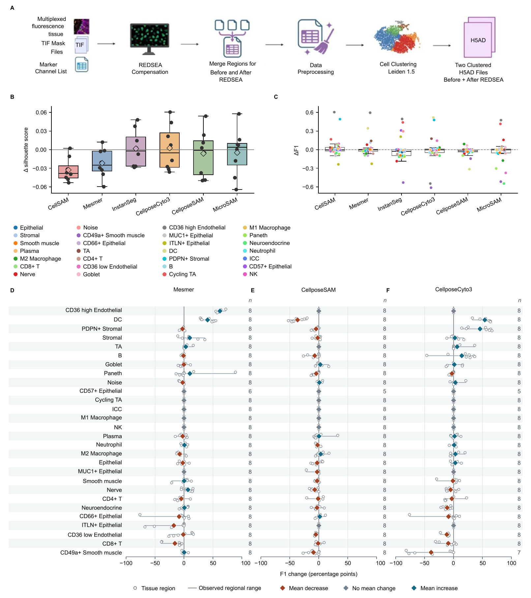

Figure 1. Spillover compensation has variable effects on clustering and cell-type annotation. (A) Original schematic of the REinforcement Dynamic Spillover EliminAtion (REDSEA) workflow for six segmentation methods. Paired uncompensated and compensated data were clustered with Leiden at resolution 1.5. (B,C) Silhouette-score and cell-type F1 changes. Points represent regions (B) or cell types (C), and diamonds show regional means (B). Boxes span interquartile ranges, center lines mark medians, and whiskers reach the most extreme observations within 1.5 times the interquartile range. (D–F) Cell-type F1 changes for Mesmer, CellposeSAM and CellposeCyto3, respectively. Hollow circles show paired regional changes, horizontal lines show the observed regional ranges, and diamonds show regional means. Teal, rust, and gray diamonds indicate increases, decreases, and no change, respectively. Changes are after minus before compensation, in F1 units for C and percentage points for D–F. Panels D–F use the same scales and cell-type order and report the number of regional pairs. Pair inclusion follows Section 2.2. Positive changes indicate higher silhouette scores or greater reference agreement. Regions are subsamples of donor B004. CellposeCyto3 refers to processed cellpose_cyto3 outputs, formerly labeled Cellpose Cyto3 or CellposeV3. The original checkpoint could not be verified. Source data: Duke Research Data Repository record 565 (Availability of Data and Materials). F1 is the harmonic mean of precision and recall. Arrows indicate workflow progression. Δ means after minus before compensation. In (D)–(F), n is the number of included regional pairs for each cell type. TIF stands for Tagged Image File Format, and H5AD is the AnnData file format. Cell-label abbreviations: CD, cluster of differentiation. DC, dendritic cells. ICC, interstitial cells of Cajal. ITLN, intelectin. NK, natural killer cells. PDPN, podoplanin. TA, transit-amplifying cells.

Compensation did not consistently improve cluster separation. Regional silhouette-score changes were slightly positive for CellposeCyto3 and InstanSeg but negative for MicroSAM, Mesmer, CellSAM and CellposeSAM, with substantial variation among regions (Figures 1B and S3A). Most regional silhouette scores remained below zero before and after compensation, consistent with overlapping or incompletely separated groups in the evaluated feature space [31], [32].

The other cluster-quality metrics also showed no consistent benefit (Figure S3B–C). Davies–Bouldin indices generally increased after compensation, indicating greater within-cluster dispersion relative to separation from the most similar neighboring cluster [33]. Mean regional Calinski–Harabasz indices decreased for all six segmentation methods, indicating poorer cluster separation by this metric [34].

We compared cell-type F1 before and after compensation. Most changes were small, although some cell types showed larger increases or decreases that differed across segmentation methods and tissue regions (Figure 1C–F).

Dendritic-cell F1 increased for Mesmer and CellposeCyto3 but decreased for CellposeSAM (Figure 1C). The number of cells assigned the dendritic-cell label changed in the same directions (Figure S4A). Mesmer and CellposeCyto3 also showed marked reductions in the number of cells assigned the CD8+ T-cell label after compensation, whereas CellposeSAM showed a smaller spatial change (Figure S4B).

To compare cell-matching rules and clustering workflows, we examined shared segmentation objects before and after compensation for all six segmentation methods (Figure S5A–C). Within each region, we averaged F1 changes across cell types represented by reference or predicted cells, then weighted the regional means equally. Mean F1 changes differed in direction across segmentation methods under processed Leiden but were negative for all six methods under the fixed FlowSOM workflow. Individual regional changes varied in both workflows (Figure S5B–C), using the matching rule in Section 2.2. These comparisons describe the sampled B004 cells and regions. Matching and retention counts differed across methods and conditions (Table S1), so we evaluated cell retention separately from F1 changes among shared segmentation objects.

Spillover compensation did not consistently improve cluster separation or reference agreement. Variation across segmentation methods, tissue regions and cell types suggests that mask geometry, initial spillover, cell density and marker distributions may influence the downstream effects.

### 3.2 Clustering performance varies across methods and reference cell types

We applied an established preprocessing pipeline [35] to the intestine CODEX dataset [3] to obtain spatial coordinates and protein marker intensities for clustering (Figure 2A). The reference annotations included abundant and rare cell types, such as epithelial and NK cells. They also included related types and subtypes, such as epithelial and CD66+ epithelial cells, and populations restricted to particular locations, such as Paneth cells (Figures 2B–C and S6A–B). UMAP projections compare the reference annotations with the reference-majority cluster assignments from the four workflows (Figure 2D).

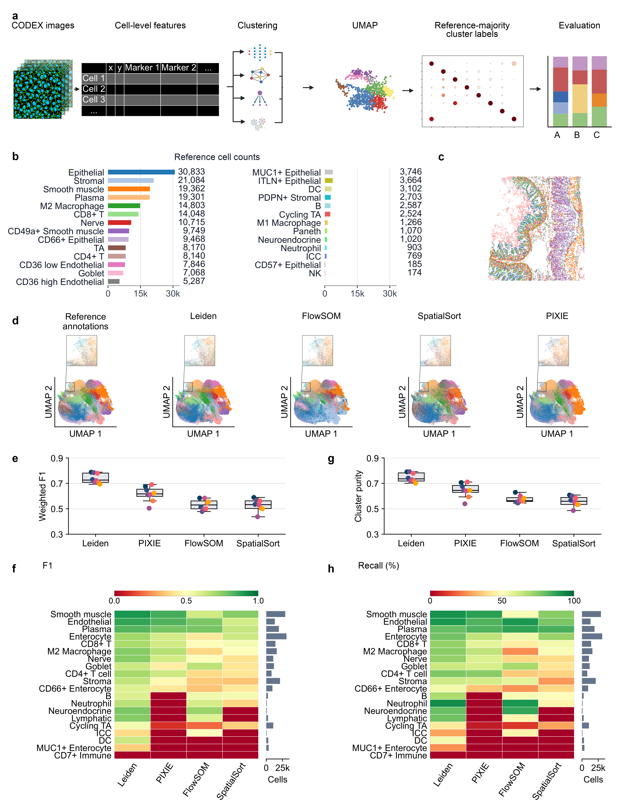

Figure 2. Clustering performance varies across methods and reference cell types. (A) Original workflow schematic from co-detection by indexing (CODEX) images and cell features to clustering and reference-majority labeling. Created with BioRender.com. (B,C) Reference cell counts and a representative cell-type map. Cell-type colors in C and D match those in B. (D) Uniform manifold approximation and projection (UMAP) embeddings colored by reference or cluster-assigned labels, with enlargements of the boxed regions above [36]. (E,G) Regional cell-count-weighted F1 and cluster purity after majority labeling within each region. Points represent regions. Boxes show medians and interquartile ranges, with 1.5-interquartile-range whiskers. (F,H) Cell-type F1 (0–1) and recall (0–100%) after global majority labeling, with reference-cell counts at right. Panels E–H use 220,082 cells and the original 28-label vocabulary, including Noise, with alphabetical tie-breaking. The eight regions are within-donor observations. Supplementary Table S7 reports conditional comparisons. Leiden, FlowSOM and SpatialSort used 47 markers, with 299 and 229 nonempty clusters in the primary FlowSOM and SpatialSort partitions, respectively. Sections 2.3 and 2.7 describe the methods and limitations. Figure S11 shows CD8+ T marker-expression profiles. Source data: Duke Research Data Repository record 505 (Availability of Data and Materials). F1 is the harmonic mean of precision and recall. Arrows indicate workflow progression. Cell-label abbreviations: CD, cluster of differentiation. DC, dendritic cells. ICC, interstitial cells of Cajal. ITLN, intelectin. NK, natural killer cells. PDPN, podoplanin. TA, transit-amplifying cells.

Leiden and PIXIE each produced 300 nonempty clusters, FlowSOM produced 299, and the primary SpatialSort run produced 229 (Table S2A).

Regional weighted F1, cell-type F1, regional cell-count-weighted cluster purity and cell-type recall varied across methods, reference cell types and tissue regions (Figure 2E–H). Leiden had the highest mean regional weighted F1 and purity, whereas SpatialSort had the lowest. The regional metrics used majority labels assigned separately within each region and method. These reference-based metrics assess the fixed B004 clusters across eight regions from one donor.

Under these configurations, Leiden exceeded SpatialSort by 22.1 percentage points in mean regional weighted F1 and 19.4 percentage points in mean regional purity. Supplementary Table S7 reports the paired regional differences and descriptive intervals.

Cell-type F1 and recall also varied across methods when each cluster was assigned its reference-majority label across all eight B004 regions (Figures 2F and 2H). Smooth muscle F1 ranged from 0.52 to 0.84 and recall from 44.8% to 83.0% across methods. No cluster received NK as its majority reference label, so F1 and recall for this rare class were zero for all four methods. The global majority labels used here differ from the labels assigned separately within each region in Figures 2E and 2G. Figure S6D provides additional regional and cell-type diagnostics.

With the original 28-label vocabulary, including Noise, pooled cluster-majority upper bounds were 68.69% for Leiden, 47.14% for FlowSOM, 48.35% for SpatialSort and 52.94% for PIXIE (Figure S7). This analysis retained all 220,082 B004 cells, including eight cells without measurable marker signal in a separate PIXIE group. SpatialSort seeds 42 and 43 produced 229 and 231 nonempty clusters, respectively, with a pooled partition ARI of 0.458. Completion of both 100-sweep chains does not establish convergence.

### 3.3 LLM annotation agreement varies across models and clustering methods

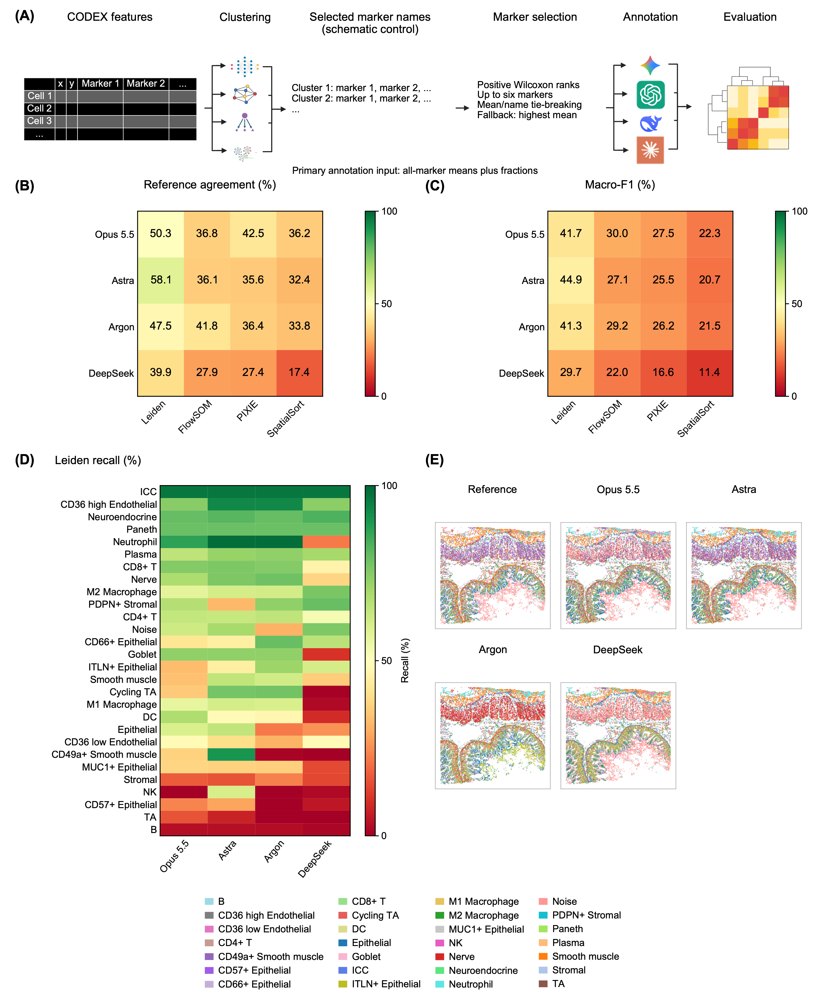

Figure 3. Large language model annotation agreement varies across models and clustering methods. (A) Original workflow schematic from cell features through clustering, marker summaries and annotation to reference-label evaluation. Created with BioRender.com. The selected-marker route is a schematic example. The primary results shown in panels B–E use all-marker means plus fractions for all 47 markers, and the executed selected-marker controls follow the rank-based rule in Section 2.4. (B,C) Reference agreement and macro-F1 calculated using the original 28-label vocabulary, respectively, averaged equally across the two test regions. The vocabulary includes Noise, and absent-class F1 is zero. (D) Label-specific recall for Leiden predictions in pooled test cells. Labels are ordered by decreasing mean recall across the four models. (E) Cell-type maps showing reference labels and each model's Leiden predictions in the fixed mid-jejunum region shown in Figure 2C. The shared four-column color key identifies labels, including Noise, across the maps, using the Figure 2C colors. Each model contributes one accepted prediction per cluster and input condition. No repeated-annotation error bars are shown. All regions are from donor B004. F1 is the harmonic mean of precision and recall. Macro-F1 is the unweighted mean of the class-specific F1 scores. CODEX stands for co-detection by indexing. Arrows indicate workflow progression. Model names are GPT-6 Astra (Astra), Claude Opus 5.5 (Opus 5.5), Gemini 4 Argon (Argon) and DeepSeek V4.1 Flash 1017 (DeepSeek). Cell-label abbreviations: CD, cluster of differentiation. DC, dendritic cells. ICC, interstitial cells of Cajal. ITLN, intelectin. NK, natural killer cells. PDPN, podoplanin. TA, transit-amplifying cells.

Across the 16 clustering-method–model combinations, mean test-region agreement ranged from 17.42% to 58.12%, and macro-F1 calculated using the original 28-label vocabulary ranged from 0.114 to 0.449 (Figures 3B–C). Leiden–GPT-6 Astra had the highest agreement in these two regions. These single-annotation results from B004 do not establish general superiority of a model or clustering method.

Across both primary LLM input representations, all 128 planned annotation request items eventually produced accepted outputs, providing all 9,024 planned cluster predictions. Prediction coverage was 100% at both the cluster and cell levels in every annotation set. Failed and interrupted attempts were retained in the execution record and were not counted as independent repetitions (Supplementary Note 2).

Label-specific recall varied across models in the pooled Leiden test-region comparison (Figure 3D).

Cell-type maps show the reference labels alongside each model's Leiden predictions in the fixed tissue region shown in Figure 2C (Figure 3E). The maps retain the individual model predictions, and the region was not selected on the basis of annotation agreement.

### 3.4 Positive fractions have mixed effects on annotation agreement

Adding positive fractions to otherwise identical mean marker-expression inputs increased agreement in 8 of the 16 method–model comparisons and reduced it in 8. Changes in agreement, averaged equally across the two test regions, ranged from −10.25 to +6.50 percentage points (Table S6a and Figure S9).

Selected marker names gave lower agreement than all-marker means in 15 of 16 method–model comparisons (Figure S10 and Tables S8a–S8d). Mean agreement across the 16 equally weighted conditions was 32.52% for selected marker names, 38.10% for all-marker means and 37.51% for all-marker means plus fractions. Using selected marker means, Leiden–DeepSeek achieved 41.42% agreement and a macro-F1 of 0.3576 calculated using the original 28-label vocabulary, with all 300 cluster predictions delivered.

Single-run comparisons do not establish consistency across repeated model calls. Positive fractions summarize processed measurements and have not been validated as measures of biological marker positivity. Figure S11 compares stored marker-expression profiles of groups labeled CD8+ T using the cross-model summary. Cells were not filtered by reference label for this comparison.

### 3.5 Annotation performance varies across cell types in the selected Leiden–Astra pipeline

We examined Leiden–GPT-6 Astra because it had the highest B004 reference agreement with all-marker means plus fractions: 58.12%, versus 50.27% for Leiden–Opus 5.5. Confusion matrices, label-specific F1 scores and cluster-majority upper bounds summarize its performance (Figure 4).

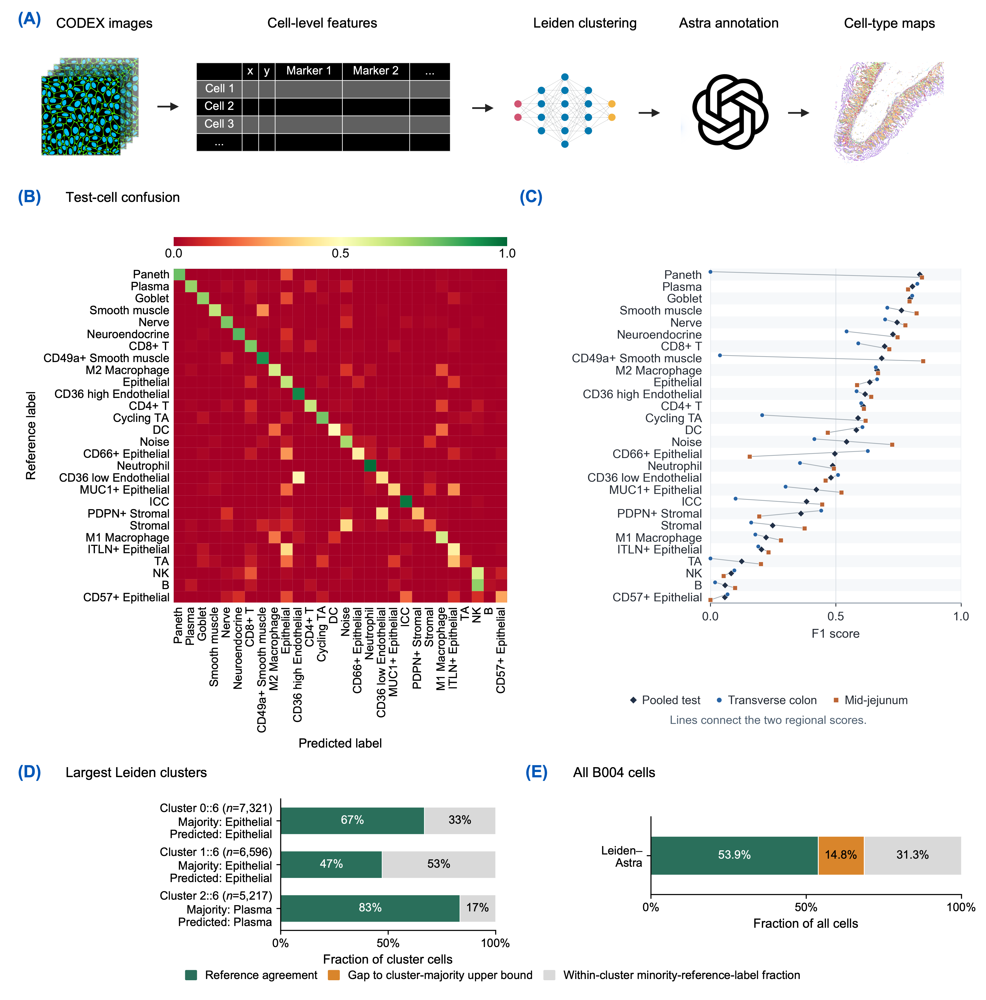

Figure 4. Cell-type performance and agreement limits of the selected Leiden–Astra pipeline. (A) Original workflow schematic from co-detection by indexing (CODEX) cell features through Leiden clustering, GPT-6 Astra annotation and cell-type maps. Created with BioRender.com. The OpenAI logo is a trademark of OpenAI. Annotation uses all-marker means plus fractions. (B) Row-normalized confusion matrix for pooled test cells. (C) Dark diamonds show pooled-test F1. Blue circles and orange squares show F1 for the transverse colon and mid-jejunum, respectively. Thin lines connect the two regional scores for each label. Both matrix axes and the aligned rows in C follow decreasing pooled-test F1. Scoring uses the original 28-label vocabulary, including Noise. (D) Reference-agreement decomposition for the three largest Leiden clusters, selected by total cell count, with ties resolved by cluster ID, before examining annotation outcomes. (E) The same decomposition across all 220,082 B004 cells. Components in D and E are agreement, the gap to the cluster-majority upper bound and the within-cluster minority-reference-label fraction. They are arithmetic components of reference disagreement and do not identify independent biological error classes. The pipeline was selected from the B004 benchmark results. The cluster-size selection rule and spatial region were unchanged. F1 is the harmonic mean of precision and recall. Arrows indicate workflow progression. The Cells column in (D) and (E) gives the cell count for each row. Cell-label abbreviations: CD, cluster of differentiation. DC, dendritic cells. ICC, interstitial cells of Cajal. ITLN, intelectin. NK, natural killer cells. PDPN, podoplanin. TA, transit-amplifying cells.

The pooled test-region confusion matrix and label-specific F1 scores showed variation across cell types and between the two test regions (Figures 4B–C). Pooled summaries give each cell equal weight and therefore differ from the main reference-agreement metric, which gives each test region equal weight.

Figures 4D–E decompose full-cohort results into reference agreement, the gap to the cluster-majority upper bound and the within-cluster minority-reference-label fraction. Figure S1B provides the corresponding supplementary Leiden–Opus 5.5 comparison. Reference agreement counts every cell whose reference label matches the model-assigned label, including matches to minority reference types within a cluster. The minority-reference-label fraction counts cells whose reference label differs from their cluster's majority label. These arithmetic components neither identify mutually exclusive groups of misclassified cells nor establish which pipeline stage caused an error. Figure 4E weights the cluster components by cell count. Figure S8 shows the primary decomposition, which weights the test regions equally.

Across all 220,082 B004 cells, Leiden–GPT-6 Astra achieved 53.88% agreement against a cluster-majority upper bound of 68.69%, leaving a 14.80-percentage-point gap (Figure 4E). These full-cohort summaries are descriptive and are distinct from the main evaluation metric for the two B004 test regions.

### 3.6 Cross-donor evaluation shows variation in clustering and annotation

Cross-donor evaluation included all 589,468 B005 and B006 cells and retained the original 28-label vocabulary, including Noise. When metrics were averaged equally across each donor's eight regions, Leiden had the highest purity, at 73.92% in B005 and 73.09% in B006. FlowSOM had the highest ARI, at 0.355 and 0.353, respectively (Figure S12A,B and Table S14a). Purity and ARI therefore ranked the methods differently.

After 50 sampling sweeps with five DMH iterations per sweep, the ARI between cluster assignments from SpatialSort seeds 42 and 43 was 0.692 in B005 and 0.580 in B006, calculated across cells common to both runs and pooled across all regions (Figure S12C and Table S14b).

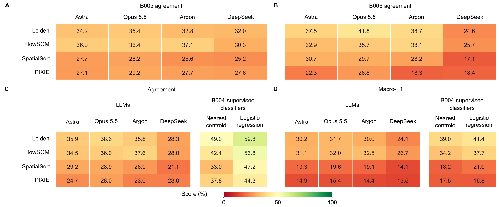

Figure 5. Cross-donor annotation agreement using all-marker means plus fractions for all 47 markers. (A,B) Reference agreement using the original 28-label vocabulary in B005 and B006, respectively, including Noise as a valid label. Each donor's value averages its eight tissue regions equally. (C,D) Agreement and macro-F1 calculated using the original 28-label vocabulary, respectively, after equal weighting of the two donor means. Results are shown for four large language models and conventional classifiers trained on B004 data. Classifiers are grouped separately because they used training reference labels and were not retrained on the evaluation donors. Tables S13a–S13b provide the donor-specific LLM results. Each cluster had one planned annotation per condition. The evaluation used at most one accepted annotation per cluster and condition. F1 is the harmonic mean of precision and recall. Macro-F1 is the unweighted mean of the class-specific F1 scores. Model names are GPT-6 Astra (Astra), Claude Opus 5.5 (Opus 5.5), Gemini 4 Argon (Argon) and DeepSeek V4.1 Flash 1017 (DeepSeek).

The B004-selected Leiden–Astra pipeline achieved reference agreement of 34.22% in B005 and 37.51% in B006 using the original 28-label vocabulary, giving 35.87% agreement after equal weighting of the donor means and a macro-F1 of 0.302. The Leiden logistic-regression classifier trained on B004 data achieved 57.66% and 61.90% agreement, respectively, giving 59.78% reference agreement averaged equally across donors and a macro-F1 of 0.414 (Figure 5C,D). The classifier used B004 training reference labels that were unavailable in the LLM prompts and was applied to both evaluation donors without additional training.

Among the same cells retained for both label definitions, Leiden–Astra agreement was 35.70% in B005 and 37.70% in B006 using the original 28-label vocabulary, compared with 42.25% and 44.66% using the projected 23-label vocabulary. Reference agreement averaged equally across donors was 36.70% and 43.46%, respectively (Figure S13 and Tables S15a–S15b). Using the same cells for both label definitions separates the effect of label mapping from the effect of excluding cells based only on their reference labels. The full-population evaluation using the original 28-label vocabulary remains the primary result.

### 3.7 Annotation controls and additional comparisons

Matched prompt controls did not improve Opus 5.5 agreement in the tested conditions. Adding the correct clustering-method name reduced agreement by 2.54–5.12 percentage points across the four methods. The corresponding baselines used all-marker means plus fractions and omitted clustering-method names (Figure S2A and Table S9). Adding measured neighborhood expression reduced Leiden–Opus 5.5 agreement from 50.27% to 45.97%, a 4.29-percentage-point decrease (Figure S2B). Leiden–Astra agreement decreased from 58.12% to 53.53% with the method name and to 51.43% with neighborhood-expression summaries, changes of −4.59 and −6.69 percentage points, respectively (Figure S2A,B and Table S9). Macro-F1 calculated using the original 28-label vocabulary was 0.4490 for the Astra baseline, 0.4458 with the method name and 0.4531 with neighborhood-expression summaries. These single-generation contrasts do not establish repeatability or a general effect of method names or spatial context. The Astra controls and baseline used different Batch routes (Section 2.7).

Allowing Noise increased mean test-region agreement by 5.11 percentage points when reference Noise cells were included, with mixed effects after those cells were excluded (Figure S15).

Conventional classifiers provided a supervised comparison using the same numerical cluster profiles (Table S10). With all-marker means plus fractions, test-region agreement ranged from 44.09% to 68.20% for logistic regression and from 35.19% to 55.74% for nearest-centroid classification. The Leiden logistic-regression classifier achieved 68.20%, compared with 58.12% for Leiden–Astra. The classifier, however, used training-cell reference labels that were not provided in the LLM prompts.

After merging clusters into 100 and 200 groups using cell-count-weighted Ward clustering, we ranked methods by their mean purity across the two equally weighted test regions. The ranking remained Leiden, PIXIE, FlowSOM and SpatialSort using the original 28-label vocabulary, including Noise (Table S11). ARI rankings changed after merging. These purity and ARI results describe merged clusters, without rerunning clustering at matching target counts or testing the stability of LLM annotation rankings.

For each model, we used the fraction of all four models that assigned the same label as an estimate of the probability of reference agreement. This gave a mean Brier score of 0.311. Logistic recalibration reduced the mean Brier score to 0.212, compared with 0.229 for a constant probability estimated from the development data (Figure S2C and Tables S12a–S12d). The means weight the two test regions equally within each of the 16 method–model conditions and then weight the conditions equally. Recalibration improved Brier score relative to raw cross-model support in all 16 conditions, but the constant probability had a lower Brier score in three. Mean expected calibration error was 0.118 after recalibration and 0.094 for the constant. Figure S2D shows selective-risk curves for the already-selected Leiden–Astra pipeline separately in each test region. These exploratory analyses used held-out cluster IDs within B004 and do not establish transferable confidence thresholds.

## 4. Discussion

Spatial proteomic cell-type annotation varied with image processing, cluster composition, marker representation and label assignment. Effects differed across cell types, tissue regions, evaluation metrics and prompt conditions, supporting joint evaluation of processing, clustering and annotation.

REDSEA previously reduced neighboring-cell marker contamination and improved cell-type classification in multiplexed ion beam imaging (MIBI) and cyclic immunofluorescence (CyCIF) data [9]. In our intestine CODEX analysis, changes in clustering performance and reference agreement varied across segmentation methods and cell types. Improved marker separation therefore need not improve reference agreement across all workflows. Differences in tissue, marker panels, segmentation and scoring prevent direct numerical comparisons with the earlier study. Similarly, Mesmer was evaluated against manually annotated cell boundaries [7], whereas we assessed downstream clustering and cell-type F1. Our findings complement segmentation benchmarks but do not establish relative boundary accuracy.

The clustering results are consistent with earlier CODEX benchmarks showing that preprocessing can strongly affect annotation [6]. Graph-based, self-organizing-map, spatial Bayesian and pixel-based workflows should therefore be evaluated against the cell types and metrics relevant to the intended analysis [15–19].

SpatialSort previously showed improved clustering with spatial information and biological priors [18], and PIXIE showed benefits from pixel-composition features for cell phenotyping [19]. Neither approach performed better than the alternatives in every tested intestine CODEX configuration. SpatialSort received no biological priors, and sampling convergence was not established. We evaluated PIXIE using pixel compositions within cell masks and fixed cell clusters, rather than its full interactive phenotyping workflow. Differences in representation, cluster granularity, reference-label definitions and evaluation metrics limit comparisons with the original studies.

Cell-level agreement reflects both cluster composition and the label assigned to each cluster. Marker-expression differences among groups labeled CD8+ T using the cross-model summary cannot independently validate those assignments (Figure S11). Overall agreement should be accompanied by cell-type and regional results, with image and marker review where predictions disagree.

We compared annotation from all-marker means and all-marker means plus fractions, using high-reasoning settings and the original 28-label vocabulary. The agreement changes were descriptive, and positive fractions were not validated measures of biological marker positivity. Lists of up to six marker names per cluster did not consistently improve reference agreement (Figure S10). Adding clustering-method names or summaries of neighboring-cell marker expression reduced reference agreement in the tested Opus 5.5 and Astra conditions (Figure S2). Astra neighborhood-expression summaries slightly increased macro-F1 despite lower agreement. The Astra baseline and controls used different execution routes and one accepted prediction per cluster and condition, limiting attribution of agreement changes to prompt content alone. Comparisons with supervised classifiers and analyses that merged clusters also showed that performance depends on the available training labels, the number and composition of clusters, and the evaluation metric. The fraction of models supporting a predicted label required separate calibration against reference agreement and did not outperform a constant baseline in every condition. It should therefore not be interpreted as a model’s own confidence estimate.

The B004-selected Leiden–Astra pipeline achieved 35.87% reference agreement averaged equally across B005 and B006, below its agreement in the two B004 test regions. The Leiden logistic-regression classifier trained on B004 reached 59.78% without retraining on B005 or B006, but it used reference labels that were unavailable to the LLMs. These results support retaining supervised comparison methods when suitable labeled data are available, while accounting for differences in supervision. They do not isolate the causes of the lower LLM agreement or establish performance in broader cohorts.

We evaluated direct annotation from numerical cluster profiles, without testing CASSIA’s iterative validation and retrieval [29] or the human-in-the-loop refinement described in the CellMaster preprint [30]. Whether those steps improve CODEX annotation remains unresolved. Comparisons with published RNA-sequencing annotation results must also account for differences in measurement type, tissue, label definitions and evaluation metrics.

Future systems could support expert review by displaying supporting and conflicting markers and allowing “unknown” or “mixed” labels. In this study, Noise was a valid dataset reference label, not an abstention output.

The study included only three donors, each with eight tissue regions. Clustering and cluster profiles used all cells, including evaluation cells. B004’s two test regions therefore assessed annotation of fixed clustering results.

Broader cohorts, disease settings, tissues and marker panels require further evaluation. Reference labels may contain errors or uncertain boundaries, and the cluster-majority upper bound depends on the reference-label composition of the evaluated clusters.

The conditional clustering tests in Supplementary Table S7 assume regional sign exchangeability. They do not resolve dependence caused by shared clusters or retrospective selection. With eight regional pairs, exact tests have limited resolution after Holm correction, which neither establishes equivalence nor rules out important differences. B004 annotation agreement, cell-type outcomes and paired representation changes remain descriptive single-run observations.

## 5. Conclusion

Scalable CODEX annotation requires evaluating image processing, clustering, marker representation and label assignment together. The effects of compensation varied across workflows, and cluster composition limited reference agreement when each cluster received one label. Reference agreement varied across models and LLM input representations within B004. Expert review of marker expression, spatial context and mixed clusters remains necessary. Performance in broader cohorts and consistency across repeated model calls require further evaluation.

## Acknowledgments

OpenAI Codex assisted with language editing, reference styling, manuscript formatting, code development and refinement, analysis implementation and verification, and figure preparation. The authors retain responsibility for the study design, scientific interpretation, accuracy and integrity of the manuscript.

## Author Contributions

Deutsch Z, Surguladze N, Miao Y, Hickey JW: Study conception and design. Review and interpretation of the data analyses. Manuscript writing, review, and editing. Surguladze N: Analyses related to Figure 1. Deutsch Z: Analyses related to Figures 2–5. Hickey JW: Study supervision and funding acquisition.

## Conflicts of Interest

The authors declare no conflicts of interest.

## Ethical Approval

This study involved secondary analysis of deidentified human tissue imaging data previously collected and made publicly available through the Human BioMolecular Atlas Program (HuBMAP). No new participants were recruited and no new tissue was collected. The original tissue collection complied with all relevant ethical regulations and was approved by the Washington University Institutional Review Board and the Stanford University Institutional Review Board. No additional ethical approval was required for the present secondary analysis.

## Consent to Participate

No participants were newly enrolled in this study. For the original tissue collection, written informed consent was obtained from the next of kin of all deceased organ donors.

## Consent for Publication

Not applicable. No identifiable participant information is included in this manuscript.

## Availability of Data and Materials

Raw CODEX images and related datasets are available through the Human BioMolecular Atlas Program (HuBMAP) Data Portal under HuBMAP Collection HBM692.JRZB.356 ([https://doi.org/10.35079/HBM692.JRZB.356](https://doi.org/10.35079/HBM692.JRZB.356)). Annotated single-cell CODEX data are available through Dryad ([https://doi.org/10.5061/dryad.pk0p2ngrf](https://doi.org/10.5061/dryad.pk0p2ngrf)). The before/after spillover-compensation datasets underlying Figures 1, S3 and S4 are available in Duke Research Data Repository record 565 ([https://doi.org/10.7924/r4r565](https://doi.org/10.7924/r4r565)). The main expert-annotated B004 CODEX dataset underlying the clustering and annotation analyses in Figures 2–4 is available in record 505 ([https://doi.org/10.7924/r4r505](https://doi.org/10.7924/r4r505)).

Code and results for the revised manuscript are available in this repository. The [B004 control outputs](../configs/reviewer47_completed_publication_20261115.json) include the exact request, validation and [offline scoring records](manuscript_reproduction.md#reviewer-controls-and-recalibration-replay). The [completed B005/B006 analysis bundle](../data/frozen/donor47_deepseek_completion_20261116/README.md) includes the frozen cluster assignments, annotation inputs, accepted predictions and scoring tables underlying Figure 5 and Figures S12–S13. The [figure index](figure_map.md) links the saved manuscript artwork and the figure sources.

## Funding Information

This work was supported by the U.S. National Institutes of Health (grant nos. 3U54AG07593, 3OT2OD033759-01S4, 3OT2OD033759-01S5, 1U01-AI186999-01, and 1U54-AI191253-01), the National Science Foundation CAREER Award (grant no. 2440733), the V Foundation (grant no. V2025-019), the Human Frontier Science Program Early Career Grant (grant no. RGEC26/2025), and start-up support from the Duke University Department of Biomedical Engineering to J.W.H.

## References

1. Goltsev Y, Samusik N, Kennedy-Darling J, Bhate S, Hale M, Vazquez G, et al. Deep profiling of mouse splenic architecture with CODEX multiplexed imaging. Cell. 2018, 174(4):968-981.e15. DOI: 10.1016/j.cell.2018.07.010.
2. Black S, Phillips D, Hickey JW, Kennedy-Darling J, Venkataraaman VG, Samusik N, et al. CODEX multiplexed tissue imaging with DNA-conjugated antibodies. Nat Protoc. 2021, 16(8):3802-3835. DOI: 10.1038/s41596-021-00556-8.
3. Hickey JW, Becker WR, Nevins SA, Horning A, Perez AE, Zhu C, et al. Organization of the human intestine at single-cell resolution. Nature. 2023, 619(7970):572-584. DOI: 10.1038/s41586-023-05915-x.
4. HuBMAP Consortium. The human body at cellular resolution: the NIH Human BioMolecular Atlas Program. Nature. 2019, 574(7777):187-192. DOI: 10.1038/s41586-019-1629-x.
5. Börner K, Blood PD, Silverstein JC, Ruffalo M, Satija R, Teichmann SA, et al. Human BioMolecular Atlas Program (HuBMAP): 3D Human Reference Atlas construction and usage. Nat Methods. 2025, 22(4):845-860. DOI: 10.1038/s41592-024-02563-5.
6. Hickey JW, Tan Y, Nolan GP, Goltsev Y. Strategies for accurate cell type identification in CODEX multiplexed imaging data. Front Immunol. 2021, 12:727626. DOI: 10.3389/fimmu.2021.727626.
7. Greenwald NF, Miller G, Moen E, Kong A, Kagel A, Dougherty T, et al. Whole-cell segmentation of tissue images with human-level performance using large-scale data annotation and deep learning. Nat Biotechnol. 2022, 40(4):555-565. DOI: 10.1038/s41587-021-01094-0.
8. Miao Y, Surguladze N, Lerner J, Poysungnoen K, Ariano K, Li Y, et al. Foundation cell segmentation models performance on live microscopy and spatial-omics data [Preprint]. 2026. DOI: 10.64898/2026.04.18.719315.
9. Bai Y, Zhu B, Rovira-Clavé X, Chen H, Markovic M, Chan CN, et al. Adjacent cell marker lateral spillover compensation and reinforcement for multiplexed images. Front Immunol. 2021, 12:652631. DOI: 10.3389/fimmu.2021.652631.
10. Stringer C, Pachitariu M. Cellpose3: one-click image restoration for improved cellular segmentation. Nat Methods. 2025, 22(3):592-599. DOI: 10.1038/s41592-025-02595-5.
11. Pachitariu M, Rariden M, Stringer C. Cellpose-SAM: superhuman generalization for cellular segmentation [Preprint]. 2025. DOI: 10.1101/2025.04.28.651001.
12. Marks M, Israel U, Dilip R, Li Q, Yu C, Laubscher E, et al. CellSAM: a foundation model for cell segmentation. Nat Methods. 2025, 22(12):2585-2593. DOI: 10.1038/s41592-025-02879-w.
13. Goldsborough T, Philps B, O’Callaghan A, Inglis F, Leplat L, Filby A, et al. InstanSeg: an embedding-based instance segmentation algorithm optimized for accurate, efficient and portable cell segmentation [Preprint]. 2024. DOI: 10.48550/arXiv.2408.15954.
14. Archit A, Freckmann L, Nair S, Khalid N, Hilt P, Rajashekar V, et al. Segment Anything for Microscopy. Nat Methods. 2025, 22(3):579-591. DOI: 10.1038/s41592-024-02580-4.
15. Traag VA, Waltman L, van Eck NJ. From Louvain to Leiden: guaranteeing well-connected communities. Sci Rep. 2019, 9(1):5233. DOI: 10.1038/s41598-019-41695-z.
16. Van Gassen S, Callebaut B, Van Helden MJ, Lambrecht BN, Demeester P, Dhaene T, et al. FlowSOM: using self-organizing maps for visualization and interpretation of cytometry data. Cytometry A. 2015, 87(7):636-645. DOI: 10.1002/cyto.a.22625.
17. Couckuyt A, Rombaut B, Saeys Y, Van Gassen S. Efficient cytometry analysis with FlowSOM in Python boosts interoperability with other single-cell tools. Bioinformatics. 2024, 40(4):btae179. DOI: 10.1093/bioinformatics/btae179.
18. Lee E, Chern K, Nissen M, Wang X, IMAXT Consortium, Huang C, et al. SpatialSort: a Bayesian model for clustering and cell population annotation of spatial proteomics data. Bioinformatics. 2023, 39(Suppl 1):i131-i139. DOI: 10.1093/bioinformatics/btad242.
19. Liu CC, Greenwald NF, Kong A, McCaffrey EF, Leow KX, Mrdjen D, et al. Robust phenotyping of highly multiplexed tissue imaging data using pixel-level clustering. Nat Commun. 2023, 14(1):4618. DOI: 10.1038/s41467-023-40068-5.
20. Ianevski A, Giri AK, Aittokallio T. Fully automated and ultra-fast cell-type identification using specific marker combinations from single-cell transcriptomic data. Nat Commun. 2022, 13(1):1246. DOI: 10.1038/s41467-022-28803-w.
21. Zhang AW, O’Flanagan C, Chavez EA, Lim JLP, Ceglia N, McPherson A, et al. Probabilistic cell-type assignment of single-cell RNA-seq for tumor microenvironment profiling. Nat Methods. 2019, 16(10):1007-1015. DOI: 10.1038/s41592-019-0529-1.
22. Aran D, Looney AP, Liu L, Wu E, Fong V, Hsu A, et al. Reference-based analysis of lung single-cell sequencing reveals a transitional profibrotic macrophage. Nat Immunol. 2019, 20(2):163-172. DOI: 10.1038/s41590-018-0276-y.
23. Abdelaal T, Michielsen L, Cats D, Hoogduin D, Mei H, Reinders MJT, et al. A comparison of automatic cell identification methods for single-cell RNA sequencing data. Genome Biol. 2019, 20(1):194. DOI: 10.1186/s13059-019-1795-z.
24. Osumi-Sutherland D, Xu C, Keays M, Levine AP, Kharchenko PV, Regev A, et al. Cell type ontologies of the Human Cell Atlas. Nat Cell Biol. 2021, 23(11):1129-1135. DOI: 10.1038/s41556-021-00787-7.
25. Brbić M, Cao K, Hickey JW, Tan Y, Snyder MP, Nolan GP, et al. Annotation of spatially resolved single-cell data with STELLAR. Nat Methods. 2022, 19(11):1411-1418. DOI: 10.1038/s41592-022-01651-8.
26. Hou W, Ji Z. Assessing GPT-4 for cell type annotation in single-cell RNA-seq analysis. Nat Methods. 2024, 21(8):1462-1465. DOI: 10.1038/s41592-024-02235-4.
27. Ye W, Ma Y, Xiang J, Liang H, Luo J, Li Y, et al. Evaluation of cell type annotation reliability using a large language model-based identifier. Commun Biol. 2025, 8(1):1360. DOI: 10.1038/s42003-025-08745-x.
28. Xiao T, Hua D, Wang Y, Lu X, Zhang C. Benchmarking large language models for cell typing in single-cell RNA-seq. Brief Bioinform. 2025, 26(6):bbaf677. DOI: 10.1093/bib/bbaf677.
29. Xie E, Cheng L, Shireman J, Cai Y, Liu J, Mohanty C, et al. CASSIA: a multi-agent large language model for automated and interpretable cell annotation. Nat Commun. 2026, 17:389. DOI: 10.1038/s41467-025-67084-x.
30. Wang Z, Gao Y, Liu J, Ma E, Chen J, Antkowiak M, et al. CellMaster: collaborative cell type annotation in single-cell analysis. arXiv [Preprint]. 2026. DOI: 10.48550/arXiv.2602.13346.
31. Rousseeuw PJ. Silhouettes: a graphical aid to the interpretation and validation of cluster analysis. J Comput Appl Math. 1987, 20:53-65. DOI: 10.1016/0377-0427(87)90125-7.
32. Gagolewski M, Bartoszuk M, Cena A. Are cluster validity measures (in)valid? Inf Sci. 2021, 581:620-636. DOI: 10.1016/j.ins.2021.10.004.
33. Davies DL, Bouldin DW. A cluster separation measure. IEEE Trans Pattern Anal Mach Intell. 1979, PAMI-1(2):224-227. DOI: 10.1109/TPAMI.1979.4766909.
34. Caliński T, Harabasz J. A dendrite method for cluster analysis. Commun Stat. 1974, 3(1):1-27. DOI: 10.1080/03610927408827101.
35. Windhager J, Zanotelli VRT, Schulz D, Meyer L, Daniel M, Bodenmiller B, et al. An end-to-end workflow for multiplexed image processing and analysis. Nat Protoc. 2023, 18(11):3565-3613. DOI: 10.1038/s41596-023-00881-0.
36. McInnes L, Healy J, Saul N, Großberger L. UMAP: uniform manifold approximation and projection. J Open Source Softw. 2018, 3(29):861. DOI: 10.21105/joss.00861.

## Supplementary Methods

### SM1. Compensation processing and cell matching

The processed compensation files contained 45 marker features and 44 centered principal components, with no highly variable feature selection. The stored graph-construction configuration specified 30 Euclidean neighbors in PCA space, RAPIDS and random state 0. The stored Leiden configuration specified resolution 1.5, 100 iterations and random state 0. These configurations differed from those in the main clustering benchmark (Sections 2.2–2.3).

For the six compensation workflows, we could not verify the original segmentation targets (whole cells or nuclei), input channels, software versions, checkpoints, inference thresholds, mask quality-control rules, runtime or hardware. Cytokit followed by SPRM and the Hoechst1/Cytokeratin channels described in Section 2.1 apply only to the reference dataset. We did not assume current defaults or comparable whole-cell segmentation configurations.

Centroid matching used Euclidean distances, with ties resolved by reference object ID (Section 2.2). Objects with invalid coordinates or distances beyond the threshold remained unmatched and were excluded from agreement scoring. Audits retained matching counts and fractions, distances, duplicate reference matches and objects present only before or after compensation (Table S1). Mutual nearest-neighbor matching at 10 source-coordinate units required matches in both directions and produced one-to-one pairs. A common conversion to pixels and the original registration across segmentation workflows could not be verified. Matching did not modify masks, identify biological splits or merges, or establish boundary accuracy.

The compensation comparison used a fixed FlowSOM configuration across all six segmentation methods, without selection by reference agreement. It used processed marker values without an additional arcsinh transformation. Preprocessing and clustering were fitted separately before and after compensation (Section 2.7).

### SM2. Reference-label harmonization

Clustering and LLM annotation retained the original 28-label vocabulary, including Noise, without class merges (Section 2.3). Figure S6D excludes Noise, and Section 2.6 describes the 23-label evaluation. Complete per-label mappings are preserved with the clustering scoring policy and annotation ontology.

### SM3. Clustering inputs and configurations

Section 2.3 and Table S2A specify the clustering inputs, transformations, scaling, requested and nonempty cluster counts, and hyperparameters. Only SpatialSort received explicit cell coordinates as clustering inputs. PIXIE paired multichannel expression images with integer-labeled cell-mask OME-TIFFs. Its 48 selected channels were smoothed and normalized before pixel clustering. Pixel assignments were aggregated within each mask into fractions of 20 pixel Ward metaclusters for later cell clustering. Figures S6 and S11 define the expression groups and scaling used only for display.

### SM4. Scoring calculations

For cell-type F1 and recall, true positives matched both the reference and assigned labels. False positives carried other reference labels, and false negatives carried the specified reference label but received another assignment. Global and within-region majority labeling used the populations and mappings in Section 2.3, with alphabetical tie-breaking. Both metrics used reference labels to evaluate fixed clustering results. Equations (2)–(5) define purity, reference agreement, normalization by the cluster-majority upper bound and the overall error identity. Minority-label matches contributed to reference agreement, including cell-type-specific ratios (Section 2.5).

### SM5. Conditional regional comparisons

Table S7 includes all six method pairs for weighted F1 and cluster purity, with Holm correction across the 12-test family. Two-sided exact sign-flip tests evaluated all 256 sign assignments for eight equally weighted regional differences. Reported quantities include regional means, differences in percentage points, raw and adjusted p-values, and descriptive 95% intervals from 10,000 paired-region bootstrap resamples with seed 42. All 12 planned comparisons retained every regional pair. Section 2.7 discusses dependence among regions, limits on donor-level inference and the exchangeability assumption.

### Supplementary Note 1. LLM prompt templates and annotation outputs

Primary requests contained numerical profiles for all 47 markers, anonymous cluster query IDs, the code dictionary for the original 28-label vocabulary, including Noise, and fixed task instructions. The all-marker means plus fractions input added a matrix of positive fractions to the unchanged matrix of mean marker-expression values. Neither primary input representation included cell- or cluster-specific reference assignments, reference expression profiles, clustering-method identities or neighborhood summaries. Literal requests, prompt hashes, anonymous-to-cluster mappings and accepted raw outputs are preserved with the reproducible analysis. Selected-marker and matched context controls differed only as specified in Sections 2.4 and 2.7.

### Supplementary Note 2. LLM inputs, execution and response handling

Inputs and design. A physical model call is one execution of an LLM. A logical request item is a predefined group of anonymous cluster queries. An annotation set combines the request items for one clustering method, model and input representation. All 220,082 B004 cells contributed to the frozen cluster profiles. The four partitions contained 300 Leiden, 299 FlowSOM, 229 SpatialSort and 300 PIXIE clusters, totaling 1,128 nonempty clusters. Each method required four request items per model and arm, with at most 75 clusters per item. The primary two-arm comparison included 32 annotation sets, 128 items and 9,024 planned cluster predictions. These sets and 32 selected-marker representation sets formed the 64-set representation comparison with 256 items. Four Opus 5.5 method-name sets and one Leiden–Opus 5.5 neighborhood set added 20 items, giving 69 base sets, 276 items and 19,476 planned cluster predictions. Two Leiden–Astra extension sets added eight items and 600 predictions, giving 71 sets, 284 items and 20,076 planned predictions overall. Each scientific condition had one planned repetition. Training-only annotation-profile standardization, integer-thousandth encoding, query order, vocabulary, and exact join and leakage checks were frozen before launch.

Execution and acceptance. The primary B004 Astra arms used OpenRouter Batch, while new selected-marker Astra requests and the Astra prompt-control extension used native OpenAI Batch. Opus 5.5 used OpenRouter Batch. Argon used standard streaming requests. DeepSeek used standard streaming requests and one Batch request, with recovery attempts and provider continuation segments recorded separately where supported. In cross-donor evaluation, Astra used native OpenAI Batch, Opus 5.5 used Anthropic Batch through OpenRouter, Argon used Google AI Studio Flex streaming through OpenRouter, and DeepSeek used Morph FP8 streaming through OpenRouter. Provider fallback was disabled. All scientific requests used supported high-reasoning settings. Actual model bindings, routes, output token ceilings, supported seeds, transport, attempt status, usage and charges were recorded per physical generation rather than inferred from model aliases. We accepted each request item in full only after validating the complete final response and replaying the saved response. Validation required every expected query ID exactly once, no extra or duplicate keys or fields, integer codes in the original 28-label vocabulary, and no refusal or truncation. Accepted prior outputs were not overwritten, and failed or interrupted attempts remained in the archive. Each physical generation and charge was recorded once, with unresolved billing holds separate from confirmed charges.

Costs and delivery. All 128 primary B004 items were accepted, covering 9,024 cluster predictions. The combined B004 design therefore delivered 20,076 predictions across 284 accepted items: 109 items reused from identical conditions and 175 newly accepted items.

Scoring and reporting. B004 outcomes equally weight the same two test regions, with scoring and paired-change definitions in Section 2.5. Calibration uses nonoverlapping clusters and regions (Section 2.7). Single accepted annotations do not estimate repeated-call variability.

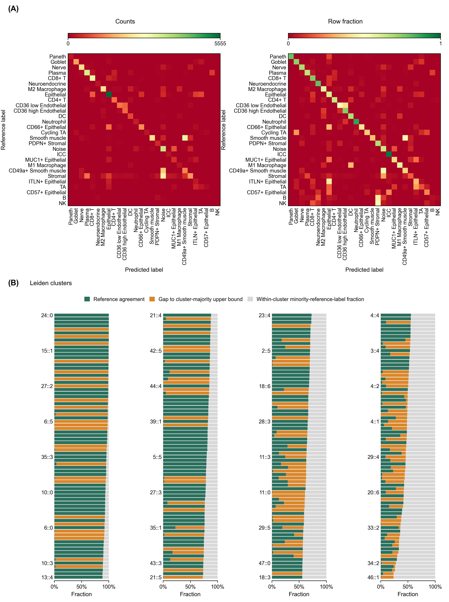

Figure S1. Supplementary Leiden–Opus 5.5 annotation diagnostics using all-marker means plus fractions. (A) Confusion matrices for pooled test cells, expressed as cell counts and row fractions under the original 28-label vocabulary, including Noise. Rows without reference cells have zero row fractions. (B) Reference-agreement decomposition for all 300 Leiden clusters across all 220,082 B004 cells. Clusters are ordered by decreasing cluster-majority reference fraction, with cluster-ID tie-breaking, in four consecutive blocks of 75. Selected cluster IDs label each block. Green indicates agreement, orange the gap to the cluster-majority upper bound, and gray the within-cluster minority-reference-label fraction. Opus 5.5 is Claude Opus 5.5. Cell-label abbreviations: CD, cluster of differentiation. DC, dendritic cells. ICC, interstitial cells of Cajal. ITLN, intelectin. NK, natural killer cells. PDPN, podoplanin. TA, transit-amplifying cells.

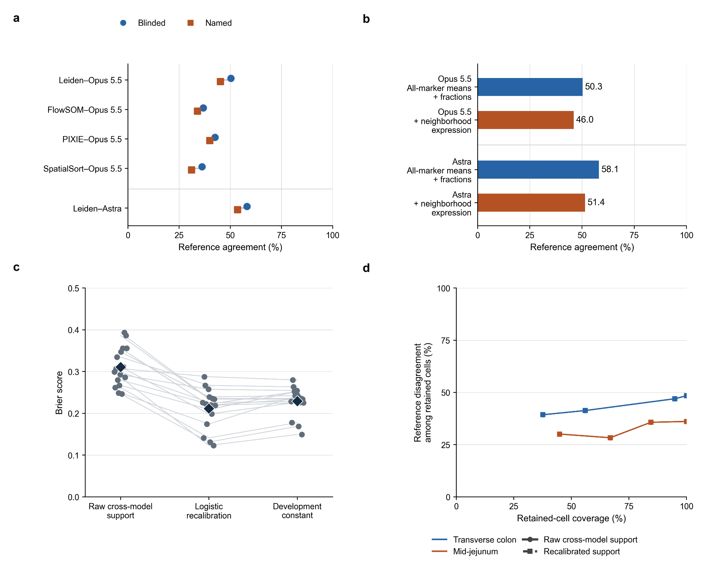

Figure S2. Matched prompt controls and exploratory cross-model support calibration. All analyses use B004. (A) Agreement when clustering-method names were omitted or provided correctly, for Opus 5.5 across four methods, followed by Leiden–Astra. The Opus 5.5 rows follow the Figure 3C method order. (B) Leiden–Opus 5.5 and Leiden–Astra agreement with all-marker means plus fractions alone or the same input plus measured expression from the 15 nearest other cells within each region. Panels A and B reuse identical baselines containing all-marker means plus fractions and weight the two test regions equally. (C) Brier scores for raw cross-model support, logistic recalibration and a development-set constant. Lines and dots represent the 16 method–model conditions. Diamonds show their equal-weighted means after equal regional weighting. Lower scores indicate better performance. (D) Selective reference-disagreement risk against retained-cell coverage for the already-selected Leiden–Astra pipeline, separately for each test region. Solid curves use raw cross-model support, and dashed curves use recalibration. Tied scores are retained together. Risk at zero retention is undefined and omitted. Calibration development and evaluation use nonoverlapping cluster IDs and regions, so evaluation cells differ from the full primary test population. These single-repetition, within-donor analyses do not estimate repeatability, an individual model’s confidence or biological certainty. Tables S9 and S12a–S12d provide the prompt-control and calibration-score results. The Astra controls used native OpenAI Batch and reused the OpenRouter Batch baseline, so their contrasts also differ in execution route. Opus 5.5 is Claude Opus 5.5, and Astra is GPT-6 Astra.

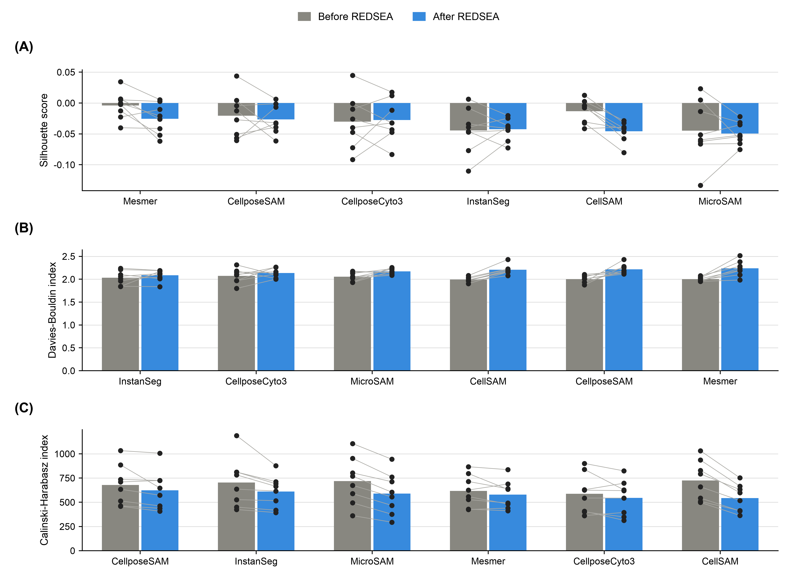

Figure S3. Cluster-quality metrics before and after spillover compensation. (A–C) Silhouette scores, Davies–Bouldin indices and Calinski–Harabasz indices, respectively, calculated in principal component analysis (PCA) space for Mesmer, CellposeCyto3, CellposeSAM, CellSAM, InstanSeg and MicroSAM segmentations. Gray and blue diamonds show the regional means before and after REinforcement Dynamic Spillover EliminAtion (REDSEA) compensation. Points represent imaged tissue regions (n = 8), with lines connecting measurements from the same region. Higher silhouette and Calinski–Harabasz values indicate better cluster separation, whereas lower Davies–Bouldin values indicate better separation. Metrics were calculated from the stored PCA representations and are descriptive. Figure S5 separately reports compensation effects among shared segmentation objects and comparisons of cell-matching rules and clustering workflows. Source data: Duke Research Data Repository record 565 (Availability of Data and Materials).

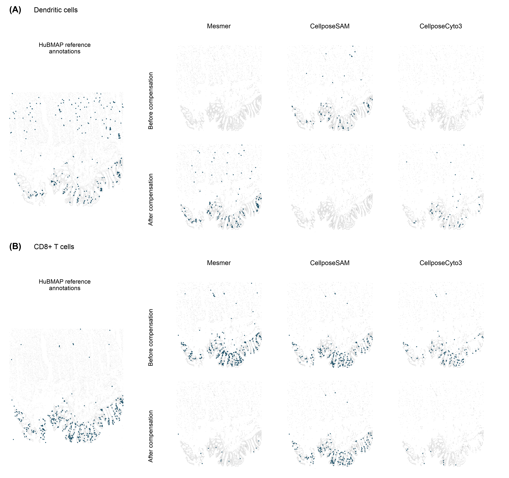

Figure S4. Spatial changes in dendritic-cell and CD8+ T-cell assignments after compensation. Cell-type maps from B004-A-004 compare Human BioMolecular Atlas Program (HuBMAP) reference labels with cluster-derived assignments before and after REinforcement Dynamic Spillover EliminAtion (REDSEA) compensation for Mesmer, CellposeSAM and CellposeCyto3. (A) Dendritic cells. (B) CD8+ T cells. Dark blue marks the specified cell type, and light gray marks all other cells. The maps are representative examples. Source data: Duke Research Data Repository record 565 (Availability of Data and Materials).

**Figure S5 (panels A and B)**

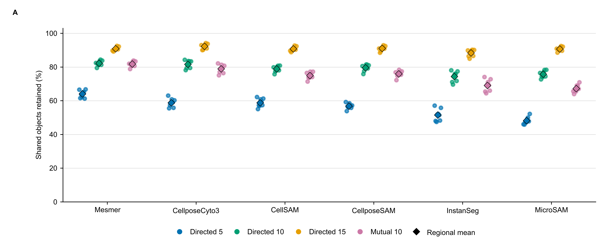

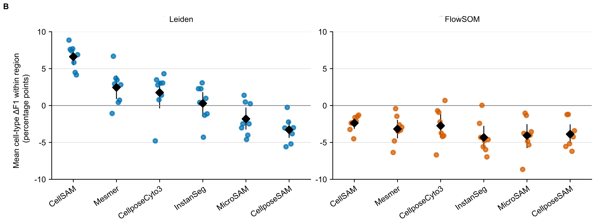

**Figure S5 (continued)**

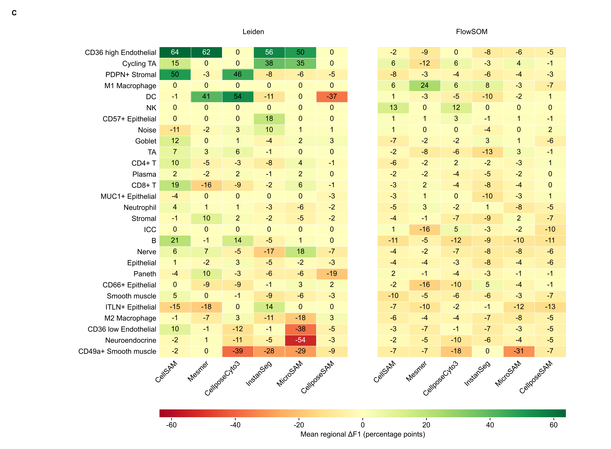

Figure S5. Comparison of cell-matching rules and compensation effects among shared segmentation objects. Results cover six segmentation methods. (A) Percentage retained under directed matching at maximum distances of 5, 10 and 15 source-coordinate units and mutual matching at 10 units. Points represent regions, and diamonds show regional means. (B) Regional mean cell-type F1 changes for processed Leiden and fixed FlowSOM workflows under directed matching at 10 units. Points represent regions, diamonds show regional means, and bars show descriptive 95% regional bootstrap intervals. (C) Mean regional cell-type F1 changes for objects with the same regional CellID, unchanged coordinates and accepted reference matches (Section 2.2). Table S1 reports matching and retention counts. The FlowSOM configuration was fixed across segmentation methods. Changes are after minus before compensation, in percentage points. Distances use each input dataset's coordinates, without a verified common conversion to pixels. Regions are subsamples of B004 and do not establish transfer across donors. F1 is the harmonic mean of precision and recall. Δ means after minus before compensation. CellID is the source cell identifier.

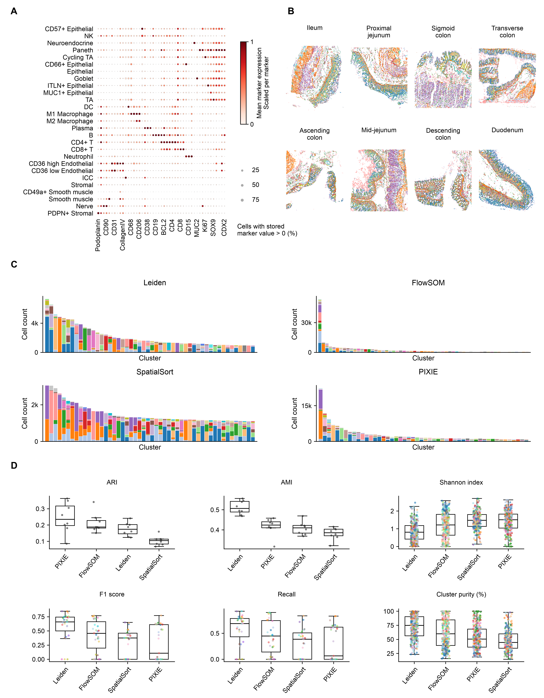

Figure S6. Reference cell types and clustering performance. (A) Stored means and positive fractions for 27 original cell types excluding Noise (209,587 cells), using all 47 protein markers from 45 H5AD X channels plus CD123/CDX2 observation columns without further transformation. Dot size shows positive fractions, not validated marker positivity. Color shows per-marker min–max-scaled means (0–1). (B) Reference cell-type maps across eight regions. (C) Reference-label composition of the 50 largest clusters per method (60 for FlowSOM), ordered by decreasing cell count. (D) Regional adjusted Rand index (ARI) and adjusted mutual information (AMI) (black dots, n = 8), cluster Shannon diversity/purity and cell-type F1 and recall after majority labeling, using 27 original labels excluding Noise versus Figure 2’s original 28-label vocabulary. Lower diversity indicates more homogeneous clusters. Colored points identify cluster-majority reference labels for diversity/purity and reference cell types for F1 and recall. Boxes span interquartile ranges, center lines mark medians, and whiskers reach the most extreme observations within 1.5 times the interquartile range. F1 is the harmonic mean of precision and recall. H5AD is the AnnData file format, and X is its stored expression matrix. Cell-label abbreviations: CD, cluster of differentiation. DC, dendritic cells. ICC, interstitial cells of Cajal. ITLN, intelectin. NK, natural killer cells. PDPN, podoplanin. TA, transit-amplifying cells. Marker symbols refer to measured protein channels, rather than gene-expression measurements.

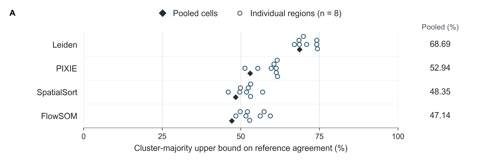

Figure S7. Reference-agreement upper bounds for the primary clustering partitions. (A) Cluster-majority upper bounds under the original 28-label vocabulary, including Noise. Diamonds show upper bounds with labels assigned across pooled regions. Open circles show upper bounds with labels assigned separately in each of the eight regions. Values are percentages. All 220,082 B004 cells are retained, including eight cells without measurable marker signal in a separate PIXIE group. All regions are from donor B004.

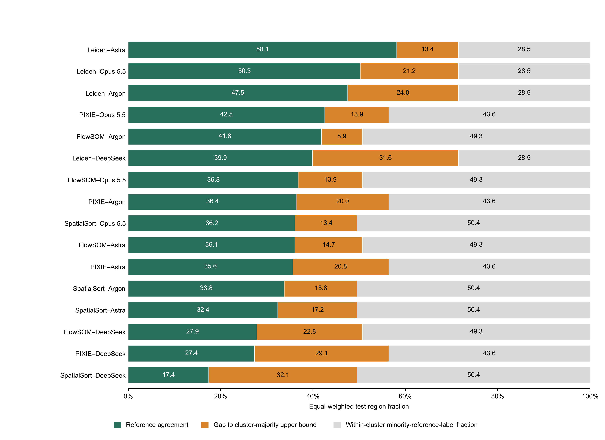

Figure S8. Reference-agreement decomposition across clustering methods and models. Results cover the 16 method–model combinations using all-marker means plus fractions. Within each test region, agreement, the gap to the cluster-majority upper bound and the within-cluster minority-reference-label fraction sum to one. The two regions receive equal weight. Scoring retains the original 28-label vocabulary, including Noise, and numbers within bars are percentages. These arithmetic components do not identify independent biological error mechanisms. Each condition contributes one accepted annotation per cluster. Model names are GPT-6 Astra (Astra), Claude Opus 5.5 (Opus 5.5), Gemini 4 Argon (Argon) and DeepSeek V4.1 Flash 1017 (DeepSeek).

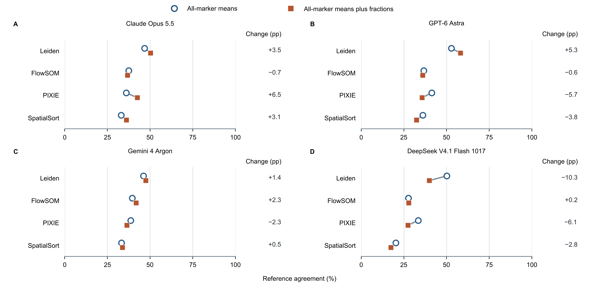

Figure S9. Paired effects of adding positive fractions to all-marker means. (A–D) Results for Claude Opus 5.5, GPT-6 Astra, Gemini 4 Argon and DeepSeek V4.1 Flash 1017, respectively. Points show agreement averaged equally across the two test regions under the original 28-label vocabulary, including Noise. Lines connect the two representations evaluated using the same fixed clustering results. The right-hand column gives the change after adding positive fractions, in percentage points. Each arm contributes one accepted annotation per cluster, with no across-repetition standard deviation or repeatability estimate. Marker means, marker order, anonymous query IDs, label vocabulary and request batch boundaries are identical within each pair. Only the positive-fraction matrix is added.

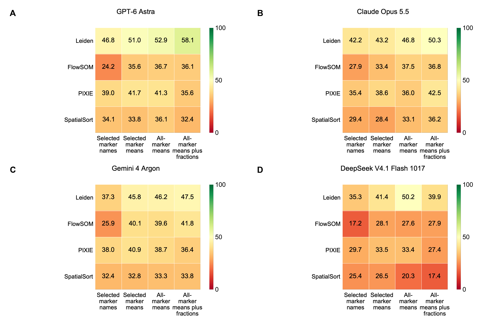

Figure S10. LLM input-representation controls using fixed B004 clustering results. (A–D) Reference agreement for GPT-6 Astra, Claude Opus 5.5, Gemini 4 Argon and DeepSeek V4.1 Flash 1017, respectively, averaged equally across the two test regions. Rows identify clustering methods in the Figure 3C order. Columns compare selected marker names, selected marker means, all-marker means and all-marker means plus fractions. Up to six markers per cluster were selected without cell- or cluster-specific reference assignments, while the full representations retain all 47 markers. Each condition contributes one accepted annotation per cluster under the original 28-label vocabulary, including Noise. All 64 representation conditions delivered every planned prediction. Tables S8a–S8d report reference agreement and macro-F1. F1 is the harmonic mean of precision and recall. Macro-F1 is the unweighted mean of the class-specific F1 scores.

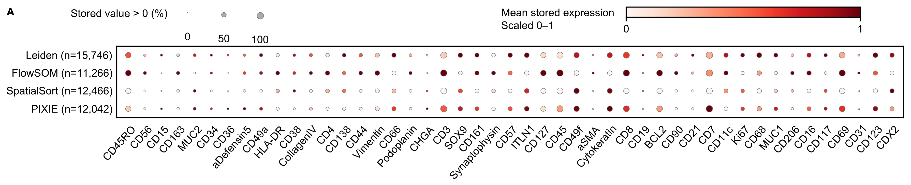

Figure S11. Marker-expression profiles of model-annotated CD8+ T groups. (A) Profiles of cells in clusters assigned CD8+ T by a cross-model summary. Each cluster receives its most frequent label across Astra, Opus 5.5, Argon and DeepSeek, with ties resolved in that order without reference assignments. Each model contributes one accepted prediction per cluster. All 47 stored marker channels are shown, including CD123 and CDX2. Dot color represents mean stored processed expression, min–max scaled independently by marker across the four method groups, without further transformation. Dot size represents the fraction of strictly positive processed values. These fractions are not validated measures of biological marker positivity. Profiles reflect combined clustering and annotation assignments and neither independently validate labels nor measure repeated-call consistency. Model names are GPT-6 Astra (Astra), Claude Opus 5.5 (Opus 5.5), Gemini 4 Argon (Argon) and DeepSeek V4.1 Flash 1017 (DeepSeek). n is the number of cells in each displayed method group. Marker symbols refer to measured protein channels, rather than gene-expression measurements.

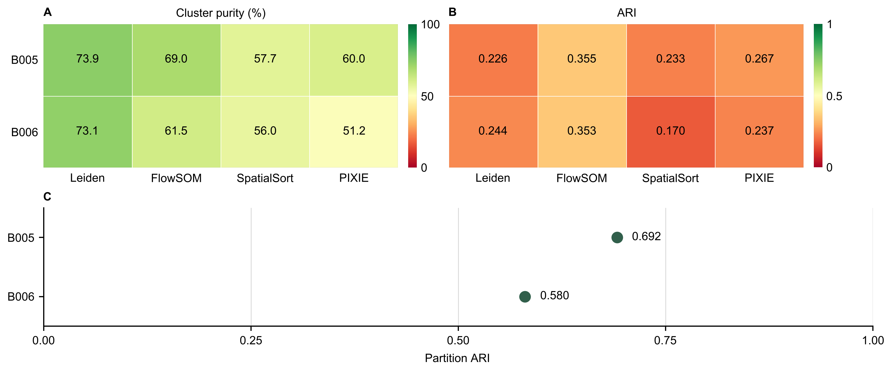

Figure S12. Fixed cross-donor clustering results and SpatialSort comparisons across random seeds. (A,B) Purity and adjusted Rand index (ARI), respectively, against the original 28-label vocabulary, including Noise. Each donor's eight regions receive equal weight. Table S14a reports whole-donor cell counts and nonempty-cluster counts. (C) Global common-cell partition ARI between SpatialSort seeds 42 and 43 within each donor, using 50 actual sweeps and a double Metropolis–Hastings (DMH) iteration count of 5. Seed 42 supplies the primary partition. Seed 43 is used only to compare clustering results across random seeds, without separate annotation calls. This comparison does not establish convergence.

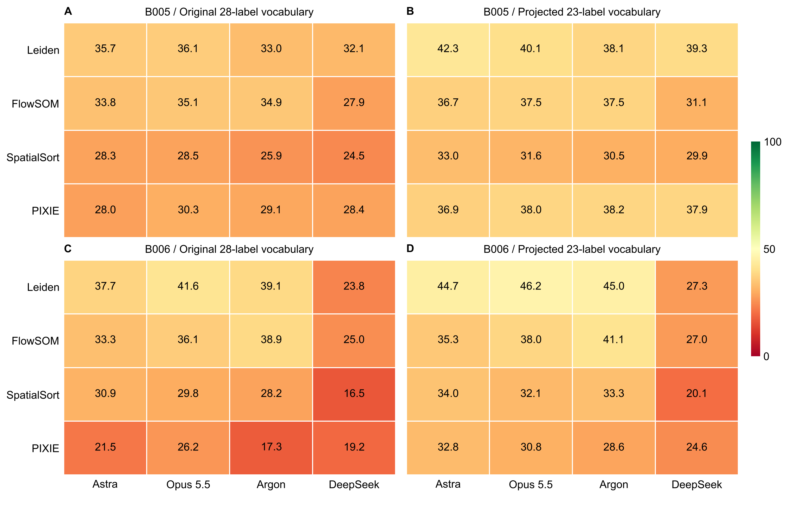

Figure S13. Evaluation using the original 28-label and projected 23-label vocabularies. (A,B) Agreement using the original 28-label vocabulary and the projected 23-label vocabulary in B005. (C,D) The corresponding comparison in B006. Each panel averages eight regions equally. Both vocabularies are evaluated on the same reference-eligible cells. The fixed reference-only mask excludes ITLN+ Epithelial, Noise and PDPN+ Stromal cells, retaining 270,216 cells in B005 and 285,973 in B006. Predictions outside the projected vocabulary remain errors. The comparison reuses the same accepted predictions generated under the original 28-label vocabulary, without additional annotation calls or prediction-dependent exclusions. Tables S15a–S15b report projected-vocabulary coverage. ITLN stands for intelectin, and PDPN stands for podoplanin. Model names are GPT-6 Astra (Astra), Claude Opus 5.5 (Opus 5.5), Gemini 4 Argon (Argon) and DeepSeek V4.1 Flash 1017 (DeepSeek).

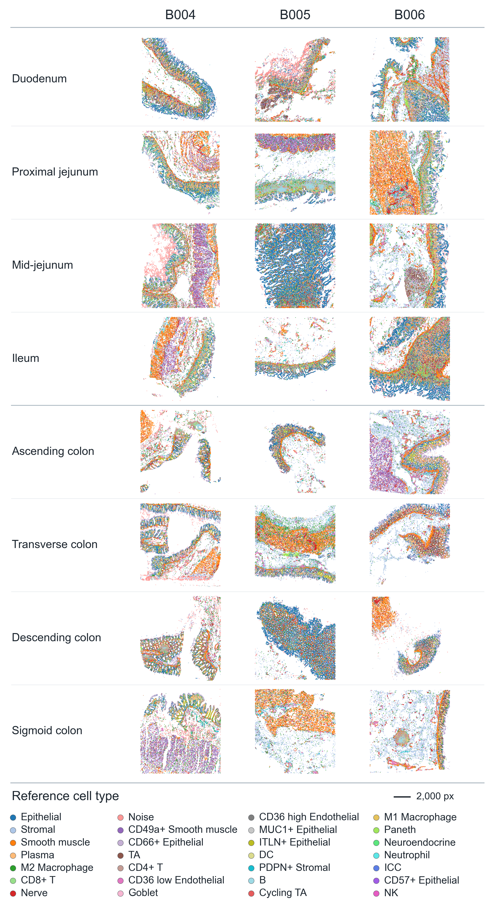

Figure S14. Spatial distribution of reference-labeled cells across the 24 study regions. Columns show B004, B005 and B006, and rows align the eight anatomical sites. Each dot represents one benchmark cell at its tissue coordinates. Colors show the dataset reference cell-type annotations, including Noise. All panels use the same spatial scale. The scale bar represents 2,000 pixels in the source images.

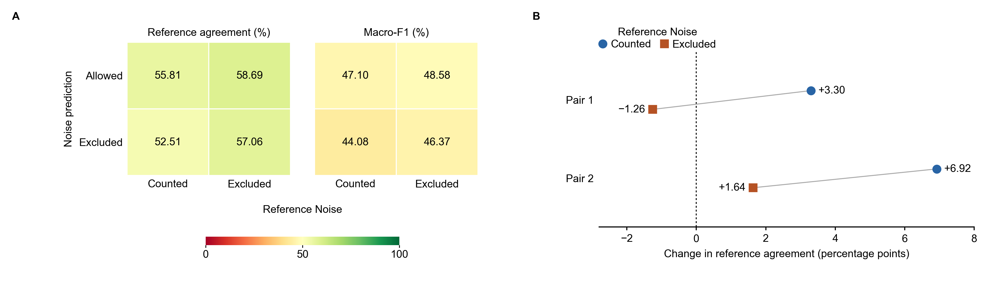

Figure S15. Noise sensitivity of B004 Leiden annotation. (A) Reference agreement and macro-F1 from four OpenAI Batch calls using GPT-6.2 Astra at maximum reasoning, one per condition. (B) Change in agreement when Noise was an eligible prediction. Pairs 1 and 2 use the calls from the counted and excluded columns of A, respectively. Both pairs were scored under both reference policies. Scores equally weight transverse colon and mid-jejunum. Counting reference Noise retains 69,576 cells and uses 28 labels for macro-F1. Excluding it retains 63,862 cells and uses 27 labels.

### TABLE S1

REDSEA MATCHING AND CELL RETENTION AUDIT

| Segmentation method | Processed before / after | Matched before / after | Shared IDs, fixed coordinates | Before-only IDs | After-only IDs |
| --- | --- | --- | --- | --- | --- |
| Mesmer | 162,439 / 161,867 | 133,665 / 133,266 | 161,656 | 783 | 211 |
| CellposeCyto3 | 145,925 / 145,270 | 118,668 / 118,104 | 145,011 | 914 | 259 |
| CellposeSAM | 173,783 / 172,465 | 137,808 / 136,927 | 172,169 | 1,614 | 296 |
| CellSAM | 195,752 / 194,832 | 154,163 / 153,385 | 194,071 | 1,681 | 761 |
| InstanSeg | 198,959 / 196,717 | 146,477 / 144,996 | 195,459 | 3,500 | 1,258 |
| MicroSAM | 197,314 / 197,400 | 149,626 / 149,080 | 196,124 | 1,190 | 1,276 |

Counts are pooled across the eight B004 regions. Processed counts refer to segmentation objects retained in the processed H5ADs. Matched counts include objects accepted by directed nearest-neighbor matching within 10 source-coordinate units after swapping the reference x and y coordinates. Multiple segmentation objects could match the same reference cell. Shared objects had the same CellID within a region and unchanged coordinates. Before-only and after-only counts were based on CellID, not saved row indices. Paired F1 evaluation also required an accepted match to the same reference cell and label in both conditions, so the shared-ID column is not its final scoring denominator. These counts describe retention and matching, not segmentation-boundary accuracy.

### TABLE S2A

CLUSTERING CONFIGURATIONS AND HYPERPARAMETERS

| Field | Leiden | FlowSOM | SpatialSort | PIXIE |
| --- | --- | --- | --- | --- |
| Clustering inputs | 47 marker-expression features | 47 marker-expression features | 47 marker-expression features, cell coordinates and a within-region 24-neighbor graph | 48 image channels and cell masks |
| Transform | arcsinh(x/5) | arcsinh(x/5) | arcsinh(x/5) | Pixel and cell composition pipeline |
| Scaling | StandardScaler within each region | RobustScaler on all B004 cells | RobustScaler on all B004 cells | Channel and composition normalization |
| Configured and nonempty clusters | 300 and 300 | 300 requested and 299 nonempty | 300 requested. 229 nonempty in the primary chain and 231 in the seed-43 comparison chain | 300 and 300 |
| Implementation | K320 local Leiden with 20 within-parent merges | 32×32 self-organizing map followed by Ward clustering | 24 neighbors and precision 0.65 | 10×10 pixel map and 24×24 cell map |
| Sigma and learning rate | See Leiden procedure in Section 2.3 | 1.0 and 0.3 | Not applicable | Pixel 5.0 and 0.05. Cell 2.0 and 0.3 |
| Iterations | See Leiden procedure in Section 2.3 | 3 whole-cohort passes, giving 660,246 updates | 100 actual sweeps per chain with dmh_iter=5 | One pixel pass and 5,000 cell iterations |
| Seed | 42 | 42 | Sampling seeds 42 (primary) and 43 (comparison) | 42 |

Leiden, FlowSOM and SpatialSort used 47 protein markers. PIXIE selected 47 protein channels and Hoechst1 DNA signal from the 59 available image channels, then converted pixel-cluster assignments into vectors of pixel-metacluster fractions. Pixel-level and cell-level configurations are reported separately for PIXIE.

### TABLE S6a

PAIRED REFERENCE AGREEMENT

| Clustering method | Model | All-marker means (%) | All-marker means plus fractions (%) | Paired change (pp) |
| --- | --- | --- | --- | --- |
| Leiden | GPT-6 Astra | 52.86 | 58.12 | +5.26 |
| FlowSOM | GPT-6 Astra | 36.66 | 36.05 | -0.61 |
| SpatialSort | GPT-6 Astra | 36.13 | 32.38 | -3.75 |
| PIXIE | GPT-6 Astra | 41.32 | 35.64 | -5.68 |
| Leiden | Claude Opus 5.5 | 46.78 | 50.27 | +3.49 |
| FlowSOM | Claude Opus 5.5 | 37.48 | 36.82 | -0.66 |
| SpatialSort | Claude Opus 5.5 | 33.11 | 36.17 | +3.06 |
| PIXIE | Claude Opus 5.5 | 36.04 | 42.54 | +6.50 |
| Leiden | Gemini 4 Argon | 46.16 | 47.51 | +1.35 |
| FlowSOM | Gemini 4 Argon | 39.57 | 41.84 | +2.27 |
| SpatialSort | Gemini 4 Argon | 33.31 | 33.80 | +0.49 |
| PIXIE | Gemini 4 Argon | 38.70 | 36.40 | -2.30 |
| Leiden | DeepSeek V4.1 Flash 1017 | 50.17 | 39.92 | -10.25 |
| FlowSOM | DeepSeek V4.1 Flash 1017 | 27.62 | 27.87 | +0.24 |
| SpatialSort | DeepSeek V4.1 Flash 1017 | 20.25 | 17.42 | -2.83 |
| PIXIE | DeepSeek V4.1 Flash 1017 | 33.42 | 27.35 | -6.07 |

Means are the transformed and standardized cluster-level marker-expression means defined in Section 2.4. Positive fractions are the per-marker proportions of cells with positive processed expression. Values are single-run outcomes averaged equally across the two B004 test regions. Paired changes subtract agreement using all-marker means from agreement using all-marker means plus fractions, in percentage points (pp). Missing or invalid predictions remain errors in the full planned denominator. All planned predictions were delivered; paired changes therefore reflect changes between valid labels.

### TABLE S6d

MODEL IDENTITIES AND INFERENCE SETTINGS

| Model | Requested model ID | Transport | Reasoning | Decoding fields sent |
| --- | --- | --- | --- | --- |
| GPT-6 Astra | gpt-6-astra, openai/gpt-6-astra | Batch | high | Combined output ceiling 32,768, seed 42, temperature/top-p omitted |
| Claude Opus 5.5 | anthropic/claude-opus-5.5 | Batch | high | Combined output ceiling 32,768, seed omitted, temperature/top-p omitted |
| Gemini 4 Argon | google/gemini-4-argon | Standard streaming | high | Combined output ceiling 943,718, seed 42, temperature/top-p omitted |
| DeepSeek V4.1 Flash 1017 | deepseek/deepseek-v4.1-flash-1017 | Standard streaming and Batch | high | Combined output ceiling 943,718, seed omitted, temperature/top-p omitted |

Requests used supported high-reasoning settings, no tools or retrieval, at most 75 clusters per item, and no automatic model or provider fallback. Table S6d reports requested model identities, transport, supported seeds and combined output ceilings. Execution records preserve native OpenAI and OpenRouter bindings, routes, attempt status, usage and confirmed charges for each physical generation. Requests and recoveries are linked to prompt, parser and source hashes. Requested output ceilings are distinct from observed token use, and recoveries do not provide independent repetitions.

### TABLE S8a

GPT-6 ASTRA MARKER-REPRESENTATION COMPARISON

| Clustering method | Input | Agreement (%) | Macro-F1 |
| --- | --- | --- | --- |
| Leiden | Selected marker names | 46.76 | 0.3948 |
| Leiden | Selected marker means | 51.03 | 0.4511 |
| Leiden | All-marker means | 52.86 | 0.4582 |
| Leiden | All-marker means plus fractions | 58.12 | 0.4490 |
| FlowSOM | Selected marker names | 24.23 | 0.2338 |
| FlowSOM | Selected marker means | 35.60 | 0.2827 |
| FlowSOM | All-marker means | 36.66 | 0.3028 |
| FlowSOM | All-marker means plus fractions | 36.05 | 0.2713 |
| SpatialSort | Selected marker names | 34.11 | 0.2026 |
| SpatialSort | Selected marker means | 33.77 | 0.2121 |
| SpatialSort | All-marker means | 36.13 | 0.2152 |
| SpatialSort | All-marker means plus fractions | 32.38 | 0.2074 |
| PIXIE | Selected marker names | 39.04 | 0.2543 |
| PIXIE | Selected marker means | 41.69 | 0.2817 |
| PIXIE | All-marker means | 41.32 | 0.2777 |
| PIXIE | All-marker means plus fractions | 35.64 | 0.2553 |

Means are the transformed and standardized cluster-level marker-expression means defined in Section 2.4. Positive fractions are the per-marker proportions of cells with positive processed expression. Reference agreement and macro-F1 calculated using the original 28-label vocabulary average the two B004 test regions equally. All planned cluster predictions were delivered. Each condition has one accepted annotation per cluster.

### TABLE S8b

CLAUDE OPUS 5.5 MARKER-REPRESENTATION COMPARISON

| Clustering method | Input | Agreement (%) | Macro-F1 |
| --- | --- | --- | --- |
| Leiden | Selected marker names | 42.16 | 0.3437 |
| Leiden | Selected marker means | 43.23 | 0.3654 |
| Leiden | All-marker means | 46.78 | 0.3842 |
| Leiden | All-marker means plus fractions | 50.27 | 0.4165 |
| FlowSOM | Selected marker names | 27.91 | 0.2414 |
| FlowSOM | Selected marker means | 33.42 | 0.2739 |
| FlowSOM | All-marker means | 37.48 | 0.2884 |
| FlowSOM | All-marker means plus fractions | 36.82 | 0.2999 |
| SpatialSort | Selected marker names | 29.36 | 0.1915 |
| SpatialSort | Selected marker means | 28.40 | 0.1897 |
| SpatialSort | All-marker means | 33.11 | 0.1966 |
| SpatialSort | All-marker means plus fractions | 36.17 | 0.2226 |
| PIXIE | Selected marker names | 35.41 | 0.2458 |
| PIXIE | Selected marker means | 38.61 | 0.2610 |
| PIXIE | All-marker means | 36.04 | 0.2527 |
| PIXIE | All-marker means plus fractions | 42.54 | 0.2751 |

Means are the transformed and standardized cluster-level marker-expression means defined in Section 2.4. Positive fractions are the per-marker proportions of cells with positive processed expression. Reference agreement and macro-F1 calculated using the original 28-label vocabulary average the two B004 test regions equally. All planned cluster predictions were delivered. Each condition has one accepted annotation per cluster.

### TABLE S8c

GEMINI 4 ARGON MARKER-REPRESENTATION COMPARISON

| Clustering method | Input | Agreement (%) | Macro-F1 |
| --- | --- | --- | --- |
| Leiden | Selected marker names | 37.33 | 0.3233 |
| Leiden | Selected marker means | 45.76 | 0.4075 |
| Leiden | All-marker means | 46.16 | 0.4073 |
| Leiden | All-marker means plus fractions | 47.51 | 0.4133 |
| FlowSOM | Selected marker names | 25.91 | 0.2299 |
| FlowSOM | Selected marker means | 40.09 | 0.2946 |
| FlowSOM | All-marker means | 39.57 | 0.3189 |
| FlowSOM | All-marker means plus fractions | 41.84 | 0.2917 |
| SpatialSort | Selected marker names | 32.39 | 0.2060 |
| SpatialSort | Selected marker means | 32.78 | 0.2007 |
| SpatialSort | All-marker means | 33.31 | 0.2090 |
| SpatialSort | All-marker means plus fractions | 33.80 | 0.2154 |
| PIXIE | Selected marker names | 37.96 | 0.2566 |
| PIXIE | Selected marker means | 40.93 | 0.2737 |
| PIXIE | All-marker means | 38.70 | 0.2689 |
| PIXIE | All-marker means plus fractions | 36.40 | 0.2619 |

Means are the transformed and standardized cluster-level marker-expression means defined in Section 2.4. Positive fractions are the per-marker proportions of cells with positive processed expression. Reference agreement and macro-F1 calculated using the original 28-label vocabulary average the two B004 test regions equally. All planned cluster predictions were delivered. Each condition has one accepted annotation per cluster.

### TABLE S8d

DEEPSEEK V4.1 FLASH 1017 MARKER-REPRESENTATION COMPARISON

| Clustering method | Input | Agreement (%) | Macro-F1 |
| --- | --- | --- | --- |
| Leiden | Selected marker names | 35.28 | 0.3083 |
| Leiden | Selected marker means | 41.42 | 0.3576 |
| Leiden | All-marker means | 50.17 | 0.4084 |
| Leiden | All-marker means plus fractions | 39.92 | 0.2974 |
| FlowSOM | Selected marker names | 17.24 | 0.1681 |
| FlowSOM | Selected marker means | 28.13 | 0.2495 |
| FlowSOM | All-marker means | 27.62 | 0.2373 |
| FlowSOM | All-marker means plus fractions | 27.87 | 0.2196 |
| SpatialSort | Selected marker names | 25.45 | 0.1623 |
| SpatialSort | Selected marker means | 26.53 | 0.1748 |
| SpatialSort | All-marker means | 20.25 | 0.1230 |
| SpatialSort | All-marker means plus fractions | 17.42 | 0.1145 |
| PIXIE | Selected marker names | 29.74 | 0.2080 |
| PIXIE | Selected marker means | 33.54 | 0.2446 |
| PIXIE | All-marker means | 33.42 | 0.1895 |
| PIXIE | All-marker means plus fractions | 27.35 | 0.1660 |

Means are the transformed and standardized cluster-level marker-expression means defined in Section 2.4. Positive fractions are the per-marker proportions of cells with positive processed expression. Reference agreement and macro-F1 calculated using the original 28-label vocabulary average the two B004 test regions equally. All planned cluster predictions were delivered. Each condition has one accepted annotation per cluster.

### TABLE S9

LLM MATCHED-EVIDENCE PROMPT CONTROLS

| Clustering method–LLM | Control | Blinded (%) | Control (%) | Change (pp) | Changed clusters |
| --- | --- | --- | --- | --- | --- |
| Leiden–Opus 5.5 | Method name | 50.27 | 45.15 | -5.12 | 75 |
| FlowSOM–Opus 5.5 | Method name | 36.82 | 34.00 | -2.83 | 50 |
| SpatialSort–Opus 5.5 | Method name | 36.17 | 31.11 | -5.06 | 53 |
| PIXIE–Opus 5.5 | Method name | 42.54 | 40.00 | -2.54 | 51 |
| Leiden–Opus 5.5 | Neighborhood | 50.27 | 45.97 | -4.29 | 63 |
| Leiden–Astra | Method name | 58.12 | 53.53 | -4.59 | 40 |
| Leiden–Astra | Neighborhood | 58.12 | 51.43 | -6.69 | 39 |

Each comparison reuses its blinded baseline containing all-marker means plus fractions. Reference agreement averages the two B004 test regions equally. Changed-cluster counts use all planned clusters. Astra macro-F1 calculated using the original 28-label vocabulary was 0.4490 for the baseline, 0.4458 with the method name and 0.4531 with neighborhood-expression summaries. Astra controls used native OpenAI Batch and reused the OpenRouter Batch baseline. These single-generation comparisons do not establish repeatability or a general prompt effect. Opus 5.5 is Claude Opus 5.5, and Astra is GPT-6 Astra.

### TABLE S10

CONVENTIONAL B004 ANNOTATION CLASSIFIERS

| Clustering method | Classifier | Input | Agreement (%) | Macro-F1 |
| --- | --- | --- | --- | --- |
| Leiden | Nearest centroid | All-marker means | 58.20 | 0.4341 |
| Leiden | Nearest centroid | All-marker means plus fractions | 55.74 | 0.4370 |
| Leiden | Logistic regression | All-marker means | 67.05 | 0.4981 |
| Leiden | Logistic regression | All-marker means plus fractions | 68.20 | 0.5030 |
| FlowSOM | Nearest centroid | All-marker means | 35.63 | 0.2745 |
| FlowSOM | Nearest centroid | All-marker means plus fractions | 35.19 | 0.2787 |
| FlowSOM | Logistic regression | All-marker means | 45.69 | 0.3078 |
| FlowSOM | Logistic regression | All-marker means plus fractions | 45.72 | 0.3059 |
| SpatialSort | Nearest centroid | All-marker means | 36.10 | 0.1798 |
| SpatialSort | Nearest centroid | All-marker means plus fractions | 35.26 | 0.1778 |
| SpatialSort | Logistic regression | All-marker means | 44.12 | 0.2165 |
| SpatialSort | Logistic regression | All-marker means plus fractions | 44.09 | 0.2170 |
| PIXIE | Nearest centroid | All-marker means | 46.76 | 0.2551 |
| PIXIE | Nearest centroid | All-marker means plus fractions | 46.96 | 0.2577 |
| PIXIE | Logistic regression | All-marker means | 49.95 | 0.2684 |
| PIXIE | Logistic regression | All-marker means plus fractions | 51.92 | 0.2728 |

Means are the transformed and standardized cluster-level marker-expression means defined in Section 2.4. Positive fractions are the per-marker proportions of cells with positive processed expression. Classifiers used cell-level reference labels from the B004 training regions, providing richer supervision than the LLM prompts. Hyperparameters were selected in the validation regions. Metrics average the two test regions equally. Macro-F1 calculated using the original 28-label vocabulary assigns zero F1 to absent classes.

### TABLE S11

EFFECT OF MERGING EXISTING B004 CLUSTERS

| Clustering method | Nonempty clusters | Purity | ARI | NMI |
| --- | --- | --- | --- | --- |
| Leiden | 100 | 0.6792 | 0.3168 | 0.5485 |
| Leiden | 200 | 0.7036 | 0.2760 | 0.5363 |
| Leiden | 300 | 0.7149 | 0.1765 | 0.5224 |
| FlowSOM | 100 | 0.4958 | 0.1837 | 0.4040 |
| FlowSOM | 200 | 0.5035 | 0.1806 | 0.3999 |
| FlowSOM | 299 | 0.5071 | 0.1807 | 0.3997 |
| SpatialSort | 100 | 0.4758 | 0.2466 | 0.3964 |
| SpatialSort | 200 | 0.4910 | 0.1750 | 0.3953 |
| SpatialSort | 229 | 0.4955 | 0.1105 | 0.3841 |
| PIXIE | 100 | 0.5554 | 0.2200 | 0.4214 |
| PIXIE | 200 | 0.5609 | 0.2122 | 0.4115 |
| PIXIE | 300 | 0.5641 | 0.2093 | 0.4085 |

K100 and K200 were formed by cell-count-weighted Ward merging of frozen, full-precision cluster profiles, with merge mappings fixed before reference scoring. They do not represent clustering rerun at those target counts or tests of whether LLM rankings remain stable. Metrics average the two test regions equally.

### TABLE S12a

GPT-6 ASTRA CROSS-MODEL SUPPORT CALIBRATION

| Clustering method | Score | Brier | Log loss | ECE |
| --- | --- | --- | --- | --- |
| Leiden | Raw cross-model support | 0.2928 | 4.3298 | 0.2111 |
| Leiden | Logistic recalibration | 0.2577 | 0.7166 | 0.1295 |
| Leiden | Development constant | 0.2545 | 0.7022 | 0.1023 |
| FlowSOM | Raw cross-model support | 0.3348 | 4.8255 | 0.2953 |
| FlowSOM | Logistic recalibration | 0.2670 | 0.7331 | 0.1717 |
| FlowSOM | Development constant | 0.2634 | 0.7228 | 0.1325 |
| SpatialSort | Raw cross-model support | 0.3559 | 4.7292 | 0.3305 |
| SpatialSort | Logistic recalibration | 0.2191 | 0.6304 | 0.0803 |
| SpatialSort | Development constant | 0.2253 | 0.6440 | 0.0585 |
| PIXIE | Raw cross-model support | 0.3116 | 4.1445 | 0.3292 |
| PIXIE | Logistic recalibration | 0.1987 | 0.5694 | 0.1020 |
| PIXIE | Development constant | 0.2264 | 0.6453 | 0.1408 |

ECE is expected calibration error. Lower scores are better. Metrics give equal weight to the two test regions and use only evaluation clusters held out by the cluster-hash split, rather than the full benchmark population. Development and evaluation use nonoverlapping clusters and regions. Cross-model support has a denominator of four. This retrospective within-donor calibration measures reference agreement, not repeatability, an individual model’s confidence or biological certainty.

### TABLE S12b

CLAUDE OPUS 5.5 CROSS-MODEL SUPPORT CALIBRATION

| Clustering method | Score | Brier | Log loss | ECE |
| --- | --- | --- | --- | --- |
| Leiden | Raw cross-model support | 0.2797 | 4.3007 | 0.2420 |
| Leiden | Logistic recalibration | 0.2223 | 0.6364 | 0.0912 |
| Leiden | Development constant | 0.2523 | 0.6978 | 0.0486 |
| FlowSOM | Raw cross-model support | 0.2992 | 4.7481 | 0.3038 |
| FlowSOM | Logistic recalibration | 0.2258 | 0.6436 | 0.1710 |
| FlowSOM | Development constant | 0.2284 | 0.6492 | 0.0866 |
| SpatialSort | Raw cross-model support | 0.3934 | 4.8111 | 0.3665 |
| SpatialSort | Logistic recalibration | 0.2356 | 0.6648 | 0.0724 |
| SpatialSort | Development constant | 0.2356 | 0.6647 | 0.0518 |
| PIXIE | Raw cross-model support | 0.3471 | 4.2212 | 0.3536 |
| PIXIE | Logistic recalibration | 0.2394 | 0.6719 | 0.1677 |
| PIXIE | Development constant | 0.2426 | 0.6783 | 0.1222 |

ECE is expected calibration error. Lower scores are better. Metrics give equal weight to the two test regions and use only evaluation clusters held out by the cluster-hash split, rather than the full benchmark population. Development and evaluation use nonoverlapping clusters and regions. Cross-model support has a denominator of four. This retrospective within-donor calibration measures reference agreement, not repeatability, an individual model’s confidence or biological certainty.

### TABLE S12c

GEMINI 4 ARGON CROSS-MODEL SUPPORT CALIBRATION

| Clustering method | Score | Brier | Log loss | ECE |
| --- | --- | --- | --- | --- |
| Leiden | Raw cross-model support | 0.2671 | 4.2733 | 0.2420 |
| Leiden | Logistic recalibration | 0.2095 | 0.6089 | 0.0949 |
| Leiden | Development constant | 0.2523 | 0.6977 | 0.0662 |
| FlowSOM | Raw cross-model support | 0.3072 | 4.7653 | 0.2720 |
| FlowSOM | Logistic recalibration | 0.2877 | 0.7786 | 0.2710 |
| FlowSOM | Development constant | 0.2799 | 0.7578 | 0.1734 |
| SpatialSort | Raw cross-model support | 0.3865 | 4.7954 | 0.3571 |
| SpatialSort | Logistic recalibration | 0.2342 | 0.6669 | 0.0850 |
| SpatialSort | Development constant | 0.2343 | 0.6633 | 0.0772 |
| PIXIE | Raw cross-model support | 0.3558 | 4.2403 | 0.3847 |
| PIXIE | Logistic recalibration | 0.2197 | 0.6310 | 0.1469 |
| PIXIE | Development constant | 0.2340 | 0.6610 | 0.1345 |

ECE is expected calibration error. Lower scores are better. Metrics give equal weight to the two test regions and use only evaluation clusters held out by the cluster-hash split, rather than the full benchmark population. Development and evaluation use nonoverlapping clusters and regions. Cross-model support has a denominator of four. This retrospective within-donor calibration measures reference agreement, not repeatability, an individual model’s confidence or biological certainty.

### TABLE S12d

DEEPSEEK V4.1 FLASH 1017 CROSS-MODEL SUPPORT CALIBRATION

| Clustering method | Score | Brier | Log loss | ECE |
| --- | --- | --- | --- | --- |
| Leiden | Raw cross-model support | 0.2487 | 4.2329 | 0.2864 |
| Leiden | Logistic recalibration | 0.1746 | 0.5212 | 0.0805 |
| Leiden | Development constant | 0.2422 | 0.6777 | 0.0489 |
| FlowSOM | Raw cross-model support | 0.2616 | 4.6661 | 0.3529 |
| FlowSOM | Logistic recalibration | 0.1414 | 0.4324 | 0.1335 |
| FlowSOM | Development constant | 0.1779 | 0.5413 | 0.1404 |
| SpatialSort | Raw cross-model support | 0.2862 | 4.5765 | 0.3666 |
| SpatialSort | Logistic recalibration | 0.1232 | 0.3888 | 0.0398 |
| SpatialSort | Development constant | 0.1494 | 0.4758 | 0.0213 |
| PIXIE | Raw cross-model support | 0.2466 | 4.0019 | 0.2991 |
| PIXIE | Logistic recalibration | 0.1314 | 0.4155 | 0.0484 |
| PIXIE | Development constant | 0.1689 | 0.5237 | 0.1019 |

ECE is expected calibration error. Lower scores are better. Metrics give equal weight to the two test regions and use only evaluation clusters held out by the cluster-hash split, rather than the full benchmark population. Development and evaluation use nonoverlapping clusters and regions. Cross-model support has a denominator of four. This retrospective within-donor calibration measures reference agreement, not repeatability, an individual model’s confidence or biological certainty.

### TABLE S13a

B005 DONOR ANNOTATION

| Clustering method | Model | Agreement (%) | Macro-F1 |
| --- | --- | --- | --- |
| Leiden | Astra | 34.22 | 0.3095 |
| Leiden | Opus 5.5 | 35.37 | 0.2990 |
| Leiden | Argon | 32.80 | 0.3041 |
| Leiden | DeepSeek | 32.03 | 0.2865 |
| FlowSOM | Astra | 36.00 | 0.3626 |
| FlowSOM | Opus 5.5 | 36.39 | 0.3558 |
| FlowSOM | Argon | 37.07 | 0.3758 |
| FlowSOM | DeepSeek | 30.35 | 0.3061 |
| SpatialSort | Astra | 27.71 | 0.1976 |
| SpatialSort | Opus 5.5 | 28.15 | 0.2009 |
| SpatialSort | Argon | 25.55 | 0.1940 |
| SpatialSort | DeepSeek | 25.18 | 0.1630 |
| PIXIE | Astra | 27.06 | 0.1782 |
| PIXIE | Opus 5.5 | 29.15 | 0.1802 |
| PIXIE | Argon | 27.75 | 0.1773 |
| PIXIE | DeepSeek | 27.64 | 0.1705 |

Agreement and macro-F1 average the donor's eight regions equally. Cell- and cluster-level prediction coverage was 100% in all conditions. The original 28-label vocabulary includes Noise (code 21). Missing or invalid predictions remain errors in the fixed planned denominator and are distinct from valid Noise predictions. One annotation was planned per cluster and condition, with accepted outputs scored where available. No uncertainty from repeated generations is estimated.

### TABLE S13b

B006 DONOR ANNOTATION

| Clustering method | Model | Agreement (%) | Macro-F1 |
| --- | --- | --- | --- |
| Leiden | Astra | 37.51 | 0.2955 |
| Leiden | Opus 5.5 | 41.77 | 0.3344 |
| Leiden | Argon | 38.74 | 0.2962 |
| Leiden | DeepSeek | 24.56 | 0.1959 |
| FlowSOM | Astra | 32.91 | 0.2586 |
| FlowSOM | Opus 5.5 | 35.67 | 0.2834 |
| FlowSOM | Argon | 38.12 | 0.2736 |
| FlowSOM | DeepSeek | 25.69 | 0.2284 |
| SpatialSort | Astra | 30.69 | 0.1887 |
| SpatialSort | Opus 5.5 | 29.70 | 0.1918 |
| SpatialSort | Argon | 28.17 | 0.1871 |
| SpatialSort | DeepSeek | 17.09 | 0.1196 |
| PIXIE | Astra | 22.29 | 0.1205 |
| PIXIE | Opus 5.5 | 26.77 | 0.1283 |
| PIXIE | Argon | 18.28 | 0.1116 |
| PIXIE | DeepSeek | 18.38 | 0.0989 |

Agreement and macro-F1 average the donor's eight regions equally. Cell- and cluster-level prediction coverage was 100% in all conditions. The original 28-label vocabulary includes Noise (code 21). Missing or invalid predictions remain errors in the fixed planned denominator and are distinct from valid Noise predictions. One annotation was planned per cluster and condition, with accepted outputs scored where available. No uncertainty from repeated generations is estimated.

### TABLE S14a

FROZEN DONOR CLUSTERING

| Donor | Clustering method | Cells | Clusters | Purity | ARI | NMI |
| --- | --- | --- | --- | --- | --- | --- |
| B005 | Leiden | 288,188 | 300 | 0.7392 | 0.2261 | 0.5209 |
| B005 | FlowSOM | 288,188 | 299 | 0.6896 | 0.3555 | 0.5292 |
| B005 | SpatialSort | 288,188 | 298 | 0.5773 | 0.2329 | 0.4277 |
| B005 | PIXIE | 288,188 | 300 | 0.5999 | 0.2673 | 0.4094 |
| B006 | Leiden | 301,280 | 300 | 0.7309 | 0.2436 | 0.5362 |
| B006 | FlowSOM | 301,280 | 300 | 0.6153 | 0.3529 | 0.4750 |
| B006 | SpatialSort | 301,280 | 270 | 0.5600 | 0.1703 | 0.4330 |
| B006 | PIXIE | 301,280 | 300 | 0.5116 | 0.2371 | 0.4106 |

Partitions use frozen method-specific inputs, and annotation profiles contain all 47 protein markers. Clustering is evaluated against the original 28-label vocabulary, including Noise. Purity, adjusted Rand index and normalized mutual information average the eight regions equally. Cell and nonempty-cluster counts cover the whole donor. SpatialSort seed 42 is primary, with 50 sweeps and five DMH iterations per sweep in each donor chain.

### TABLE S14b

SPATIALSORT COMPARISON ACROSS RANDOM SEEDS

| Donor | Cells | Seed 42 clusters | Seed 43 clusters | Partition ARI |
| --- | --- | --- | --- | --- |
| B005 | 288,188 | 298 | 298 | 0.6917 |
| B006 | 301,280 | 270 | 267 | 0.5805 |

Both seeds use the same donor cells, 47-marker source and computational budget of 50 sweeps with five DMH iterations per sweep. Partition ARI compares the two sets of cluster assignments across all common donor cells. Seed 43 is used only to compare clustering results across random seeds, without additional annotation calls or reference-guided seed selection.

### TABLE S15a

B005 EVALUATION USING THE ORIGINAL 28-LABEL AND PROJECTED 23-LABEL VOCABULARIES

| Clustering method | Model | Original 28-label agreement (%) | Projected 23-label agreement (%) | Change (pp) | Original 28-label macro-F1 | Projected 23-label macro-F1 | Projected-vocabulary coverage (%) |
| --- | --- | --- | --- | --- | --- | --- | --- |
| Leiden | Astra | 35.70 | 42.25 | +6.55 | 0.3075 | 0.3881 | 82.34 |
| Leiden | Opus 5.5 | 36.15 | 40.14 | +3.99 | 0.2793 | 0.3400 | 84.20 |
| Leiden | Argon | 33.01 | 38.06 | +5.05 | 0.2890 | 0.3614 | 84.50 |
| Leiden | DeepSeek | 32.11 | 39.31 | +7.20 | 0.2659 | 0.3424 | 79.33 |
| FlowSOM | Astra | 33.78 | 36.74 | +2.96 | 0.3295 | 0.3879 | 63.98 |
| FlowSOM | Opus 5.5 | 35.10 | 37.52 | +2.42 | 0.3273 | 0.3833 | 66.20 |
| FlowSOM | Argon | 34.95 | 37.54 | +2.59 | 0.3411 | 0.4012 | 65.48 |
| FlowSOM | DeepSeek | 27.90 | 31.14 | +3.24 | 0.2788 | 0.3344 | 55.82 |
| SpatialSort | Astra | 28.28 | 32.98 | +4.70 | 0.1838 | 0.2309 | 82.96 |
| SpatialSort | Opus 5.5 | 28.46 | 31.64 | +3.18 | 0.1862 | 0.2282 | 80.76 |
| SpatialSort | Argon | 25.93 | 30.49 | +4.57 | 0.1814 | 0.2267 | 82.96 |
| SpatialSort | DeepSeek | 24.47 | 29.88 | +5.41 | 0.1523 | 0.2025 | 75.94 |
| PIXIE | Astra | 28.05 | 36.91 | +8.86 | 0.1703 | 0.2249 | 93.56 |
| PIXIE | Opus 5.5 | 30.29 | 37.98 | +7.69 | 0.1738 | 0.2276 | 94.79 |
| PIXIE | Argon | 29.06 | 38.21 | +9.15 | 0.1725 | 0.2286 | 88.49 |
| PIXIE | DeepSeek | 28.44 | 37.94 | +9.50 | 0.1649 | 0.2235 | 86.49 |

Both vocabularies use exactly the same reference-eligible cells. The 23-label projection merges or renames the specified classes. Reference ITLN+ Epithelial, Noise and PDPN+ Stromal cells are excluded from the eligibility set. Projected predictions outside the projected 23-label vocabulary remain errors and never remove cells from evaluation. Projected-vocabulary coverage is separate from prediction coverage. Macro-F1 uses the original 28-label or projected 23-label vocabulary. Both vocabularies score the same predictions.

### TABLE S15b

B006 EVALUATION USING THE ORIGINAL 28-LABEL AND PROJECTED 23-LABEL VOCABULARIES

| Clustering method | Model | Original 28-label agreement (%) | Projected 23-label agreement (%) | Change (pp) | Original 28-label macro-F1 | Projected 23-label macro-F1 | Projected-vocabulary coverage (%) |
| --- | --- | --- | --- | --- | --- | --- | --- |
| Leiden | Astra | 37.70 | 44.66 | +6.97 | 0.2661 | 0.3413 | 86.18 |
| Leiden | Opus 5.5 | 41.60 | 46.20 | +4.60 | 0.3012 | 0.3654 | 84.05 |
| Leiden | Argon | 39.06 | 45.03 | +5.97 | 0.2756 | 0.3452 | 84.65 |
| Leiden | DeepSeek | 23.78 | 27.33 | +3.54 | 0.1691 | 0.2217 | 81.58 |
| FlowSOM | Astra | 33.26 | 35.31 | +2.05 | 0.2513 | 0.2960 | 76.52 |
| FlowSOM | Opus 5.5 | 36.13 | 38.02 | +1.89 | 0.2760 | 0.3236 | 76.19 |
| FlowSOM | Argon | 38.88 | 41.13 | +2.25 | 0.2692 | 0.3174 | 77.11 |
| FlowSOM | DeepSeek | 25.03 | 27.02 | +1.99 | 0.2209 | 0.2537 | 55.49 |
| SpatialSort | Astra | 30.87 | 34.00 | +3.13 | 0.1730 | 0.2122 | 85.81 |
| SpatialSort | Opus 5.5 | 29.77 | 32.12 | +2.35 | 0.1782 | 0.2160 | 78.65 |
| SpatialSort | Argon | 28.15 | 33.30 | +5.14 | 0.1726 | 0.2168 | 83.56 |
| SpatialSort | DeepSeek | 16.45 | 20.12 | +3.66 | 0.1078 | 0.1332 | 74.84 |
| PIXIE | Astra | 21.52 | 32.76 | +11.24 | 0.1143 | 0.1625 | 72.02 |
| PIXIE | Opus 5.5 | 26.19 | 30.81 | +4.62 | 0.1226 | 0.1578 | 70.39 |
| PIXIE | Argon | 17.29 | 28.61 | +11.32 | 0.1072 | 0.1542 | 71.26 |
| PIXIE | DeepSeek | 19.16 | 24.62 | +5.46 | 0.0986 | 0.1192 | 93.65 |

Both vocabularies use exactly the same reference-eligible cells. The 23-label projection merges or renames the specified classes. Reference ITLN+ Epithelial, Noise and PDPN+ Stromal cells are excluded from the eligibility set. Projected predictions outside the projected 23-label vocabulary remain errors and never remove cells from evaluation. Projected-vocabulary coverage is separate from prediction coverage. Macro-F1 uses the original 28-label or projected 23-label vocabulary. Both vocabularies score the same predictions.

## Supplementary table file index

The Supplementary Reproducibility Archive and the versioned project repository provide numerical sources, accepted-prediction mappings, execution receipts, and reproducible scoring and figure scripts. Companion tables provide regional, cell-type, cluster, confusion-matrix and complete selective-risk values.

Table S6a: Paired reference agreement. File: [Table_S6a.csv](tables/ieee_reviewer47_20261119/Table_S6a.csv).

Table S6d: Model identities and inference settings. File: [Table_S6d.csv](tables/ieee_reviewer47_20261119/Table_S6d.csv).

Table S7: [conditional_comparisons.csv](../data/frozen/figure2_native28_20261119/conditional_comparisons.csv) and [paired_regional_observations.csv](../data/frozen/figure2_native28_20261119/paired_regional_observations.csv) contain all 12 planned clustering-diagnostic comparisons and their paired regional observations.
