# Evaluation of Clustering Methods and Large Language Models for Spatial Proteomic Cell Type Annotation

Zachary Deutsch¹, Nick Surguladze², Yang Miao¹, John W. Hickey¹*

¹Department of Biomedical Engineering, Duke University, Durham, NC 27708, USA
²Department of Biostatistics and Bioinformatics, Duke University School of Medicine, Durham, NC 27710, USA

*Corresponding author. E-mail: john.hickey@duke.edu

## Abstract

Aims: Spatial proteomics enables cell-type annotation while preserving tissue architecture, but this task remains difficult to scale because performance depends on segmentation, clustering, marker selection, and expert interpretation.

Methods: We benchmarked these components using a healthy human intestine CO-Detection by indEXing (CODEX) dataset comprising 220,082 cells across eight tissue regions from donor B004. Expert reference labels included 10,495 Noise cells, representing cells without a confident cell-type assignment. Four frozen clustering partitions were annotated by four large language models using 47-marker means alone or the same means plus fractions of processed values above zero. The primary annotation endpoint equally weighted two test regions.

Results: Spillover-compensation effects varied across six segmentation methods, tissue regions and cell types, with no consistent improvement across metrics. We compared Leiden, FlowSOM, SpatialSort and PIXIE against reference annotations and evaluated GPT-6 Astra, Claude Opus 5.5, Gemini 4 Argon and DeepSeek V4.1 Flash 1017 for cluster annotation. All 9,024 requested cluster predictions were delivered. With means plus fractions, reference agreement across the 16 method–model combinations ranged from 23.06% to 58.12% in the equally weighted test regions. Adding fractions increased agreement in 9 of 16 comparisons and reduced agreement in 7.

Conclusion: These results show that scalable CODEX annotation is constrained by image processing, cluster composition, marker representation and model interpretation. Automated workflows can reduce manual annotation burden, but supporting-marker review and expert validation remain necessary, particularly for rare cell types and mixed clusters.

## Keywords

Spatial proteomics, multiplexed tissue imaging, cell segmentation, unsupervised clustering, cell-type annotation, large language models

## 1. Introduction

Spatial proteomics technologies such as CO-Detection by indEXing (CODEX) measure dozens of protein markers in situ while preserving tissue architecture [1], [2]. This spatial context supports cell-type identification and analysis of local cellular neighborhoods across healthy human tissues [3]. These capabilities have also supported large-scale atlasing efforts such as the Human BioMolecular Atlas Program (HuBMAP), which is generating reference datasets across the human body [4], [5].

Cell-type annotation requires segmentation, feature extraction, dimensionality reduction, clustering, and marker-based interpretation [2], [6], [7]. Segmentation determines which pixels contribute to each cell’s marker intensities and can affect downstream annotation [2], [7], [8]. Spillover compensation reduces marker-expression contamination between neighboring segmented cells and has improved annotation [9], but its benefit with newer segmentation models remains unclear [7], [10]–[14].

Beyond segmentation, benchmarking work in CODEX has shown that downstream cell-type annotation is sensitive not only to segmentation, but also to normalization and clustering methods [6]. Preprocessing decisions influenced clustering quality as much as or more than the clustering algorithm itself [6]. These findings suggest that preprocessing and clustering should be evaluated together when developing an annotation workflow.

Several clustering methods have been developed for high-dimensional single-cell and multiplexed imaging data, but they are based on different assumptions and have not been compared on CODEX tissues. Graph-based clustering methods such as Leiden are widely used in single-cell analysis because they are efficient and produce well-connected communities in similarity graphs [6], [15]. FlowSOM, developed for cytometry analysis, applies self-organizing maps and metaclustering to group cells by their marker-expression profiles for subsequent cell-type annotation [16], [17]. SpatialSort is a Bayesian model developed specifically for spatial proteomics data that uses spatial neighborhood structure together with marker information and optional prior knowledge to improve clustering and cell-type annotation [18]. PIXIE is another algorithm developed specifically for spatial data that performs pixel-level clustering to address issues with cell segmentation [19]. To examine how these approaches recover CODEX cell types, we compared them within the same B004 dataset.

Cluster annotation typically requires experts to assign cell-type labels by inspecting marker-expression patterns, a process that is slow, difficult to standardize, and often hard to reproduce across datasets or analysts. Earlier automated approaches, such as marker-based scoring, probabilistic assignment models, and reference-based transfer methods, have improved this process but still face challenges when cell types share markers, new datasets differ from the training data, or studies use different cell-type labels [20]–[24]. In spatial datasets, methods such as STELLAR have shown that label transfer can benefit from spatial context and learned representations [25]. However, these approaches still depend on specific references, prior label systems, or supervised training assumptions.

Large language models (LLMs) such as GPT-4 can infer cell-type names from marker gene lists with strong agreement with expert labels in single-cell RNA-sequencing studies [26], although outputs require verification against observed marker expression [27]. Annotation quality and reproducibility vary across model families, prompt designs, marker selections and output constraints [28]. Whether these findings extend to spatial proteomic cluster annotation remains unclear.

Agentic and human-in-the-loop systems extend direct LLM annotation by adding validation, refinement, or expert feedback. CASSIA combines annotation with iterative validation and quality assessment, with optional retrieval and refinement agents [29]. The CellMaster preprint describes both automated annotation and human-in-the-loop refinement [30]. We focus on direct annotation of fixed CODEX clusters from numerical marker-expression profiles.

We address these gaps by evaluating spillover compensation across recent cell segmentation foundation models, comparing four distinct clustering methods, and testing GPT, Gemini, Claude and DeepSeek for annotation of the resulting CODEX clusters. We compare annotation from all 47 marker means with annotation from identical means plus fractions of processed marker values above zero, using the original 28-label vocabulary and the same test regions.

## 2. Methods

### 2.1 Compensation algorithm

We applied REDSEA [9] to CODEX images, marker lists and segmentation masks using element-size = 2, element-shape = star and all markers. REDSEA estimates neighboring-cell contributions from shared boundaries, subtracts their weighted signal and sets negative corrected values to zero.

### 2.2 Downstream processing and clustering

The compensation comparison used processed H5AD files from before and after REDSEA with stored Leiden assignments and PCA representations. Processing included Z-normalization, noise filtering and Leiden clustering at resolution 1.5, distinct from the main clustering benchmark. Features, graph settings and stored execution parameters are detailed in Supplementary Methods, Section SM1.

Changes in which cells remained after processing were assessed separately from changes among shared segmentation objects, using the matching criteria and exclusion records described in Section 2.4. These processing exclusions were distinct from the reference annotation Noise. For the before–after comparison of shared segmentation objects, regional cell-type pairs were retained when reference or predicted cells of that type were present in either condition. F1 was set to zero when neither reference nor predicted cells of that type were present in a condition. Pairs absent in both conditions were excluded.

### 2.3 Cluster-quality metrics

We calculated silhouette scores [31], [32], Davies–Bouldin indices [33] and Calinski–Harabasz indices [34] in PCA space for each segmentation method’s pooled cells and tissue regions. Changes were calculated as after minus before compensation. Larger silhouette and Calinski–Harabasz values or smaller Davies–Bouldin values indicated improved separation.

### 2.4 Evaluation of cell-type annotation

We assigned each cluster the most frequent HuBMAP reference label among its centroid-matched cells and compared the resulting labels with the same reference annotations. This reference-informed diagnostic measures agreement of fixed clusters, rather than independent annotation performance.

For each cell type and segmentation method, agreement between cell-type labels assigned to clusters and the HuBMAP reference was summarized using the F1 score:

$$
\mathrm{F1}=\frac{2\,\mathrm{precision}\,\mathrm{recall}}{\mathrm{precision}+\mathrm{recall}}\tag{1}
$$

F1 is the harmonic mean of precision and recall. Compensation-associated changes were calculated as after minus before F1.

Segmentation objects were matched to their nearest reference centroid within the same region, within 10 source-coordinate units, allowing many-to-one matches. We also tested 5- and 15-unit thresholds and mutual nearest-neighbor matching. The reconstruction interchanged reference x and y coordinates. Matching audits and deterministic tie rules are in Supplementary Methods, Section SM1. Paired before–after objects required the same regional CellID, unchanged coordinates and an accepted match to the same reference cell and label. Table S1 reports retention and matching counts.

### 2.5 Study design and data source

We performed a retrospective benchmark of clustering and LLM annotation using a previously published HuBMAP CODEX dataset of healthy human large and small intestine [3]. All 220,082 cells from eight B004 tissue regions were linked to reference annotations by exact, unique (File_ID, ID) keys. The annotation evidence comprised 47 protein markers. All models could predict the original 28 dataset labels, including Noise, Paneth, NK and M1 and M2 macrophages as distinct outputs. Cell-level reference agreement is the fraction of cells whose predicted label matches the provided reference label; it does not independently establish biological correctness.

The clustering inputs differed by method and are summarized in Table S2. Leiden, FlowSOM and SpatialSort used all 47 protein markers. PIXIE used its image-derived cell-composition representation. Annotation evidence used the same 47 markers for all four partitions. Regional results describe variation within donor B004, which was the only donor in this clustering and annotation study. No new specimens were collected.

Reference labels came from the processed dataset. The annotation analysis retained the original 28-label vocabulary without merging classes. The 20-class mapping used only for the clustering diagnostics in Figure 2 is specified in Section 2.9 and Supplementary Methods, Section SM2.

### 2.6 Image processing and single-cell features

Raw CODEX images were processed with the published intestine workflow [3]. The eight reference image records identify Cytokit segmentation followed by SPRM, with Hoechst1 nuclei and Cytokeratin cell channels. The six-method compensation analysis used separate segmentation outputs from those used in the main clustering benchmark. For each retained cell, x-y centroid coordinates were available in the processed H5AD, together with mean intensity for each marker within the cell mask.

The compensation experiment used processed outputs from Mesmer, CellposeCyto3, CellposeSAM, CellSAM, InstanSeg and MicroSAM. The available records did not establish their original inference settings, input channels, checkpoints or mask quality-control rules (Supplementary Methods, Section SM1).

Leiden and FlowSOM clustered marker-expression features. SpatialSort also used cell coordinates and a within-region 24-neighbor graph. FlowSOM used arcsinh(x/5) values with RobustScaler fitted on full B004. PIXIE clustered smoothed, normalized image pixels, aggregated pixel-metacluster fractions within masks, and clustered those cell-level compositions. Detailed feature construction is in Supplementary Methods, Section SM3.

The common expression matrix contained 45 protein markers. Leiden, FlowSOM and SpatialSort additionally used the separately stored CD123 and CDX2 measurements. PIXIE used those 47 protein channels plus Hoechst1 DNA signal from 59 available image channels. Table S2B specifies channel membership.

### 2.7 Clustering

All workflows targeted 300 clusters using fixed method-specific configurations and primary seed 42. Leiden transformed 47 markers as arcsinh(x/5), standardized within the tissue region, generated 320 local clusters and merged them to 300 using a Ward-style procedure [15]. FlowSOM used a 32 × 32 self-organizing map trained with seed 42 in three shuffled passes through all 220,082 cells (660,246 updates), followed by Ward metaclustering with 300 requested and 299 occupied clusters [16], [17]. SpatialSort used 100 actual sampling sweeps with dmh_iter=5 and a shared frozen initialization for sampling seeds 42 and 43. It requested 300 clusters, with 229 occupied clusters in the primary seed-42 run and 231 in the seed-43 sensitivity run [18]. PIXIE used pixel and cell self-organizing maps followed by Ward metaclustering [19]. Table S2A and Supplementary Methods, Section SM3 provide full settings.

### 2.8 Clustering configurations and evaluation

We used fixed, method-specific clustering configurations for Leiden, FlowSOM, SpatialSort and PIXIE. We evaluated the fixed partitions using weighted cluster purity, the maximum agreement attainable when each unchanged cluster receives one allowed label. SpatialSort sampling seed 43 supplied a clustering sensitivity analysis and was not an additional annotation input.

Let K denote the total number of clusters, N the total number of cells in the evaluation set, and nk,c the number of cells with reference class c in cluster k. Weighted cluster purity, which was subsequently used as the cluster-majority upper bound, was calculated as

$$
A_{\mathrm{UB}}=\frac{\sum_{k=1}^{K}\max_{c}n_{k,c}}{N}\tag{2}
$$

This score represents the fraction of cells whose assigned label matches the reference when every cluster is assigned its majority reference label.

### 2.9 Evaluation of clustering performance

For cell-type F1 and recall, each fixed cluster received its most frequent harmonized reference label across all eight B004 regions. Both heatmaps used 209,587 non-Noise cells and 20 harmonized classes, including Paneth to Goblet. This differs from the annotation analysis, which retains all 28 original labels including Noise. F1 and recall were calculated from those assignments. Full scoring definitions are in Supplementary Methods, Section SM4.

Regional weighted F1 and cell-count-weighted cluster purity used the same non-Noise cells and 20-class mapping, but assigned majority labels separately within each region. Weighted F1 averages class-specific F1 by reference-cell count. Cluster purity is the fraction matching each cluster’s majority reference label (Equation (2)). The eight regional values per method describe fixed-partition diagnostics within B004. Conditional comparisons and their assumptions are described in Section 2.17 and Supplementary Methods, Section SM5.

### 2.10 Marker-expression profiles for LLM annotation

Each cluster profile contained all 47 marker means. Authoritative processed expression values were transformed as arcsinh(x/5), then cluster means were standardized using marker centers and population standard deviations fitted on the 90,296 cells in the four training regions. A scale of one was used only for an exactly constant marker. Fractions were calculated as the proportion of processed values strictly above zero before transformation or standardization. Both arrays were encoded as integer thousandths. These numerical fractions were not validated measures of biological marker positivity.

A physical model call denotes one execution of an LLM. A logical request item denotes one prescribed group of anonymous cluster queries, and an annotation set combines the request items for one method, model and input arm.

### 2.11 Paired marker representations

The means-only arm contained all 47 standardized marker means. The means-plus-fractions arm reused exactly the same means and added the corresponding 47 numerical fractions. Memberships, opaque query IDs, marker and cluster order, vocabulary and batch boundaries were fixed within pairs. Prompts requested exactly one integer label code per anonymous query ID and a JSON-object response. They contained no reference labels or profiles, clustering-method names, neighborhood summaries, retrieval, tools or web access.

### 2.12 LLM models and prompting conditions

GPT-6 Astra, Claude Opus 5.5, Gemini 4 Argon and DeepSeek V4.1 Flash 1017 each annotated the four frozen clustering outputs with both marker representations, giving 32 logical annotation sets. The 1,128 occupied clusters required four request items per method, at most 75 clusters per item, giving 128 initial items and 9,024 requested cluster predictions. All requests used supported high-reasoning settings. Model identities, actual output ceilings, seeds where supported, transport, attempts, usage and charges are preserved with the request and response records. Each logical condition contributed one accepted prediction set; recovery attempts are recorded separately (Supplementary Note 2).

### 2.13 Evaluation of LLM annotation

For each cluster, we defined its majority reference label and its model-predicted label. Using the notation introduced in Equation (2), let ĉk denote the model-predicted label assigned to cluster k, and let nk denote the total number of cells in that cluster.

Cell-level reference agreement was calculated as the number of cells whose model-assigned label matched their original reference label, divided by N, the number of cells in the stated evaluation population:

$$
A_{\mathrm{cell}}=\frac{\sum_{k=1}^{K}n_{k,\hat c_k}}{N}\tag{3}
$$

The primary analysis calculated agreement separately in each of the two test regions and averaged the two values equally. These regions contained 69,576 cells in total. Fixed-28-label macro-F1 was calculated within each region, with absent-class F1 set to zero, and then averaged equally. Noise remained a valid label; any non-Noise prediction on a reference-Noise cell counted as an error. Missing or invalid predictions remained errors in the full planned denominator. Cell- and cluster-level delivery coverage were reported separately. Full-cohort displays retained all 220,082 cells, including 10,495 reference-Noise cells.

The cluster-majority upper bound used to normalize LLM performance was the weighted cluster purity AUB defined in Equation (2). To express annotation performance relative to this upper bound, we calculated the percentage of the cluster-majority upper bound as

$$
P_{\mathrm{UB}}=100\frac{A_{\mathrm{cell}}}{A_{\mathrm{UB}}}=100\frac{\sum_{k=1}^{K}n_{k,\hat c_k}}{\sum_{k=1}^{K}\max_c n_{k,c}}\tag{4}
$$

The ratio divides direct cell-level matches by matches attainable under cluster-majority labeling in the same evaluation population and label vocabulary. Minority-reference cells counted as matches whenever the model predicted their label. Secondary reference-Noise-excluded scoring removed cells only at evaluation, while predicted Noise on retained cells remained an error. Supplementary Methods, Section SM4 provides further calculation details. The aggregate error identity is

$$
1-A_{\mathrm{cell}}=(1-A_{\mathrm{UB}})+(A_{\mathrm{UB}}-A_{\mathrm{cell}})\tag{5}
$$

The gap to maximum agreement subtracts minority-label matches from majority-label errors, divided by total cells. It does not causally attribute errors to pipeline stages.

For displays summarizing predictions across the four LLMs, we used one accepted prediction per model and each cluster’s most frequent label, resolving ties in Astra, Opus, Argon and DeepSeek order without using reference labels. This display summary does not measure repeated-call consistency.

### 2.14 End-to-end Leiden–Opus analysis

The Leiden–Claude Opus 5.5 pairing was prespecified for the end-to-end illustration before annotation outcomes were inspected. Its three example clusters were the largest occupied Leiden clusters by cell count, with cluster-ID tie-breaking. The pipeline was not selected by reference agreement. Spatial displays used the fixed Figure 2C region.

### 2.15 Study partitions and annotation evaluation

B004 regions were assigned to four training, two validation and two test regions containing 90,296, 60,210 and 69,576 cells, respectively. The training cells determined marker normalization. Reference labels were excluded from annotation prompts, query construction and model-selected display groups. Cluster memberships and profiles used full B004 data, including training and evaluation cells, so the study evaluates annotation of existing partitions in previously examined data rather than prospective generalization.

The means-plus-fractions arm supplied the primary four-model benchmark. The paired comparison used means-plus-fractions minus means for the same method, model, cluster and test region. We reported each test-region value, their equal-weighted mean, paired label changes and delivery coverage. Primary scoring retained all 28 labels including Noise. No repeated-call mean, standard deviation, vote fraction or calibrated confidence was estimated.

### 2.16 Response validation and execution records

Each request item was accepted atomically only after validating a complete terminal response with every expected query ID exactly once, no extra or duplicate keys or fields, integer label codes in the fixed 28-label vocabulary, and no refusal or truncation. Invalid attempts and interrupted streams remained in the execution archive. Explicitly authorized recoveries supplied missing logical items; no accepted prior output was overwritten. Each physical generation and charge was recorded once, and unresolved billing holds remained separate from confirmed charges. This recovery process does not provide independent repetitions.

### 2.17 Supporting sensitivity analyses and descriptive statistics

A sensitivity analysis repeated compensation evaluation with fixed FlowSOM settings across all six segmentation methods. Preprocessing was fitted separately before and after compensation, and granularity differed from processed Leiden. The comparison therefore did not isolate clustering alone (Supplementary Methods, Section SM1).

We reported absolute metrics, regional changes and within-donor variation. Agreement and paired F1 differences were expressed in percentage points. B004 regions were subsamples of one donor and were not biological replicates. Annotation macro-F1 used the fixed 28-label vocabulary, with absent-class F1 set to zero. One accepted prediction per condition does not establish repeated-call stability or calibrated uncertainty.

Supplementary Table S7 reports the 12 clustering-diagnostic comparisons, with Holm correction across the complete family. Exact paired sign-flip tests weighted the eight B004 regions equally. Regional bootstrap intervals described sampled-region variation. Full calculations and observations are in Supplementary Methods, Section SM5. Annotation and paired-representation outcomes are descriptive single-run results.

These conditional clustering calculations assume joint exchangeability under independent regional sign reversals: under the null hypothesis, reversing the direction of any subset of regional differences would leave their joint distribution unchanged. The sampling design does not establish this assumption, and shared fitted partitions and reference-majority labels can couple regions. The calculations do not establish superiority across donors or remove retrospective selection bias. All 12 clustering comparisons and their paired regional observations are provided with no missing pairs.

### 2.18 Reproducibility

We linked analyses to exact cell IDs, marker order, the original label vocabulary, frozen partitions, prompts and accepted predictions, and reconstructed predictions from stored raw responses before scoring. Source and membership checksums, request hashes, per-attempt receipts, strict parsing, coverage and confirmed charges are preserved with the reproducible scoring and figure sources. Supplementary Notes 1–2 and Supplementary Methods document inputs, execution and calculations.

## 3. Results

### 3.1 Spillover compensation effects depend on segmentation method, tissue region, and cell type

We tested REDSEA compensation across six segmentation methods—Mesmer, CellposeCyto3, CellposeSAM, CellSAM, InstanSeg, and MicroSAM—to assess its effects on clustering and cell-type annotation [7], [9]–[14] (Figure 1A). Using the annotated intestine CODEX dataset, we compared compensated and uncompensated outputs with reference labels across immune, epithelial and stromal cell types in densely and sparsely populated tissue regions [3].

To evaluate whether compensation improved cluster separation, we calculated silhouette scores separately for each tissue region. Spillover compensation did not consistently improve silhouette scores and produced substantial regional variation. CellposeCyto3 and InstanSeg showed slightly positive changes, whereas MicroSAM, Mesmer, CellSAM, and CellposeSAM showed negative changes (Figures 1B and S1A). Most regional silhouette scores remained below zero under both conditions, consistent with overlapping or incompletely separated groups in the evaluated feature space [31], [32].

We next evaluated whether this pattern was consistent across the Davies–Bouldin and Calinski–Harabasz metrics (Figure S1B–C). Davies–Bouldin indices generally increased following compensation, indicating greater within-cluster dispersion relative to separation from the most similar neighboring cluster (Figure S1B) [33]. Likewise, the Calinski–Harabasz index increased for Mesmer and CellposeCyto3 but decreased for CellposeSAM, CellSAM, InstanSeg, and MicroSAM in the analysis combining tissue regions within each segmentation method (Figure S1C) [34]. Together, these results show that the downstream effects of spillover compensation depended on both the segmentation method and the tissue region.

To determine how compensation affected cell-type agreement, we compared F1 scores before and after compensation using reference-majority cluster labels. Most F1 changes were small, but some cell types showed larger increases or decreases that varied across segmentation methods and tissue regions (Figure 1C–F).

Dendritic cells showed particularly large variation. Mesmer and CellposeCyto3 exhibited positive changes in dendritic-cell F1 score, whereas CellposeSAM exhibited a negative change (Figure 1C). We observed increases in cells assigned the dendritic-cell label for Mesmer and CellposeCyto3 and a decrease for CellposeSAM (Figure S2A). Similarly, Mesmer and CellposeCyto3 showed marked reductions in the number of cells assigned the CD8+ T-cell label after compensation, whereas CellposeSAM showed a smaller spatial change (Figure S2B).

Spillover compensation did not consistently improve cluster separation or reference agreement. The effects varied across segmentation methods, tissue regions and cell types, suggesting that mask geometry, initial spillover, cell density and marker distributions may influence its downstream effects.

To assess sensitivity to cell matching and clustering workflow, we performed a before–after comparison of shared segmentation objects for all six segmentation methods (Figure S3A–C). For each segmentation method and clustering workflow, we first averaged F1 changes across the cell types represented by reference or predicted cells within each region, then averaged those regional values equally. Mean F1 changes varied in direction across segmentation methods for processed Leiden but were negative for all six methods under the fixed FlowSOM workflow. Individual regional changes varied in both workflows (Figure S3B–C), using the matching rule described in Section 2.4. These comparisons describe the sampled B004 cells and tissue regions. Because clustering granularity and separately fitted preprocessing differed between workflows, they do not isolate the effect of the clustering algorithm alone. Matching and retention counts differed across methods and between conditions (Table S1), supporting separate assessment of cell retention and F1 changes among shared segmentation objects.

### 3.2 Clustering performance varies across methods, cell types, and tissue regions

Rare cell types and shared marker-expression patterns make cell types difficult to separate, while spatially adjacent cells can belong to different cell types. We therefore compared Leiden, FlowSOM, SpatialSort and PIXIE to examine how these approaches recovered cell types.

We applied an established preprocessing pipeline [35] to the intestine CODEX dataset [3], generating spatial coordinates and protein marker intensities for clustering (Figure 2A). The reference cell-type annotations represented in this dataset included both abundant and rare cell types (e.g., epithelial, NK), cell subtypes (e.g., epithelial, CD66+ epithelial), and cell types only present in certain locations (e.g., Paneth), providing a varied set of challenges for unsupervised clustering (Figures 2B–C and S4A–B).

To compare workflows at a common requested cluster count, we targeted 300 clusters using fixed method-specific configurations. Leiden and PIXIE each produced 300 occupied clusters, FlowSOM produced 299, and the primary SpatialSort run produced 229 (Table S2A).

Regional weighted F1 (Figure 2E), cell-type F1 (Figure 2F), regional cell-count-weighted cluster purity (Figure 2G) and cell-type recall (Figure 2H) varied across methods, reference cell types and tissue regions. Leiden had the highest mean regional weighted F1 and cluster purity, while SpatialSort had the lowest. These values summarize reference-informed diagnostics of the fixed clustering assignments, with regional majority labels defined separately for each method. The eight regional observations describe variation within donor B004 and do not establish independent cell-type annotation performance.

Under these fixed configurations, Leiden’s mean regional weighted F1 and cluster purity exceeded SpatialSort’s by 21.1 and 18.8 percentage points, respectively. Paired regional differences and descriptive intervals are reported in Supplementary Table S7.

Cell-type-specific F1 and recall varied across the fixed clustering partitions under global majority labeling (Figures 2F and 2H). Smooth muscle F1 ranged from 0.62 to 0.90 and recall from 51.2% to 91.0% across methods. The rare CD7+ Immune reference class received no cluster-majority label from any method, yielding zero F1 and recall in all four partitions. These cell-type-specific results use one global reference-majority mapping per method, whereas the regional diagnostics in Figures 2E and 2G define majority labels separately within each region. Additional regional and cell-type clustering diagnostics are shown in Figure S4D.

Using the original 28 labels including Noise, pooled cluster-majority upper bounds were 68.69% for Leiden, 47.14% for FlowSOM, 48.35% for SpatialSort and 52.94% for PIXIE (Figure S5). All 220,082 B004 cells were retained, including eight cells without measurable marker signal in a separate PIXIE group. SpatialSort sampling seeds 42 and 43 produced 229 and 231 occupied clusters, respectively, with a pooled partition ARI of 0.458. Completion of both 100-sweep chains does not establish convergence.

### 3.3 LLM annotation performance varies across models, clustering methods, and cell types

We next tested whether the four LLMs could assign cell-type labels to CODEX clusters and examined differences across clustering methods, cell types, and tissue regions. The workflow from cluster marker-expression profiles to LLM labels and reference-based evaluation is shown in Figure 3A.

We assigned each cluster’s predicted label to its constituent cells and compared the assignments with the original 28 reference labels. The primary benchmark used the means-plus-fractions arm and equally weighted the two test regions. Reference-majority upper bounds describe the constraints of the fixed partitions, while macro-F1 retains all 28 labels (Figures 3B–C and S7).

Across the 16 clustering-method–model combinations, mean test-region reference agreement ranged from 23.06% to 58.12%, and fixed-28-label macro-F1 ranged from 0.151 to 0.449 (Figures 3B–C). Leiden–GPT-6 Astra had the highest agreement in these two test regions. These comparisons describe one accepted annotation per condition in B004 and do not establish general model or method superiority.

All 128 logical request items returned accepted outputs, covering all 9,024 planned cluster predictions. Cluster- and cell-level delivery coverage was 100% in every final annotation set. Failed and interrupted physical attempts remained in the execution record rather than being treated as independent repeats (Supplementary Note 2).

Reference agreement varied across models and reference cell types in the Leiden test-region comparison (Figure 3D). Cell-type results used the same original label definitions as the primary benchmark.

Spatial maps compare reference labels with the four models’ Leiden predictions in the fixed Figure 2C region (Figure 3E). These maps retain individual predictions and were not selected by their annotation agreement.

The primary benchmark and paired marker-representation comparison used the same frozen partitions, original 28-label vocabulary and accepted predictions. The paired comparison is reported in Section 3.5, Tables S6a–S6d and Figure S10.

### 3.4 End-to-end evaluation of the Leiden–Opus annotation pipeline

We characterized the prespecified Leiden–Opus 5.5 pipeline using confusion matrices, cell-type F1 and fixed-cluster reference-majority bounds (Figure 4). The pairing and example-cluster selection were fixed before annotation outcomes were inspected.

The pooled test-region confusion matrix and cell-type F1 scores show how reference agreement varied across cell types and the two test regions (Figures 4B–C and S6A). Pooled test-region summaries weight cells equally and therefore differ from the equal-region primary endpoint.

Figures 4D–E and S6B compare full-cohort reference agreement with the maximum agreement achievable by assigning one label to each fixed cluster. The displayed components are reference agreement, the gap to maximum agreement and the within-cluster minority-label fraction. Reference agreement includes minority-reference cells whose label matches the assigned model label. These arithmetic components do not identify mutually exclusive groups of misclassified cells or causally attribute errors to pipeline stages. Figure 4E weights clusters by cell count; Figure S7 separately reports the primary equal-test-region decomposition.

The three largest Leiden clusters are shown in Figure 4D with their model-assigned and reference-majority labels. Their selection depended only on cluster size, with cluster-ID tie-breaking, rather than agreement or marker appearance.

Across all 220,082 cells, Leiden–Opus 5.5 achieved 48.27% reference agreement against a fixed-cluster upper bound of 68.69%, leaving a 20.41-percentage-point gap (Figure 4E). These full-cohort components are descriptive and are not the held-out test-region endpoint.

### 3.5 Paired marker-representation comparison

We compared means alone with the identical means plus fractions of processed marker values above zero across all four clustering methods and four models. Both arms delivered every planned prediction. Adding fractions increased agreement in 9 of 16 comparisons and reduced agreement in 7, with equal-test-region changes ranging from -8.75 to +6.50 percentage points (Tables S6a–S6c; Figure S10).

The comparison describes the observed single-run outcomes under the two input representations. It does not establish repeated-call stability, and fractions above zero are numerical summaries of processed measurements rather than validated biological positivity. Figure S11 compares stored marker-expression profiles of model-consensus CD8+ T groups, reflecting the combined clustering and annotation assignments without reference-label filtering.

## 4. Discussion

Spatial proteomic annotation depended on image processing, clustering, marker representation and LLM interpretation, with effects varying across cell types, tissue regions, metrics and prompt conditions.

REDSEA previously reduced neighboring-cell marker contamination and improved cell-type classification in multiplexed ion beam imaging (MIBI) and cyclic immunofluorescence (CyCIF) images [9]. Here, downstream gains were inconsistent across segmentation outputs and cell types in intestine CODEX data. This difference suggests that improved marker separation need not produce uniform gains in reference agreement under every workflow. Differences in tissue, marker panels, segmentation and scoring prevent direct numerical comparison. Mesmer was evaluated against manually annotated cell boundaries [7], whereas our compensation analysis assessed downstream clustering and cell-type agreement. Our findings therefore complement segmentation benchmarks without establishing relative boundary accuracy.

The clustering results support earlier CODEX benchmarks showing that preprocessing can strongly affect annotation [6]. We therefore recommend evaluating graph-based, self-organizing-map, spatial Bayesian and pixel-based workflows against the cell types and metrics relevant to the intended analysis [15–19].

SpatialSort reported improved clustering using spatial information and biological priors [18], while PIXIE demonstrated benefits of pixel-composition features for cell phenotyping [19]. Our results show that these approaches do not uniformly outperform alternatives under the tested intestine CODEX configurations. However, SpatialSort received no biological priors and its sampling convergence was not established. PIXIE was evaluated through mask-aggregated pixel compositions and fixed cell clusters, rather than its full interactive phenotyping workflow. Differences in representations, cluster granularity, reference-label definitions and evaluation metrics therefore limit comparison with the original studies.

Cell-level annotation agreement reflects both the composition of the fixed clusters and the model-assigned label. Differences in marker-expression profiles of model-consensus CD8+ T groups therefore do not independently validate those assignments (Figure S11). We recommend reporting cell-type and regional results alongside overall agreement and reviewing images and markers where predictions disagree.

The paired marker-expression results show how annotation changed when the same 47-marker means were supplemented with fractions of processed values above zero under the tested high-reasoning, 28-label conditions. The comparison is descriptive, and the fractions were not validated measures of biological positivity.

Our study evaluated direct numerical-profile annotation. We did not test the iterative validation and retrieval described in CASSIA [29] or the human-in-the-loop refinement described in the CellMaster preprint [30]. Whether these steps improve CODEX annotation remains an open question. Numerical comparisons with published RNA-sequencing results require accounting for differences in modality, tissue, label definitions and evaluation metrics.

The largest-cluster illustrations show that cluster composition and model label choice both constrain reference agreement (Figure 4D). Future systems could support expert review by displaying supporting and conflicting markers and allowing “unknown” or “mixed” labels. Noise remained a dataset reference label rather than an abstention output in this study.

This study has several limitations. The clustering and annotation benchmark included eight tissue regions from one donor, and full-cohort cluster memberships and profiles included the evaluation cells. The two test regions therefore assess labeling of existing partitions in previously examined B004 data, not prospective donor generalization. Generalization to new donors, diseases, tissues or marker panels requires further evaluation. Reference labels may contain errors or uncertain boundaries, and the cluster-majority upper bound depends on the reference-label composition of the evaluated clusters.

The available records do not establish whether reference labels informed selection of the original clustering configurations. Method-specific preprocessing and different occupied cluster counts limit attribution of differences to the clustering algorithms alone.

Additional limitations include the lack of independently verified cell boundaries and incomplete records of preprocessing steps. One accepted annotation per condition does not estimate repeated-call variability or calibrated confidence, and recovery attempts do not supply independent repetitions. No independent second set of cell-type annotations was obtained.

The conditional clustering tests in Supplementary Table S7 assume regional sign exchangeability and do not resolve dependence from shared clusters or retrospective selection. With eight regional pairs, exact tests have limited resolution after Holm correction. This does not establish equivalence or rule out important differences. Annotation agreement, cell-type results and paired marker-representation changes remain descriptive single-run observations within B004.

## 5. Conclusion

To develop scalable CODEX annotation workflows, image processing, clustering, marker representation and label assignment should be evaluated together. Compensation benefits varied with the workflow, and cluster composition limited reference agreement when each cluster received one label. The four-model annotation benchmark and paired marker-representation comparison showed condition-specific agreement within B004. Expert review of markers, spatial context and mixed clusters remains necessary; performance in new donors and repeated-call stability require separate evaluation.

## Acknowledgments

The authors have no acknowledgments to declare.

## Author contributions

Deutsch Z, Surguladze N, Miao Y, Hickey JW: Study conception and design. Review and interpretation of the data analyses. Manuscript writing, review, and editing. Surguladze N: Analyses related to Figure 1. Deutsch Z: Analyses related to Figures 2–4. Hickey JW: Study supervision and funding acquisition.

## Conflicts of interest

The authors declare no conflicts of interest.

## Ethical Approval

This study involved secondary analysis of deidentified human tissue imaging data previously collected and made publicly available through the Human BioMolecular Atlas Program (HuBMAP). No new participants were recruited and no new tissue was collected. The original tissue collection complied with all relevant ethical regulations and was approved by the Washington University Institutional Review Board and the Stanford University Institutional Review Board. No additional ethical approval was required for the present secondary analysis.

## Consent to Participate

No participants were newly enrolled in this study. For the original tissue collection, written informed consent was obtained from the next of kin of all deceased organ donors.

## Consent for Publication

Not applicable. No identifiable participant information is included in this manuscript.

## Availability of Data and Materials

Raw CODEX images and related datasets are available through the Human BioMolecular Atlas Program (HuBMAP) Data Portal under HuBMAP Collection HBM692.JRZB.356 (https://doi.org/10.35079/HBM692.JRZB.356). Annotated single-cell CODEX data are available through Dryad (https://doi.org/10.5061/dryad.pk0p2ngrf). The before/after spillover-compensation datasets underlying Figures 1, S1 and S2 are available in Duke Research Data Repository record 565 (https://doi.org/10.7924/r4r565). The main expert-annotated B004 CODEX dataset underlying the clustering and annotation analyses in Figures 2–4 is available in record 505 (https://doi.org/10.7924/r4r505).

All code used for data analysis and figure generation is available through the project’s GitHub repository (https://github.com/HickeyLab/LLM-Spatial-omics-Clustering).

## Funding Information

This work was supported by the U.S. National Institutes of Health (grant nos. 3U54AG07593, 3OT2OD033759-01S4, 3OT2OD033759-01S5, 1U01-AI186999-01, and 1U54-AI191253-01), the National Science Foundation CAREER Award (grant no. 2440733), the V Foundation (grant no. V2025-019), the Human Frontier Science Program Early Career Grant (grant no. RGEC26/2025), and start-up support from the Duke University Department of Biomedical Engineering to J.W.H.

## References

1. Goltsev Y, Samusik N, Kennedy-Darling J, Bhate S, Hale M, Vazquez G, et al. Deep profiling of mouse splenic architecture with CODEX multiplexed imaging. Cell. 2018;174(4):968-981.e15. DOI: 10.1016/j.cell.2018.07.010.

2. Black S, Phillips D, Hickey JW, Kennedy-Darling J, Venkataraaman VG, Samusik N, et al. CODEX multiplexed tissue imaging with DNA-conjugated antibodies. Nat Protoc. 2021;16(8):3802-3835. DOI: 10.1038/s41596-021-00556-8.

3. Hickey JW, Becker WR, Nevins SA, Horning A, Perez AE, Zhu C, et al. Organization of the human intestine at single-cell resolution. Nature. 2023;619(7970):572-584. DOI: 10.1038/s41586-023-05915-x.

4. HuBMAP Consortium. The human body at cellular resolution: the NIH Human BioMolecular Atlas Program. Nature. 2019;574(7777):187-192. DOI: 10.1038/s41586-019-1629-x.

5. Börner K, Blood PD, Silverstein JC, Ruffalo M, Satija R, Teichmann SA, et al. Human BioMolecular Atlas Program (HuBMAP): 3D Human Reference Atlas construction and usage. Nat Methods. 2025;22(4):845-860. DOI: 10.1038/s41592-024-02563-5.

6. Hickey JW, Tan Y, Nolan GP, Goltsev Y. Strategies for accurate cell type identification in CODEX multiplexed imaging data. Front Immunol. 2021;12:727626. DOI: 10.3389/fimmu.2021.727626.

7. Greenwald NF, Miller G, Moen E, Kong A, Kagel A, Dougherty T, et al. Whole-cell segmentation of tissue images with human-level performance using large-scale data annotation and deep learning. Nat Biotechnol. 2022;40(4):555-565. DOI: 10.1038/s41587-021-01094-0.

8. Miao Y, Surguladze N, Lerner J, Poysungnoen K, Ariano K, Li Y, et al. Foundation cell segmentation models performance on live microscopy and spatial-omics data [Preprint]. 2026. DOI: 10.64898/2026.04.18.719315.

9. Bai Y, Zhu B, Rovira-Clavé X, Chen H, Markovic M, Chan CN, et al. Adjacent cell marker lateral spillover compensation and reinforcement for multiplexed images. Front Immunol. 2021;12:652631. DOI: 10.3389/fimmu.2021.652631.

10. Stringer C, Pachitariu M. Cellpose3: one-click image restoration for improved cellular segmentation. Nat Methods. 2025;22(3):592-599. DOI: 10.1038/s41592-025-02595-5.

11. Pachitariu M, Rariden M, Stringer C. Cellpose-SAM: superhuman generalization for cellular segmentation [Preprint]. 2025. DOI: 10.1101/2025.04.28.651001.

12. Marks M, Israel U, Dilip R, Li Q, Yu C, Laubscher E, et al. CellSAM: a foundation model for cell segmentation. Nat Methods. 2025;22(12):2585-2593. DOI: 10.1038/s41592-025-02879-w.

13. Goldsborough T, Philps B, O’Callaghan A, Inglis F, Leplat L, Filby A, et al. InstanSeg: an embedding-based instance segmentation algorithm optimized for accurate, efficient and portable cell segmentation [Preprint]. 2024. DOI: 10.48550/arXiv.2408.15954.

14. Archit A, Freckmann L, Nair S, Khalid N, Hilt P, Rajashekar V, et al. Segment Anything for Microscopy. Nat Methods. 2025;22(3):579-591. DOI: 10.1038/s41592-024-02580-4.

15. Traag VA, Waltman L, van Eck NJ. From Louvain to Leiden: guaranteeing well-connected communities. Sci Rep. 2019; 9(1):5233. DOI: 10.1038/s41598-019-41695-z.

16. Van Gassen S, Callebaut B, Van Helden MJ, Lambrecht BN, Demeester P, Dhaene T, et al. FlowSOM: using self-organizing maps for visualization and interpretation of cytometry data. Cytometry A. 2015;87(7):636-645. DOI: 10.1002/cyto.a.22625.

17. Couckuyt A, Rombaut B, Saeys Y, Van Gassen S. Efficient cytometry analysis with FlowSOM in Python boosts interoperability with other single-cell tools. Bioinformatics. 2024;40(4):btae179. DOI: 10.1093/bioinformatics/btae179.

18. Lee E, Chern K, Nissen M, Wang X, IMAXT Consortium, Huang C, et al. SpatialSort: a Bayesian model for clustering and cell population annotation of spatial proteomics data. Bioinformatics. 2023;39(Suppl 1):i131-i139. DOI: 10.1093/bioinformatics/btad242.

19. Liu CC, Greenwald NF, Kong A, McCaffrey EF, Leow KX, Mrdjen D, et al. Robust phenotyping of highly multiplexed tissue imaging data using pixel-level clustering. Nat Commun. 2023;14(1):4618. DOI: 10.1038/s41467-023-40068-5.

20. Ianevski A, Giri AK, Aittokallio T. Fully automated and ultra-fast cell-type identification using specific marker combinations from single-cell transcriptomic data. Nat Commun. 2022;13(1):1246. DOI: 10.1038/s41467-022-28803-w.

21. Zhang AW, O’Flanagan C, Chavez EA, Lim JLP, Ceglia N, McPherson A, et al. Probabilistic cell-type assignment of single-cell RNA-seq for tumor microenvironment profiling. Nat Methods. 2019;16(10):1007-1015. DOI: 10.1038/s41592-019-0529-1.

22. Aran D, Looney AP, Liu L, Wu E, Fong V, Hsu A, et al. Reference-based analysis of lung single-cell sequencing reveals a transitional profibrotic macrophage. Nat Immunol. 2019;20(2):163-172. DOI: 10.1038/s41590-018-0276-y.

23. Abdelaal T, Michielsen L, Cats D, Hoogduin D, Mei H, Reinders MJT, et al. A comparison of automatic cell identification methods for single-cell RNA sequencing data. Genome Biol. 2019;20(1):194. DOI: 10.1186/s13059-019-1795-z.

24. Osumi-Sutherland D, Xu C, Keays M, Levine AP, Kharchenko PV, Regev A, et al. Cell type ontologies of the Human Cell Atlas. Nat Cell Biol. 2021;23(11):1129-1135. DOI: 10.1038/s41556-021-00787-7.

25. Brbić M, Cao K, Hickey JW, Tan Y, Snyder MP, Nolan GP, et al. Annotation of spatially resolved single-cell data with STELLAR. Nat Methods. 2022;19(11):1411-1418. DOI: 10.1038/s41592-022-01651-8.

26. Hou W, Ji Z. Assessing GPT-4 for cell type annotation in single-cell RNA-seq analysis. Nat Methods. 2024;21(8):1462-1465. DOI: 10.1038/s41592-024-02235-4.

27. Ye W, Ma Y, Xiang J, Liang H, Luo J, Li Y, et al. Evaluation of cell type annotation reliability using a large language model-based identifier. Commun Biol. 2025;8(1):1360. DOI: 10.1038/s42003-025-08745-x.

28. Xiao T, Hua D, Wang Y, Lu X, Zhang C. Benchmarking large language models for cell typing in single-cell RNA-seq. Brief Bioinform. 2025;26(6):bbaf677. DOI: 10.1093/bib/bbaf677.

29. Xie E, Cheng L, Shireman J, Cai Y, Liu J, Mohanty C, Dey M, Kendziorski C. CASSIA: a multi-agent large language model for automated and interpretable cell annotation. Nature Communications. 2026;17:389. https://doi.org/10.1038/s41467-025-67084-x.

30. Wang Z, Gao Y, Liu J, Ma E, Chen J, Antkowiak M, et al. CellMaster: Collaborative Cell Type Annotation in Single-Cell Analysis. arXiv [Preprint]. 2026. https://doi.org/10.48550/arXiv.2602.13346.

31. Rousseeuw PJ. Silhouettes: a graphical aid to the interpretation and validation of cluster analysis. J Comput Appl Math. 1987;20:53-65. DOI: 10.1016/0377-0427(87)90125-7.

32. Gagolewski M, Bartoszuk M, Cena A. Are cluster validity measures (in)valid? Inf Sci. 2021;581:620-636. DOI: 10.1016/j.ins.2021.10.004.

33. Davies DL, Bouldin DW. A cluster separation measure. IEEE Trans Pattern Anal Mach Intell. 1979;PAMI-1(2):224-227. DOI: 10.1109/TPAMI.1979.4766909.

34. Caliński T, Harabasz J. A dendrite method for cluster analysis. Commun Stat. 1974;3(1):1-27. DOI: 10.1080/03610927408827101.

35. Windhager J, Zanotelli VRT, Schulz D, Meyer L, Daniel M, Bodenmiller B, et al. An end-to-end workflow for multiplexed image processing and analysis. Nat Protoc. 2023;18(11):3565-3613. DOI: 10.1038/s41596-023-00881-0.

36. McInnes L, Healy J, Saul N, Großberger L. UMAP: uniform manifold approximation and projection. J Open Source Softw. 2018;3(29):861. DOI: 10.21105/joss.00861.

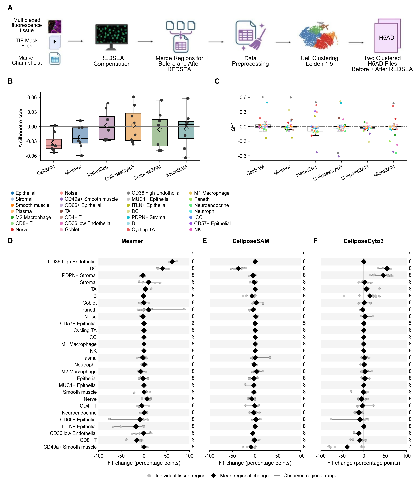

Figure 1. Effects of spillover compensation on downstream clustering and cell-type annotation. (A) REDSEA workflow using images, masks and marker lists for Mesmer, CellposeCyto3, CellposeSAM, CellSAM, InstanSeg and MicroSAM outputs. Regions were merged separately before and after compensation, preprocessed and clustered with Leiden at resolution 1.5 to produce paired H5AD files. (B) Silhouette-score changes. Points show regions, diamonds regional means and boxes distributions. (C) Cell-type-specific F1 changes. Points show cell types and boxes their distributions. (D–F) Regional cell-type F1 changes for Mesmer, CellposeSAM and CellposeCyto3, respectively. Gray circles show paired regional changes, black diamonds regional means and horizontal lines observed ranges. F1 changes are calculated as after minus before compensation and expressed in F1 units in C and percentage points in D–F. Panels D–F share an axis scale and cell-type order, with contributing regional-pair counts shown for each type. Regional-pair inclusion follows Section 2.2. Positive changes indicate increased silhouette scores or reference agreement. Regions are subsamples of donor B004. CellposeCyto3 denotes processed cellpose_cyto3 outputs, previously labeled Cellpose Cyto3 or CellposeV3. The original checkpoint could not be verified. Source data: Duke Research Data Repository record 565 (Availability of Data and Materials).

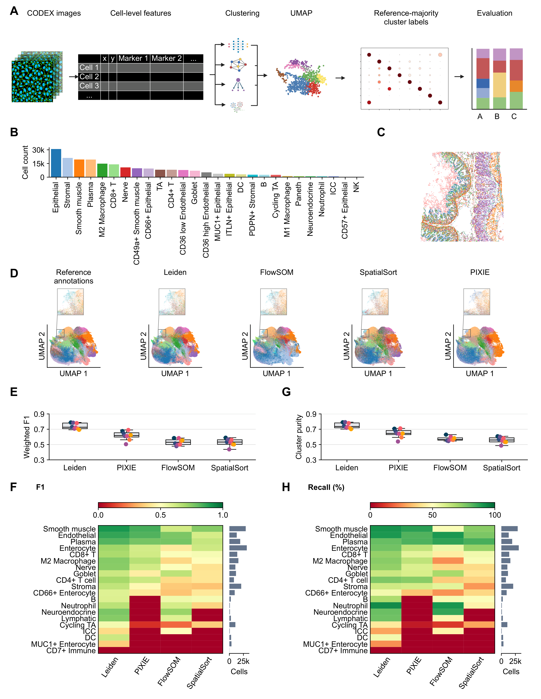

Figure 2. Benchmarking unsupervised clustering against reference cell-type annotations. (A) Workflow from CODEX images and cell features to clustering and reference-majority labeling. The workflow illustration was created with BioRender.com. (B–C) Reference cell counts and a representative spatial map. Cell-type colors in C and D correspond to B. (D) UMAP embeddings colored by reference or cluster-assigned labels, with boxed regions enlarged above [36]. (E, G) Regional cell-count-weighted F1 and cluster purity after majority labeling within each region. Points identify regions. Boxes show medians and interquartile ranges, with 1.5-interquartile-range whiskers. (F, H) Cell-type F1 (0–1) and recall (0–100%) after global majority labeling, with reference-cell counts at right. E–H use 209,587 non-Noise cells and 20 harmonized classes, with alphabetical tie-breaking. The eight regions are within-donor observations. Conditional comparisons are in Supplementary Table S7. Leiden, FlowSOM and SpatialSort used 47 markers. The primary FlowSOM and SpatialSort partitions contained 299 and 229 occupied clusters, respectively. Methods and limitations are in Sections 2.9 and 2.17. CD8+ T marker-expression profiles are shown in Figure S11. Source data: Duke Research Data Repository record 505 (Availability of Data and Materials).

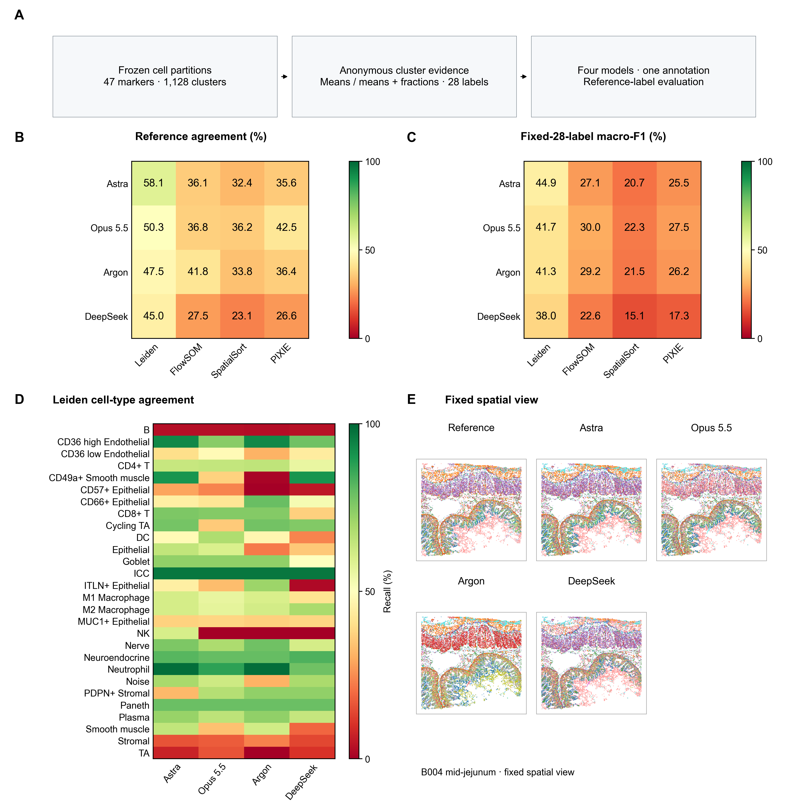

Figure 3. Annotation benchmark using 47-marker cluster profiles. (A) Workflow from frozen clustering assignments and anonymous marker evidence to model predictions and reference-label evaluation. (B) Reference agreement and (C) fixed-28-label macro-F1 for the means-plus-fractions arm, averaged equally across the two test regions. The original 28-label vocabulary includes Noise; absent-class F1 is zero. (D) Cell-type reference agreement (recall) for Leiden predictions, using pooled test cells in the fixed ontology order. (E) Reference labels and the four models' Leiden predictions in the fixed mid-jejunum region shown in Figure 2C, using the same cell-type colors. Each model supplies one accepted prediction per cluster and arm. There are no repeated-annotation error bars. All regions are from donor B004.

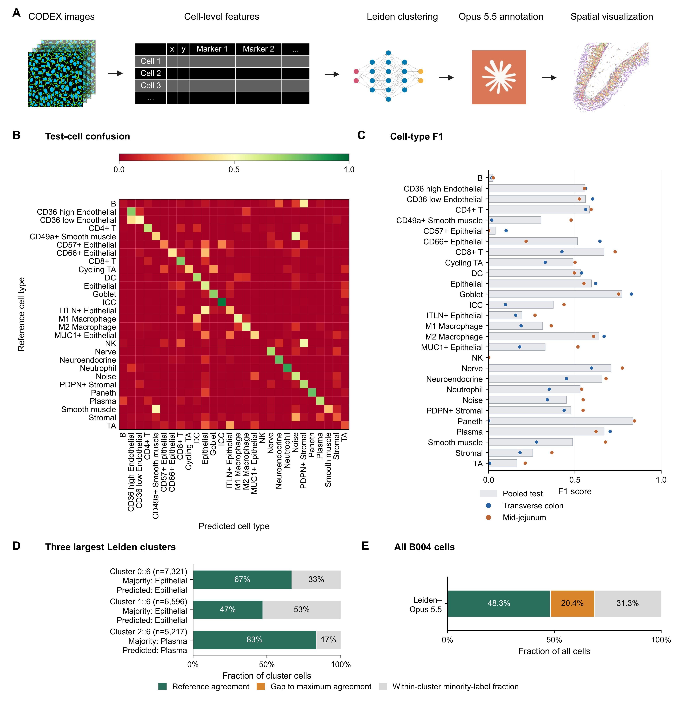

Figure 4. Prespecified Leiden–Opus 5.5 annotation pipeline using means plus fractions. (A) Workflow from CODEX cell features through Leiden clustering and Opus annotation to spatial visualization. The workflow illustration was created with BioRender.com. (B) Row-normalized confusion matrix for pooled test cells. (C) Cell-type F1 for pooled test cells (bars) and each of the two test regions (points). All 28 labels, including Noise, remain in the scoring vocabulary. (D) Reference-agreement decomposition for the three largest Leiden clusters, selected by total cell count with cluster-ID tie-breaking before examining annotation outcomes. (E) The same decomposition across all 220,082 B004 cells. D and E show agreement, the gap between agreement and the cluster-majority upper bound, and the within-cluster minority-reference-label fraction. These are arithmetic components of reference disagreement, not independent biological error classes. The illustrative pipeline was selected before the annotation outcomes.

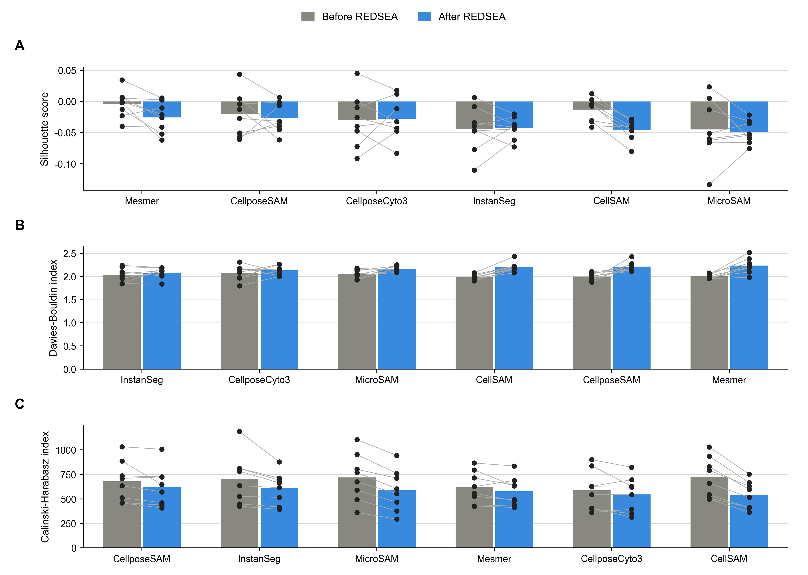

Figure S1. Cluster-quality metrics before and after spillover compensation across segmentation methods. (A) Silhouette scores by imaged tissue region, (B) Davies–Bouldin indices, and (C) Calinski–Harabasz indices calculated in PCA space for data segmented using Mesmer, CellposeCyto3, CellposeSAM, CellSAM, InstanSeg, or MicroSAM. Gray and blue bars show the mean across tissue regions before and after REDSEA compensation, respectively. Each point represents one imaged tissue region (n = 8), and lines connect paired measurements from the same imaged tissue region. Higher silhouette scores and Calinski–Harabasz indices indicate improved cluster separation, whereas lower Davies–Bouldin indices indicate improved cluster separation. These descriptive metrics were calculated from the stored PCA representations. The before–after comparison of shared segmentation objects and sensitivity to matching rules and clustering workflow are reported separately in Figure S3. Source data: Duke Research Data Repository record 565 (see Availability of Data and Materials).

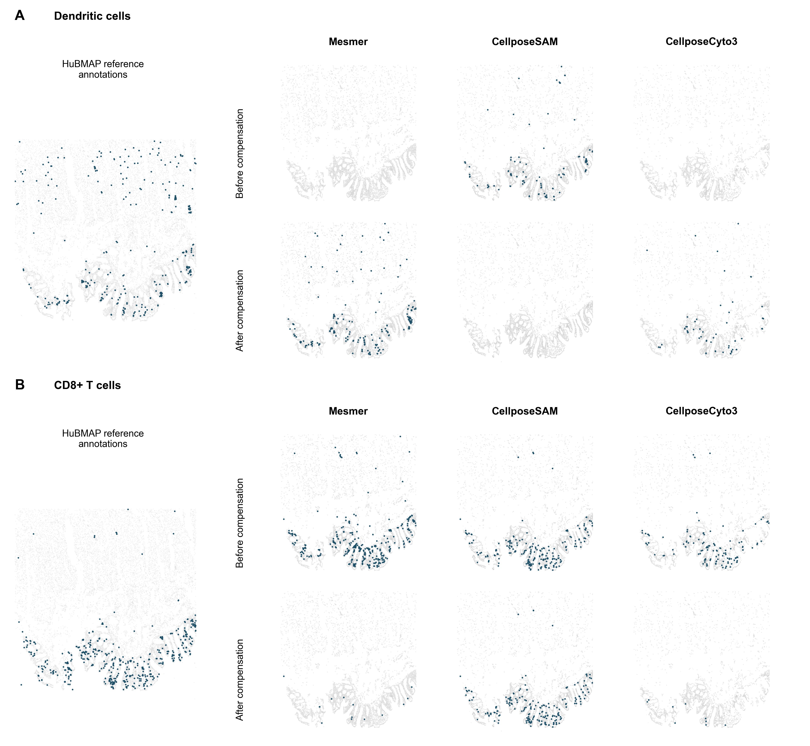

Figure S2. Spatial changes in dendritic-cell and CD8+ T-cell assignments after compensation. Representative maps from B004-A-004 compare HuBMAP reference labels with cluster-derived assignments for Mesmer, CellposeSAM and CellposeCyto3 before and after REDSEA compensation. (A) Dendritic cells. (B) CD8+ T cells. Dark blue indicates the specified type and light gray all other cells. Source data: Duke Research Data Repository record 565 (Availability of Data and Materials).

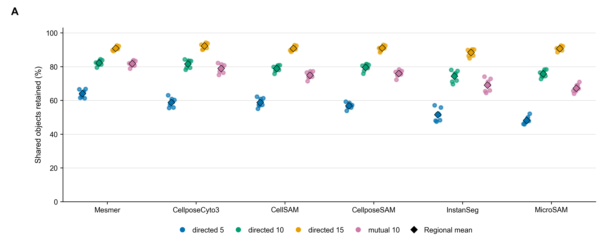

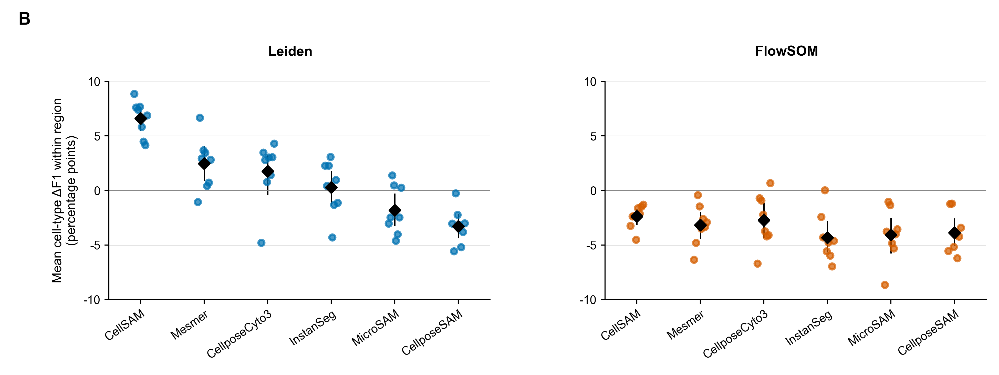

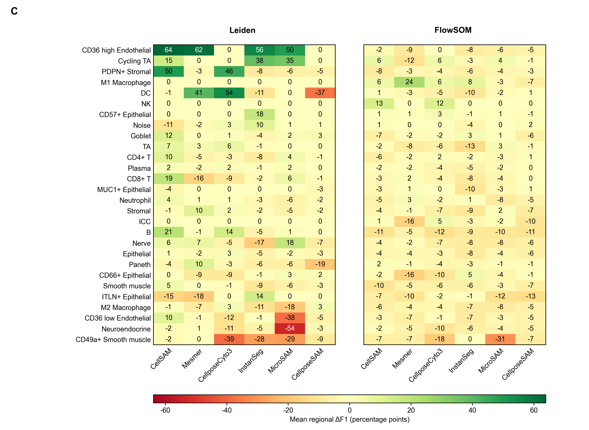

Figure S3. Matching-rule sensitivity and compensation effects among shared segmentation objects across six methods. (A) Percentage retained under directed matching at maximum distances of 5, 10 and 15 source-coordinate units and mutual matching at 10 units. Points show regions and diamonds regional means. (B) Regional mean cell-type F1 changes for processed Leiden and fixed FlowSOM workflows under directed matching at 10 units. Points show regions, diamonds regional means and bars descriptive 95% regional bootstrap intervals. (C) Mean regional cell-type F1 changes for objects with the same regional CellID, unchanged coordinates and accepted reference matches (Section 2.4). Table S1 reports matching and retention counts. FlowSOM settings were fixed across methods. Changes are percentage points, calculated as after minus before compensation. Distances use each input dataset's coordinates, with no verified common conversion to pixels. Regions are subsamples of B004 and do not establish transfer across donors.

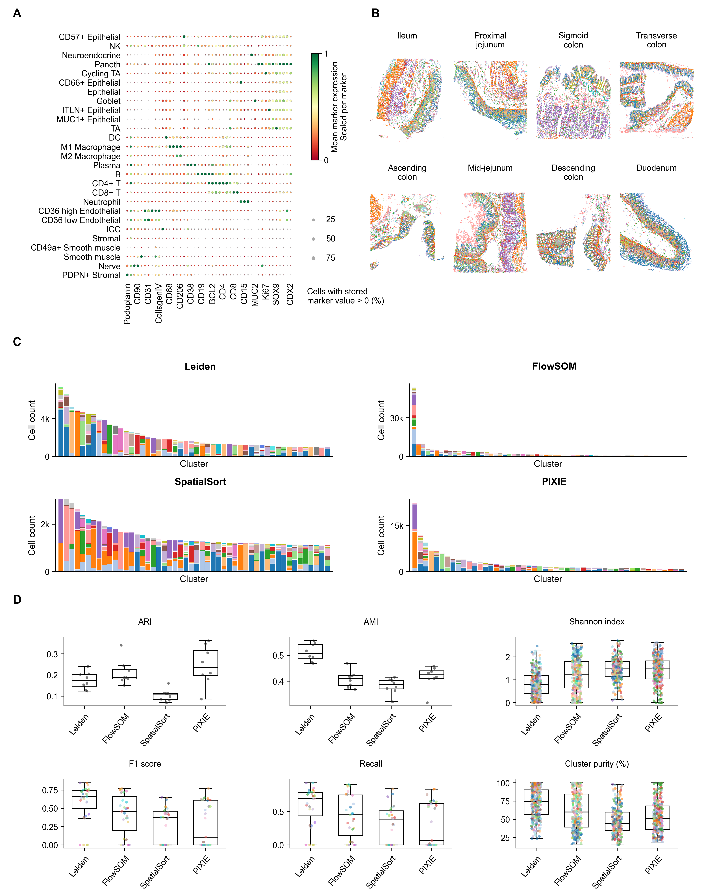

Figure S4. Reference cell types and comparative clustering evaluation. (A) Stored marker means and fractions above 0.0 across 27 original non-Noise reference types (209,587 cells), using all 47 stored protein markers (45 H5AD X channels plus CD123 and CDX2 observation columns) without another transformation. Dot size shows above-cutoff fractions, which are not validated marker-positive fractions. Color shows mean expression min–max scaled to 0–1 independently by marker across the displayed types. (B) Reference-label maps across eight regions. (C) Reference-type composition of the 50 largest clusters per method (60 for FlowSOM), ordered by decreasing cell count, with colored segments indicating reference types. (D) Regional adjusted Rand index (ARI) and adjusted mutual information (AMI) (black dots, n = 8), cluster-level reference-label Shannon diversity and purity, and cell-type F1 and recall after majority labeling. Panel D uses 27 original non-Noise reference labels, distinct from the 20-class mapping in Figure 2. Lower Shannon diversity indicates less heterogeneous clusters. Colored points denote cluster-majority reference labels for diversity and purity, and reference types for F1 and recall. Boxes show interquartile ranges, center lines medians and whiskers 1.5 times the interquartile range.

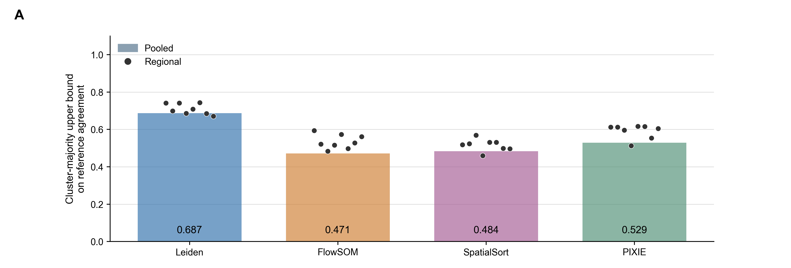

Figure S5. Reference agreement upper bounds for the primary clustering assignments. (A) Cluster-majority upper bounds using the original 28 reference labels including Noise. Bars use pooled regions and points use labels assigned within each of the eight regions. All 220,082 B004 cells are retained, including eight cells without measurable marker signal in a separate PIXIE group. All regions are from donor B004.

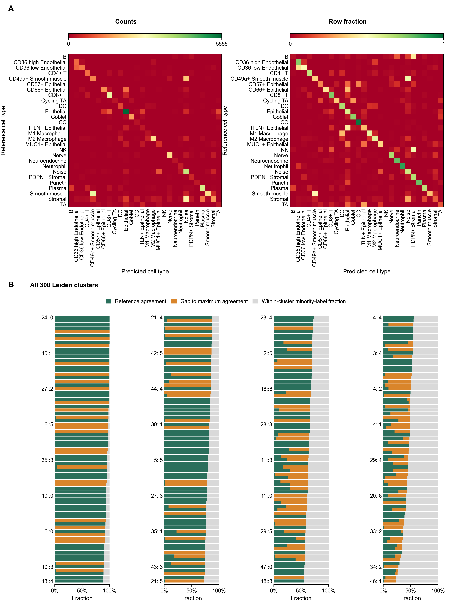

Figure S6. Leiden–Opus 5.5 annotation diagnostics for the means-plus-fractions arm. (A) Confusion matrices for pooled test cells, shown as cell counts and row fractions over the fixed 28-label vocabulary including Noise. Rows without reference cells have zero row fractions. (B) Reference-agreement decomposition for all 300 Leiden clusters across all 220,082 B004 cells. Clusters are ordered by decreasing cluster-majority reference fraction, with cluster-ID tie-breaking, and displayed in four consecutive blocks of 75. Selected cluster IDs label each block. Green denotes agreement, orange the gap to the cluster-majority upper bound, and gray the within-cluster minority-reference-label fraction.

### TABLE S1

REDSEA MATCHING AND CELL RETENTION AUDIT

| Segmentation method | Processed before / after | Matched before / after | Shared IDs, fixed coordinates | Before-only IDs | After-only IDs |
| --- | --- | --- | --- | --- | --- |
| Mesmer | 162,439 / 161,867 | 133,665 / 133,266 | 161,656 | 783 | 211 |
| CellposeCyto3 | 145,925 / 145,270 | 118,668 / 118,104 | 145,011 | 914 | 259 |
| CellposeSAM | 173,783 / 172,465 | 137,808 / 136,927 | 172,169 | 1,614 | 296 |
| CellSAM | 195,752 / 194,832 | 154,163 / 153,385 | 194,071 | 1,681 | 761 |
| InstanSeg | 198,959 / 196,717 | 146,477 / 144,996 | 195,459 | 3,500 | 1,258 |
| MicroSAM | 197,314 / 197,400 | 149,626 / 149,080 | 196,124 | 1,190 | 1,276 |

Counts are pooled across eight B004 regions. Processed counts refer to objects in the processed H5ADs after preprocessing. Matched counts include all objects accepted by directed nearest-neighbor matching at a maximum distance of 10 source-coordinate units after interchanging the reference x and y coordinates. Multiple segmented objects could match the same reference cell. Shared segmentation objects had the same CellID within a region and unchanged coordinates. Before-only and after-only counts use CellID, not saved row indices. The before–after comparison of shared segmentation objects further required an accepted match to the same reference cell and label in both conditions, so the shared-ID column is not its final scoring denominator. These counts describe retention and correspondence, not segmentation-boundary accuracy.

### TABLE S2A

CLUSTERING CONFIGURATIONS AND HYPERPARAMETERS

| Field | Leiden | FlowSOM | SpatialSort | PIXIE |
| --- | --- | --- | --- | --- |
| Inputs | 47 markers | 47 markers | 47 markers | 48 image channels |
| Transform | arcsinh(x/5) | arcsinh(x/5) | arcsinh(x/5) | Pixel and cell composition pipeline |
| Scaling | StandardScaler within each region | RobustScaler on all B004 cells | RobustScaler on all B004 cells | Channel and composition normalization |
| Configured and occupied clusters | 300 and 300 | 300 requested and 299 occupied | 300 requested. 229 occupied in the primary chain and 231 in the sensitivity chain | 300 and 300 |
| Implementation | K320 local Leiden with 20 within-parent merges | 32×32 self-organizing map followed by Ward clustering | 24 neighbors and precision 0.65 | 10×10 pixel map and 24×24 cell map |
| Sigma and learning rate | See Leiden procedure in Section 2.7 | 1.0 and 0.3 | Not applicable | Pixel 5.0 and 0.05. Cell 2.0 and 0.3 |
| Iterations | See Leiden procedure in Section 2.7 | 3 whole-cohort passes, giving 660,246 updates | 100 actual sweeps per chain with dmh_iter=5 | One pixel pass and 5,000 cell iterations |
| Seed | 42 | 42 | Sampling seed 42 primary and 43 sensitivity | 42 |

Table S2A reports the clustering configurations and hyperparameters. Occupied clusters are those containing at least one cell. Additional procedure details are given in Section 2.7. Leiden, FlowSOM and SpatialSort used 47 protein markers. PIXIE selected 47 protein channels and the Hoechst1 DNA channel from the 59 available image channels, then converted pixel-cluster assignments into vectors of pixel-metacluster fractions. Pixel-level and cell-level settings are reported separately for PIXIE. Table S2B identifies channel membership.

### TABLE S2B

CHANNEL MEMBERSHIP

| Channel group | Leiden | FlowSOM | SpatialSort | PIXIE |
| --- | --- | --- | --- | --- |
| Shared 45 protein markers | Included | Included | Included | Included |
| CD123 | Included | Included | Included | Included |
| CDX2 | Included | Included | Included | Included |
| Hoechst1 | Excluded | Excluded | Excluded | Included |
| Total selected inputs | 47 | 47 | 47 | 48 |

Membership refers to inputs used for clustering, not all channels available in the source images. Hoechst1 is a DNA channel. PIXIE uses selected-channel pixel intensities to construct vectors of pixel-metacluster fractions. Table_S1_channel_membership.csv lists all 48 channel names, source locations, OME aliases, method membership and supporting evidence.

## Supplementary Methods

### SM1. Compensation processing and cell matching

The processed compensation files contained 45 marker features and 44 centered principal components, without highly variable feature selection. Stored graph settings were 30 Euclidean neighbors in PCA space, RAPIDS and random state 0. Stored Leiden settings were resolution 1.5, 100 iterations and random state 0, distinct from the main clustering benchmark (Section 2.2).

Original segmentation targets (whole cells or nuclei), channels, software versions, checkpoints, inference thresholds, mask quality-control rules, runtime and hardware could not be verified for the six compensation workflows. The Cytokit+SPRM attribution and Hoechst1/Cytokeratin channels in Section 2.6 apply only to the reference dataset. Current defaults and comparable whole-cell settings were not assumed.

For the centroid matching in Section 2.4, distances were Euclidean and ties were resolved by reference object ID. Objects with invalid coordinates or distances beyond the threshold remained unmatched and were excluded from agreement scoring. Audits retained matched counts and fractions, distances, duplicate reference matches and before-only/after-only objects (Table S1). Mutual nearest-neighbor matching at 10 units required reciprocal matches and yielded one-to-one pairs. The common conversion to pixels and original registration across segmentation workflows could not be verified. Matching did not modify masks or detect biological splits or merges and did not establish boundary accuracy.

The FlowSOM compensation sensitivity analysis used the same settings across all six methods without selection by reference agreement. It used processed marker values without another arcsinh transformation, fitting preprocessing and clustering separately before and after compensation (Section 2.17).

### SM2. Reference-label harmonization

The annotation analysis retains the original 28 reference labels, including Noise, without class merges. The 20-class clustering diagnostics in Figure 2 exclude Noise and combine selected naming variants and classes, including Paneth to Goblet (Section 2.9). These mappings are separate analysis definitions and are not interchangeable. Full per-label mappings are preserved with the clustering scoring policy and the annotation ontology.

### SM3. Clustering inputs and configuration

Sections 2.6–2.8 and Tables S2A–S2B specify marker membership, transformations, scaling, requested/occupied cluster counts and hyperparameters. Only SpatialSort received explicit cell coordinates as clustering inputs. PIXIE paired multichannel expression images with integer-labeled cell-mask OME-TIFFs. Its 48 selected channels were smoothed and normalized before pixel clustering. Pixel assignments were aggregated within each mask into pixel-metacluster fractions for cell clustering, with 20 pixel Ward metaclusters. The primary FlowSOM fit used three shuffled whole-cohort passes with seed 42. SpatialSort used 100 actual sweeps and dmh_iter=5 in each of two chains with sampling seeds 42 and 43. Frozen inputs and full-state checkpoints were preserved across the allocation handoff. An implementation-only arithmetic-reuse optimization was introduced after exact copied-checkpoint replay and restart-parity checks. Figure S4 and Figure S11 define the expression groups and scaling used only for display.

### SM4. Scoring calculations

For cell-type F1 and recall, true positives matched both reference and assigned labels, false positives carried other reference labels and false negatives carried the specified reference label but received another assignment. Global and within-region majority labeling used the populations and mappings in Section 2.9, with alphabetical tie-breaking. Both metrics were reference-informed fixed-partition diagnostics. Equations (2)–(5) define purity, direct agreement and normalization by the cluster-majority upper bound. Minority-label matches contributed to direct agreement, including in cell-type-specific ratios (Section 2.13).

### SM5. Conditional regional comparisons

Supplementary Table S7 includes all six method pairs for each of weighted F1 and cluster purity, with Holm correction across the 12-test family. Two-sided exact sign-flip tests enumerated all 256 sign assignments for eight equally weighted regional differences. Reported quantities were regional means, differences in percentage points, raw and adjusted p-values, and descriptive 95% intervals from 10,000 paired-region resamples with seed 42. All 12 planned comparisons retained every regional pair. The unestablished exchangeability assumption, regional dependence and limits on donor-level inference are stated in Section 2.17.

### Supplementary Note 1. LLM prompt templates and model outputs for cell-type annotation.

The four models received numerical profiles for all 47 markers, anonymous cluster query identifiers, the original 28-label code dictionary including Noise, and fixed task instructions. The means-plus-fractions arm added a fraction matrix to the identical means matrix. Neither arm received reference labels or profiles, clustering-method identities, neighborhood summaries, retrieval, tools or web access. Requests specified exactly one allowed integer label code for every query ID in a JSON object. Literal requests, prompt hashes, anonymous-to-cluster mappings and accepted raw outputs are preserved with the reproducible analysis.

### Supplementary Note 2. LLM inputs, execution and response handling.

Inputs and design. All 220,082 B004 cells contributed to the frozen cluster profiles. The four partitions contained 300 Leiden, 299 FlowSOM, 229 SpatialSort and 300 PIXIE clusters. The design contained four models, two input arms and one accepted annotation per condition: 32 annotation sets, 128 initial request items and 9,024 cluster predictions. Each request item contained at most 75 clusters. Training-only normalization, integer-thousandth encoding, deterministic paired-arm order and exact join and leakage checks were frozen before launch.

Execution and acceptance. GPT-6 Astra and Claude Opus 5.5 used Batch transport; Gemini 4 Argon and DeepSeek V4.1 Flash 1017 also have separately recorded recovery attempts. All scientific requests used high reasoning. Actual model bindings, routes, token ceilings, supported seeds, transport and attempt status are recorded per physical generation rather than inferred from a model alias. Final outputs were accepted only after strict, complete JSON validation and saved-response replay. Missing outputs were recovered only after explicit authorization; prior accepted outputs and every failed or interrupted attempt were preserved.

Costs and delivery. All 128 logical items were accepted, covering all 9,024 requested cluster predictions. Confirmed campaign charges totaled US$77.08. Unresolved billing holds were retained separately and were not treated as observed charges. Recovery generations were counted as physical attempts, not independent repetitions or additional scientific conditions. The final accepted prediction bank maps each logical request to its accepted output and all supporting provenance.

Scoring and reporting. The primary endpoint is the equal-weighted mean of reference agreement across the same two test regions. Fixed-28-label macro-F1 treats absent classes as zero. Means-plus-fractions minus means changes reuse the accepted outputs, with paired label changes and full-denominator coverage reported separately. There is one accepted annotation per condition and no across-repetition standard deviation, within-model voting or calibration analysis. Figures 3–4, S6–S7, S10–S11 and Tables S6a–S6d use these same primary partitions and accepted predictions.

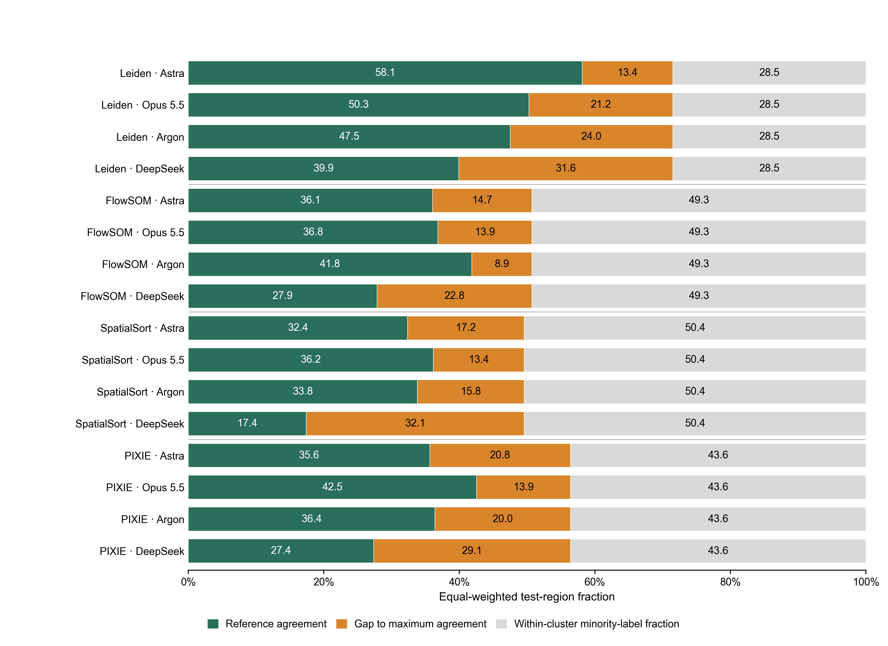

Figure S7. Reference-agreement decomposition for the 16 clustering-method/model combinations in the means-plus-fractions arm. For each test region, the fraction of correctly labeled cells, the gap to the cluster-majority upper bound, and the within-cluster minority-reference-label fraction sum to one. The two test-region fractions are averaged equally. The original 28-label vocabulary includes Noise. Values inside bars are percentages. The components describe arithmetic reference disagreement and do not identify independent biological error mechanisms. Each condition uses one accepted annotation per cluster.

### TABLE S6a

PAIRED REFERENCE AGREEMENT

| Clustering | Model | Means (%) | Means + fractions (%) | Paired change (pp) |
| --- | --- | --- | --- | --- |
| Leiden | GPT-6 Astra | 52.86 | 58.12 | +5.26 |
| FlowSOM | GPT-6 Astra | 36.66 | 36.05 | -0.61 |
| SpatialSort | GPT-6 Astra | 36.13 | 32.38 | -3.75 |
| PIXIE | GPT-6 Astra | 41.32 | 35.64 | -5.68 |
| Leiden | Claude Opus 5.5 | 46.78 | 50.27 | +3.49 |
| FlowSOM | Claude Opus 5.5 | 37.48 | 36.82 | -0.66 |
| SpatialSort | Claude Opus 5.5 | 33.11 | 36.17 | +3.06 |
| PIXIE | Claude Opus 5.5 | 36.04 | 42.54 | +6.50 |
| Leiden | Gemini 4 Argon | 46.16 | 47.51 | +1.35 |
| FlowSOM | Gemini 4 Argon | 39.57 | 41.84 | +2.27 |
| SpatialSort | Gemini 4 Argon | 33.31 | 33.80 | +0.49 |
| PIXIE | Gemini 4 Argon | 38.70 | 36.40 | -2.30 |
| Leiden | DeepSeek V4.1 Flash 1017 | 42.58 | 44.96 | +2.38 |
| FlowSOM | DeepSeek V4.1 Flash 1017 | 28.38 | 27.50 | -0.88 |
| SpatialSort | DeepSeek V4.1 Flash 1017 | 22.62 | 23.06 | +0.45 |
| PIXIE | DeepSeek V4.1 Flash 1017 | 35.31 | 26.56 | -8.75 |

Values are single-run outcomes after equally averaging the same two test regions. Paired changes are means-plus-fractions minus means in percentage points (pp). Missing or invalid predictions remain errors in the full planned denominator.

### TABLE S6b

MACRO-F1 AND PREDICTION COVERAGE (DATA FILE: Table_S6b.csv)

| Clustering | Model | Means macro-F1 | Fractions macro-F1 | Means coverage (%) | Fractions coverage (%) |
| --- | --- | --- | --- | --- | --- |
| Leiden | GPT-6 Astra | 0.4582 | 0.4490 | 100.00 | 100.00 |
| FlowSOM | GPT-6 Astra | 0.3028 | 0.2713 | 100.00 | 100.00 |
| SpatialSort | GPT-6 Astra | 0.2152 | 0.2074 | 100.00 | 100.00 |
| PIXIE | GPT-6 Astra | 0.2777 | 0.2553 | 100.00 | 100.00 |
| Leiden | Claude Opus 5.5 | 0.3842 | 0.4165 | 100.00 | 100.00 |
| FlowSOM | Claude Opus 5.5 | 0.2884 | 0.2999 | 100.00 | 100.00 |
| SpatialSort | Claude Opus 5.5 | 0.1966 | 0.2226 | 100.00 | 100.00 |
| PIXIE | Claude Opus 5.5 | 0.2527 | 0.2751 | 100.00 | 100.00 |
| Leiden | Gemini 4 Argon | 0.4073 | 0.4133 | 100.00 | 100.00 |
| FlowSOM | Gemini 4 Argon | 0.3189 | 0.2917 | 100.00 | 100.00 |
| SpatialSort | Gemini 4 Argon | 0.2090 | 0.2154 | 100.00 | 100.00 |
| PIXIE | Gemini 4 Argon | 0.2689 | 0.2619 | 100.00 | 100.00 |
| Leiden | DeepSeek V4.1 Flash 1017 | 0.3556 | 0.3804 | 100.00 | 100.00 |
| FlowSOM | DeepSeek V4.1 Flash 1017 | 0.2435 | 0.2262 | 100.00 | 100.00 |
| SpatialSort | DeepSeek V4.1 Flash 1017 | 0.1327 | 0.1508 | 100.00 | 100.00 |
| PIXIE | DeepSeek V4.1 Flash 1017 | 0.2268 | 0.1731 | 100.00 | 100.00 |

Macro-F1 uses all 28 labels, with absent-class F1 set to zero in each test region. Prediction coverage is the proportion of cells with a valid prediction. Values equally average the two test-region outcomes and have no across-repetition standard deviation.

### TABLE S6c

DECOMPOSITION OF PAIRED AGREEMENT CHANGES

| Clustering | Model | Valid-label term (pp) | Delivery term (pp) | Total change (pp) |
| --- | --- | --- | --- | --- |
| Leiden | GPT-6 Astra | +5.26 | 0.00 | +5.26 |
| FlowSOM | GPT-6 Astra | -0.61 | 0.00 | -0.61 |
| SpatialSort | GPT-6 Astra | -3.75 | 0.00 | -3.75 |
| PIXIE | GPT-6 Astra | -5.68 | 0.00 | -5.68 |
| Leiden | Claude Opus 5.5 | +3.49 | 0.00 | +3.49 |
| FlowSOM | Claude Opus 5.5 | -0.66 | 0.00 | -0.66 |
| SpatialSort | Claude Opus 5.5 | +3.06 | 0.00 | +3.06 |
| PIXIE | Claude Opus 5.5 | +6.50 | 0.00 | +6.50 |
| Leiden | Gemini 4 Argon | +1.35 | 0.00 | +1.35 |
| FlowSOM | Gemini 4 Argon | +2.27 | 0.00 | +2.27 |
| SpatialSort | Gemini 4 Argon | +0.49 | 0.00 | +0.49 |
| PIXIE | Gemini 4 Argon | -2.30 | 0.00 | -2.30 |
| Leiden | DeepSeek V4.1 Flash 1017 | +2.38 | 0.00 | +2.38 |
| FlowSOM | DeepSeek V4.1 Flash 1017 | -0.88 | 0.00 | -0.88 |
| SpatialSort | DeepSeek V4.1 Flash 1017 | +0.45 | 0.00 | +0.45 |
| PIXIE | DeepSeek V4.1 Flash 1017 | -8.75 | 0.00 | -8.75 |

Both terms use the full region denominator and sum to the means-plus-fractions minus means agreement change. The label term counts net reference matches gained or lost when both arms returned valid labels. The delivery term counts matches gained or lost when only one arm returned a valid label. Neither term estimates labels for failed calls. All final predictions were delivered, so delivery terms are zero and observed agreement changes arise from label changes. Changes are percentage points (pp).

### TABLE S6d

MODEL ROUTES AND INFERENCE SETTINGS

| Model | Requested model ID | Pinned route | Reasoning | Decoding fields sent |
| --- | --- | --- | --- | --- |
| GPT-6 Astra | openai/gpt-6-astra | openai | high | Batch; max_tokens 32768; seed 42; temperature/top-p omitted |
| Claude Opus 5.5 | anthropic/claude-opus-5.5 | anthropic | high | Batch; max_tokens 32768; seed omitted; temperature/top-p omitted |
| Gemini 4 Argon | google/gemini-4-argon | google-vertex/global | high | Standard streaming; max_tokens 943718; provider continuation segments; seed 42; temperature/top-p omitted |
| DeepSeek V4.1 Flash 1017 | deepseek/deepseek-v4.1-flash-1017 | OpenRouter routes recorded per request | high | Standard streaming; max_tokens 943718; seed omitted; temperature/top-p omitted |

All requests used OpenRouter with supported high reasoning, no tools or retrieval, at most 75 clusters per item and no automatic model/provider fallback. The table records actual model identities, transport, supported seeds, output ceilings, per-attempt status, usage and confirmed charges. Requests and recovery attempts are linked to prompt, parser and source hashes. Requested output ceilings differ from observed token use; recovery attempts do not provide independent repetitions.

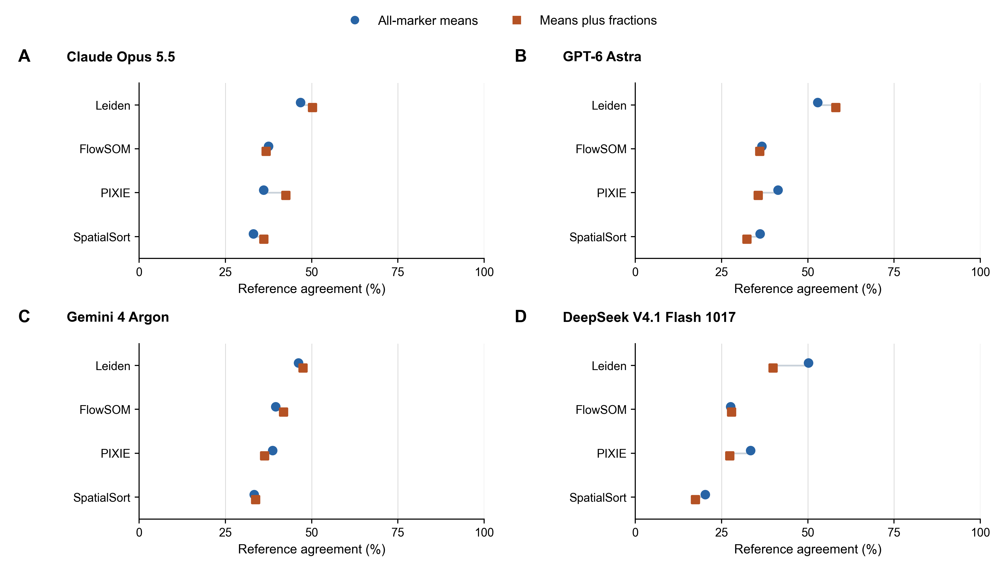

Figure S10. Descriptive comparison of all-marker means with means plus fractions for (A) GPT-6 Astra, (B) Claude Opus 5.5, (C) Gemini 4 Argon and (D) DeepSeek V4.1 Flash 1017. Points show reference agreement averaged equally across the two test regions, using the fixed 28-label vocabulary including Noise. Lines connect the two input arms for the same frozen clustering method. Each arm uses one accepted annotation per cluster; no across-repetition SD or repeatability estimate is shown. Means, marker order, anonymous query IDs, label vocabulary and request batch boundaries are identical within each input pair; only the fractions matrix is added.

## Supplementary table file index

[IEEE-style table assets](tables/ieee/README.md) provide native-paste HTML, LaTeX, PDF and PNG versions of Tables S1, S2A, S2B and S6a–d with unchanged cell contents.

Complete numerical sources, accepted prediction mappings, execution receipts and reproducible scoring and figure scripts are provided with the GitHub revision. Tables S1–S2 and S7 document compensation and clustering; Tables S6a–S6d report the paired annotation outcomes, delivery and execution settings. Companion benchmark tables provide regional, cell-type, cluster and confusion-matrix values. Existing versioned releases and original source evidence remain preserved separately from the active analysis.

Table S2B channel membership: Table_S1_channel_membership.csv. Complete 48-channel inventory with H5AD locations, OME aliases, method membership and evidence references.

### Table S6a: Paired reference agreement. File: Table_S6a.csv.

### Table S6b: Macro-F1 and prediction coverage. File: Table_S6b.csv.

### Table S6c: Decomposition of paired agreement changes. File: Table_S6c.csv.

### Table S6d: Model routes and inference settings. File: Table_S6d.csv.

### Table S7: Clustering-only conditional_comparisons.csv and paired_regional_observations.csv; all 12 planned clustering comparisons and their paired regional observations.

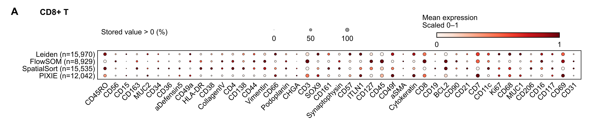

Figure S11. Marker profiles of cells assigned CD8+ T by each clustering method. (A) A single accepted prediction from each of the four models contributes to a most-frequent-label summary for each cluster; ties follow the fixed Astra, Opus, Argon and DeepSeek order. Row counts indicate cells in clusters assigned CD8+ T by that summary. All 47 stored marker channels are displayed, including CD123 and CDX2. Dot color shows mean stored processed expression, min–max scaled independently by marker across the four displayed method groups; no additional transformation is applied. Dot size shows the fraction of processed values strictly above zero, which is a numerical cutoff rather than validated biological marker positivity. This cross-model display does not measure repeated-call consistency.
